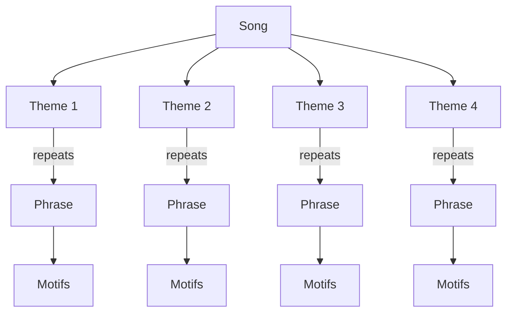

# Agents for whale song modeling and detection

## Goals

1. **Detect** songs: start, end, and theme sequence.
2. **Characterize** drift across years: dictionary, correlated pairs, HMM transitions, phrase lengths.

A *detected season* is a season with enough detections that those parameters can be estimated and compared to neighboring years.

## Song structure

Payne & McVay hierarchy: **motif → phrase → theme → song**.

| Unit | Meaning |
|------|---------|
| Motif | Short spectrogram atom (dictionary kernel) |
| Phrase | Short motif sequence (~2–20 s as a unit) |
| Theme | One phrase repeated a variable number of times |
| Song | Fixed-order theme cycle (Site H model: four themes; none dropped) |

Reference annotations:

## Pipeline elements

Elements depend on each other and on the season. Flow: **energy cues → pairs → dictionary → phrases → themes → songs**.

| # | Element | Status | Role |
|---|---------|--------|------|
| 1 | Energy 50–500 Hz | exists | Song-like band energy gate |
| 2 | Band energy 0.1–1 Hz | exists | Phrase-repeat cue (ACF / FFT fraction) |
| 3 | Correlated pairs (panMP) | exists | Seed repeated subsequences |
| 4 | Motif dictionary | exists | Atoms; placed by matching pursuit |
| 5 | Theme HMM | exists | Theme order and phrase repeats |
| 6 | Repeating-phrase model | **to build** | Phrases as units between motifs and themes |

Until (6) exists, themes rest on motif sequences alone.

## Agent system

| Piece | Role |
|-------|------|
| Element | One model (dictionary, HMM, …) |
| Agent | Owns one element; LLM + tools; proposes changes |
| Scores | Element metrics; computed by the harness |
| Harness | Accepts a change only if no score regresses |
| Tools | Python/C CLIs; agents set parameters |
| Season | Always in scope — elements drift year to year |

Each agent is autonomous and owned by a human developer.

### Loop

1. Pick element + season (prefer warm-start from a neighboring year).
2. Propose a change; run tools.
3. Harness rescoring on held-out / agreed wavs.
4. Keep only if every reported score holds or improves (including **gap** where defined).

### Agents

| Agent | Job |
|-------|-----|
| Correlated pairs | Find / improve panMP pairs for a season |
| Create motif dictionary | Build atoms (from pairs / prior year) |
| Improve motif dictionary | Split over-used atoms; merge near-ties; add if coverage is low |
| Create phrase dictionary | Longer (2–20 s) repeating units |
| Create HMM | Fit theme HMM on motif scores |
| Compare HMMs | Vary theme count; keep winners by score |

## Scoring

**Rule:** keep a change only if all reported scores stay ≥ previous. Dictionary, HMM, and pairs also report a **gap** (best − second-best).

### Correlated pairs

- **Unusualness** — within-length z-score of the pair distance.
- **Copies** — non-overlapping starts under the copy threshold.
- **Gap** — unusualness(best) − unusualness(second-best) at that length.

**Per wav:** pair count; median unusualness and copies; modal second-best length.

### Motif dictionary

- **Coverage** — fraction of time with some motif >2σ above its mean.
- **Specificity** — peak score / score at ±½ length shift.
- **Gap** — best motif − second-best on the same stretch.

**Per wav:** coverage; hit count; median specificity and gap; modal second-best motif.

High coverage + specificity + gap ⇒ hits song, quiet off-hit, one motif owns the hit.

### Theme HMM

- **Fit** — posterior-weighted likelihood of the sequence.
- **Stability** — fit change under a small parameter perturbation.
- **Gap** — best theme-sequence likelihood − second-best.

**Per wav (over songs):** song count; median fit, stability, gap; modal second-best sequence.

**Decode checks:** strong Viterbi path; **boundary score** drops when a theme boundary is shifted.

## Tools

Agents call these; tools do not replace scoring.

**Archive scans** (Site H energy, song detect, minute ACF/energy) are **optimized C**: OpenMP on CPU, cuFFT on both GPUs when available; Python orchestrators only schedule files and write progress.

| Area | Entry points |
|------|----------------|
| Pairs | `python -m analysis.matrix_profile pan` (default GPL band 50–500 Hz) |
| GPL | `python -m analysis.GPL_Python.process_v4` |
| Dictionary | `randomized-build` / `pan-build`; `matching-pursuit`; `split` (`analysis.dict_learning`) |
| HMM | `python -m analysis.HMM.run_train`; `refresh_metrics()`; `write_report` |
| Site H energy | `pre_processing/c/energy_filter`, `minute_energy`, `minute_acf` (C/GPU); `…/hires_energy_ratio.py` |
| Site H songs | `…/find_songs/c/song_detector` (C); `…/siteH_all_songs/hybrid_run.py` (detect when ratio ≥ 0.15) |
| Periodicity | `repeating_peaks` (Python); minute ACF CSVs under `12TB_results/minute_acf/` |

Corpus: Site H `df20` under `/mnt/sda/SiteH` (manifest in `analysis/dict_HMM/find_songs/siteH_all_songs/`). Local LeiData clips under `/home/yfreund/whale_processing/LeiData/`.

## Working rules

1. One agent ↔ one element; season always named.
2. Propose → tools → harness rescoring → no regressions.
3. Prefer warm-start from a neighboring year.
4. Gate archive scans with energy cues (cost).
5. Phrase model is the next build priority; until then, treat theme decoding as provisional on motif sequences.

## Near-term priorities

1. Define harness I/O: score JSON schema + accept/reject log per agent run.
2. Build the repeating-phrase model and its scores (coverage / specificity / gap analogs).
3. Wire Site H hybrid scan outputs into season-level characterization (dictionary / HMM drift tables).
