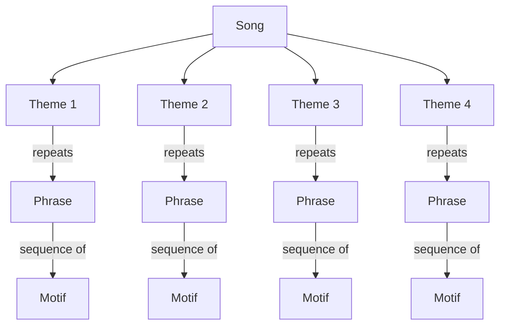
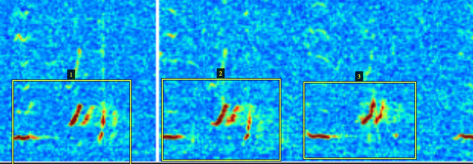
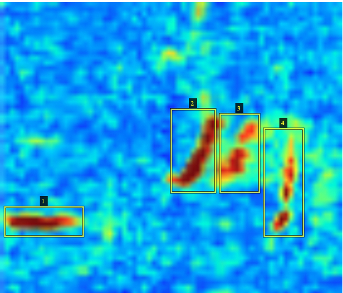

# A plan for using agents for whale song modeling and detection

## Goals

Our high-level goals are two:

* Detect and segment most of the songs
* Characterize the parameters of the elements and how they change over time.

Detection returns a start, an end, and a theme sequence for each song. Characterization tracks the dictionary, the correlated pairs, the transition weights, and the phrase lengths through the years. A detected season is a season whose drift can be measured.

## Organization

The whale song analysis pipeline consists of several interacting elements. The overall performance depends on the performance of each element. Moreover, the training of each element depends on the other elements as well as the period of time under analysis.

An agent owns one element and reports a score the other agents can use. A change is kept when those scores stay the same or improve. The season is part of the task, because the same element can drift from year to year.

### Elements

Currently, the elements we consider are:

1. Energy band between 50 and 500 Hz
2. Energy in band 1 between 0.1 and 1Hz
3. Motif dictionaries (**exists**)
4. Theme HMMs (**exists**)
5. Repeating Phrase model.
6. Correlated pairs (based on matrix profile)

The motif dictionary, the theme HMM, and correlated pairs (via the pan matrix profile) are already in the repository. The repeating phrase model is the piece still to build. Correlated pairs seed the dictionary; motifs form a phrase; a repeated phrase forms a theme.

### Scoring

Each element reports its scores. A change is kept when those scores stay the same or improve. A dictionary, an HMM, and correlated pairs also report the gap between the best fit and the second-best fit.

Calculating the scores is part of the Harness. The Models try to improve the scores.

#### Correlated pairs

* Unusualness: the within-length z-score of the matrix-profile distance of the pair.
* Copies: how many non-overlapping starts fall under the copy threshold from the pair's first copy.
* Gap: the unusualness of the best pair minus that of the second-best pair at the same length.

**For a whole wav file:**

* The number of pairs reported.
* The median unusualness and median copy count.
* The length that is most often the second-best pair's length.

#### Motif dictionary

* Coverage: the fraction of the recording in which at least one motif scores more than two standard deviations above its own mean.
* Specificity: the peak score divided by the scores of that same motif shifted by half its length to either side.
* Gap: the difference between the highest motif score and the next-highest motif score on the same stretch.

**For a whole wav file:**

* Coverage of the file, as defined above.
* The number of hits, the stretches where some motif clears its coverage threshold.
* The median specificity of those hits.
* The median gap of those hits.
* The motif that is most often the second-best hit.

High coverage, high specificity, and a large gap mean the dictionary hits the song, stays quiet off the hit, and one motif accounts for that hit.

#### Theme HMM

* Fit: the posterior-weighted likelihood the model assigns to the sequence.
* Stability: how far that likelihood moves when a single parameter is changed.
* Gap: the difference between the likelihood of the best theme sequence and the likelihood of the second-best theme sequence.

**For a whole wav file, over the songs in that file:**

* The number of songs.
* The median fit.
* The median stability.
* The median gap.
* The theme sequence that is most often the second-best hit.

A useful model gives a high likelihood that barely moves under a small parameter change and that stands well above the next sequence.

**Decoded song.** The path score is the likelihood of the Viterbi sequence. The boundary score is how far that likelihood moves when a boundary between themes is shifted. A reliable decode has a high path score and a boundary score that drops when a boundary moves.

### Models

The models encapsulate the LLM part of the agents, they call tools to create and improve the elements and get scored by the scorers.

* Find Correlated pairs
* Create Motif Dictionary
* Improve Motif Dictionary
* Create HMM
* Compare HMMs with different number of themes.

### Tools

Tools are programs, written in Python or C, which perform the actual work of the system. The Models set the parameters of the tools.

**Correlated pairs**

* **Pan matrix profile** — find the top correlated motif pairs (`pairs.json`) on a series, WAV, or GPL folder (GPL default: one band, 50–500 Hz). `python -m analysis.matrix_profile pan`

**Motif dictionary**

* **GPL process_v4** — whitened spectrogram windows and detections from a WAV. `python -m analysis.GPL_Python.process_v4`
* **Randomized build** — build a dictionary from random detection patches. `python -m analysis.dict_learning randomized-build`
* **Pan build** — the same outer loop, with seeds from correlated pairs (default search: 50–500 Hz). `python -m analysis.dict_learning pan-build`
* **Matching pursuit** — place a saved dictionary on a GPL folder. `python -m analysis.dict_learning matching-pursuit`
* **Split** — replace one atom by two from its patches. `python -m analysis.dict_learning split`

**Theme HMM**

* **HMM train** — build panMP motif scores, run Baum–Welch, and write `song_soft_hmm_t6.npz`. `python -m analysis.HMM.run_train`
* **Refresh metrics** — recompute fit metrics for the saved parameters without a refit. `refresh_metrics()` in `analysis.HMM.run_train`
* **HMM report** — rebuild the training PDF from the saved parameters and figures. `python -m analysis.HMM.write_report`

**Site H corpus scan**

* **Energy filter** — whitened 50–500 Hz energy / overall energy in 600 s segments over a wav tree. `pre_processing/c/energy_filter`
* **Song detector** — place motifs and decode conforming four-theme songs on 10 kHz wavs. `analysis/dict_HMM/find_songs/c/song_detector`
* **Hybrid run** — walk `/mnt/sda`, run energy on every eligible file, and run the song detector only when any 600 s ratio is at least 0.15. `analysis/dict_HMM/find_songs/siteH_all_songs/hybrid_run.py`
* **High-res energy ratio** — 0.1 s whitened 50–500 Hz energy ratio, and the fraction of that series's FFT energy in 0.1–1 Hz. `analysis/dict_HMM/find_songs/siteH_all_songs/hires_energy_ratio.py`
* **Repeating peaks** — find peaks in a 1-D energy series that repeat with a fixed period (ACF + gap scoring). `python -m analysis.dict_HMM.find_songs.repeating_peaks`
* **Scan** — Python placement of the dictionary on whole recordings (predecessor of Song detector). `analysis/dict_HMM/find_songs/scan.py`

## Song structure

A song is the parent of four themes, sung in a fixed order. Each theme is a phrase sung again and again. A phrase is a short sequence of motifs.

Every theme is present, and the theme order stays fixed. The number of phrase repeats can change from song to song. Each theme has its own phrase, and each phrase has its own motif sequence.

### Annotations

The first figure marks phrase repeats on a real spectrogram. The second figure marks the motifs inside those phrases. These annotations are the target a phrase model should match.

