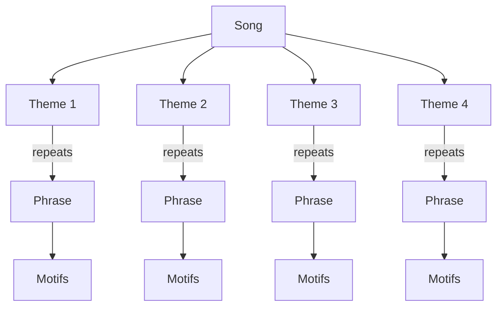
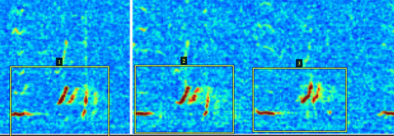
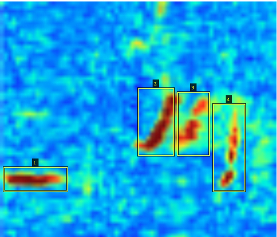
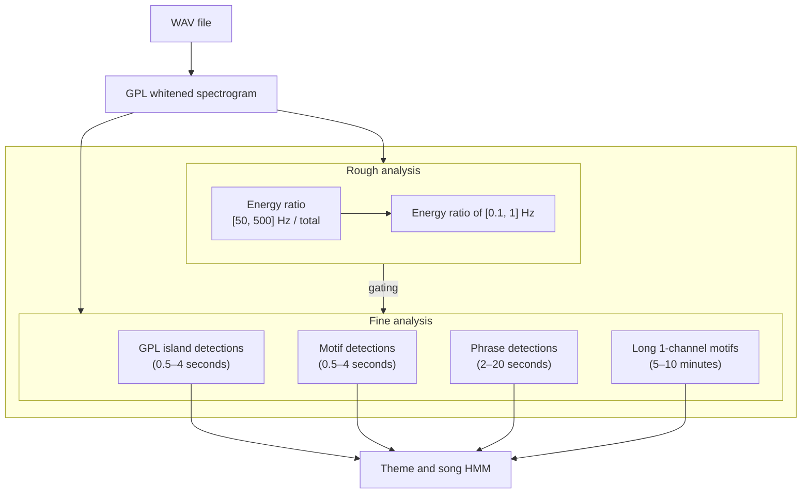

# Agents for whale song modeling and detection

## What we want

We have two aims. First, **detect** songs: find where each song starts and ends, and recover its theme sequence. Second, **characterize** how song structure drifts from year to year—dictionary atoms, correlated pairs, HMM transitions, and phrase lengths.

Singing occurs mostly during mating season, which takes place December–April, peaking February–March.

A season counts as *detected* when we have enough songs that those parameters can be estimated and compared with neighboring years.

## The structure of a song

Following Payne and McVay, song structure is hierarchical: **motif → phrase → theme → song**.

A **motif** is a short spectrogram atom—a kernel in the dictionary. Motifs chain into a **phrase** (roughly 2–20 seconds when treated as one unit). A **theme** is that phrase repeated a variable number of times. A **song** is a fixed cycle of themes; in the Site H model there are four themes, all present, in fixed order.

Reference annotations on a real song:

## Elements

The analysis is a chain of elements. Each depends on the others and on the season under study.

### Energy 50–500 Hz

Whitened band / total energy ratio. Gates where song-like sound appears and keeps full-archive scans affordable (e.g. hybrid detect when ratio ≥ 0.15).

### Energy 0.1–1 Hz

Periodicity of the band-energy envelope (ACF peak / FFT fraction). Cues phrase repetition rate within song.

### Correlated pairs (panMP)

Repeated energy ratio subsequences from matrix profile. Used to Seed dictionary learning to find long motifs that typically appear once in a song.

### Motif dictionary

A set of short spectrogram atoms placed along time (matching pursuit). Motifs come from two sources:

- repeated templates found by matching pursuit / pan-build;
- clustering of GPL contour islands (`cm` / `cm_max` / `cm_max2`).

### Repeating-phrase model

Phrases as first-class units (~2–20 s) between motifs and themes. Phrase are relatively long (2-20 seconds) so we cannot find them from GPL segmentation. Instead, the plan is to use Matrix Profile to find seeds for the repeated phrase.

### Theme HMM

Models fixed theme order and variable phrase-repeat counts from motif (or later phrase) scores. Used to decode start, end, and theme sequence of each song.

## How elements are scored

The **harness** scores every proposed change. **Acceptance rule:** keep a change only if all reported scores stay the same or improve. Where defined, scores include a **gap** (best − second-best). Tools compute features; they do not decide acceptance.

### Scoring correlated pairs

- **Unusualness** — within-length z-score of the pair distance.
- **Copies** — non-overlapping starts under the copy threshold.
- **Gap** — unusualness(best) − unusualness(second-best) at that length.

Per recording: pair count; median unusualness and copies; modal second-best length.

### Scoring the motif dictionary

- **Coverage** — fraction of time when some motif is >2σ above its mean.
- **Specificity** — peak score / score at ±½ length shift.
- **Gap** — best motif − second-best on the same stretch.

High coverage, specificity, and gap together mean: hits land on song, off-hits stay quiet, and one motif owns each hit. Per recording: coverage, hit count, median specificity and gap, modal second-best motif.

### Scoring the theme HMM

- **Fit** — posterior-weighted likelihood of the sequence.
- **Stability** — how much fit moves under a small parameter change.
- **Gap** — best theme-sequence likelihood − second-best.

Per recording (over songs): song count; median fit, stability, gap; modal second-best sequence. On decode: strong Viterbi path; **boundary score** drops when a theme boundary is deliberately shifted.

### Scoring the phrase model

Not defined yet. Plan analogs of coverage, specificity, and gap once the repeating-phrase model exists.

## How agents work

An **agent** owns one element: prompt-driven (LLM plus tools), proposes changes, owned by a human developer. The **season** is always in scope because elements drift year to year.

Typical loop:

1. Choose an element and a season (prefer warm-start from a neighboring year).
2. Propose a change and run the tools.
3. Rescore on agreed or held-out recordings.
4. Keep only if nothing regresses (including gap where defined).

### Which agents we need

- **Correlated pairs** — find or improve panMP pairs for a season.
- **Create motif dictionary** — build atoms from pairs or from a prior year.
- **Improve motif dictionary** — split over-used atoms, merge near-ties, add atoms when coverage is low.
- **Create phrase dictionary** — learn longer (2–20 s) repeating units.
- **Create HMM** — fit a theme HMM on motif scores.
- **Compare HMMs** — try different theme counts; keep winners by score.

## Tools and data

Agents call tools; tools do not replace scoring.

**Archive scans**—Site H energy, song detection, per-minute energy and ACF—are written in **optimized C**. They use OpenMP on the CPU and cuFFT on both GPUs when available. Python only schedules files and writes progress.

Other entry points:

- **Pairs:** `python -m analysis.matrix_profile pan` (default GPL band 50–500 Hz).
- **GPL:** `python -m analysis.GPL_Python.process_v4`.
- **Dictionary:** `randomized-build` / `pan-build`, `matching-pursuit`, `split` under `analysis.dict_learning`.
- **HMM:** `python -m analysis.HMM.run_train`, `refresh_metrics()`, `write_report`.
- **Site H energy:** `pre_processing/c/energy_filter`, `minute_energy`, `minute_acf`; also `hires_energy_ratio.py`.
- **Site H songs:** `find_songs/c/song_detector`; `siteH_all_songs/hybrid_run.py` (run the detector when the energy ratio is at least 0.15).
- **Periodicity:** `repeating_peaks`; minute ACF CSVs under `12TB_results/minute_acf/`.

The main corpus is Site H `df20` on `/mnt/sda/SiteH`, indexed by the manifest in `analysis/dict_HMM/find_songs/siteH_all_songs/`. Local LeiData clips live under `/home/yfreund/whale_processing/LeiData/`.

## Working rules

One agent owns one element, and the season is always named. Propose a change, run tools, let the harness rescore, and reject any regression. Prefer warm-start from a neighboring year over training from scratch. Gate full-archive work with energy cues so scans stay affordable. Until the phrase model exists, treat theme decoding as provisional.

## What to do next

1. Specify harness I/O: a score JSON schema and an accept/reject log per agent run.
2. Build the repeating-phrase model and scores analogous to coverage, specificity, and gap.
3. Feed Site H hybrid-scan outputs into season-level characterization (dictionary and HMM drift tables).
