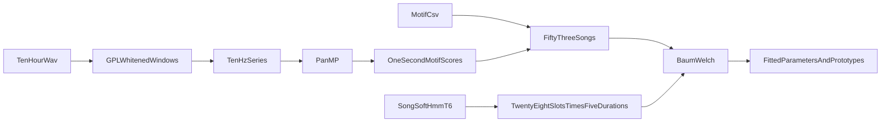

# Train the soft HMM in a notebook

Stage 2 of [plans/whale_song_pipeline.md](../../plans/whale_song_pipeline.md) is the fit in this folder. GPL windows, the 10 Hz series, and the motif scores are on disk under `work/`. Retraining reuses them.

The recording is `SOCAL_H_76_230426_193500_df100.x.x_10kHz.wav` (10 kHz, mono, 10 hours). It was upsampled from 2 kHz, so energy above 1 kHz is empty. The matching labels are [backend/data/song_structure/SOCAL_H_76_230426_193500_df100.x.x.motif_segments.csv](../../backend/data/song_structure/SOCAL_H_76_230426_193500_df100.x.x.motif_segments.csv): 53 songs and the same phrase chains drawn in [song_soft_hmm_t6.dot](song_soft_hmm_t6.dot). The CSV cuts songs and initializes the Gaussians. It is not the observation.

Matching Pursuit stays out of this pass. The pipeline sketch that hands panMP peaks to the dictionary learner is unchanged and unused here.



## 1. GPL

Run the existing orchestrator, [analysis/GPL_Python/process_v4.py](../GPL_Python/process_v4.py):

```bash
python -m analysis.GPL_Python.process_v4 "C:\Users\hoang\Downloads\SOCAL_H_76_230426_193500_df100.x.x_10kHz.wav" --output-dir analysis/HMM/work/gpl_193500 --freq-lo 10 --freq-hi 1000
```

`--freq-hi 1000` keeps the band that actually has energy. The default 10 kHz would be capped at the 5 kHz Nyquist and would whiten an empty upper band. Windows are the GPL default of 75 s, so this file is 480 windows. Each window writes a whitened spectrogram under `analysis/HMM/work/gpl_193500/spectrogram_npy/`. Those arrays stay on disk as a working product; they are not the model.

This is the long step. The detector loads the whole file (about 3 GB as float64) and walks all 480 windows once.

## 2. panMP motifs

panMP needs a 1-D series. [analysis/matrix_profile/mpx_fast.py](../matrix_profile/mpx_fast.py) is the kernel written for a 10-hour, 10 Hz series. The pure-Python `mpxForPan` path inside [analysis/matrix_profile/panMP.py](../matrix_profile/panMP.py) is the reference and is too slow at this length, so the length sweep uses `mpx_fast` and does not plot.

- Sum each whitened window over frequency and concatenate in time. The GPL frame step is the sidecar `overlap` field (768 samples at 10 kHz, about 13 Hz). Average that energy down to 10 Hz. Ten hours becomes 360,000 samples.
- Motif lengths 10, 20, 30, 40, 50 samples: 1 s through 5 s, the same span as the duration states. The MATLAB demo range 32:64:512 is for short test series and is longer than a unit.
- Prototypes: walk the pan surface from the strongest peak, keep the subsequence there, and skip an exclusion zone of that motif’s length. Stop at K = 12 prototypes, a few more than the eight unit names on the drawing (U1, U2, U3, U6, U7, U8, U9, U11). K stays a notebook knob.
- Score the 10 Hz series with the z-normalized correlation to each prototype, then average to one K-vector per second. Z-score each score across the recording.

Save the prototypes, the 1 s score matrix, and the score mean and standard deviation under `analysis/HMM/work/`.

## What the DOT means as a model

A node is a phrase slot (28 slots: 3+3+6+3+5+8). Each slot expands to five duration states, one per second from 1 s through 5 s. Those five states share one diagonal Gaussian over the K motif scores. The unit name on a node identifies the slot; it does not tie emissions across slots that share a unit.

Inside a theme the advance is certain: the slot ends, then the next slot starts at its 1 s state. Only the last slot of a theme branches. Initial branch weights are the numbers on the drawing. Theme 6 repeats with probability 1 and has no edge back to theme 1. The 10 hours are therefore 53 sequences, cut at the song spans in the motif CSV.

## Baum–Welch

Code under [analysis/HMM/](./), called from [train_song_soft_hmm_t6.ipynb](train_song_soft_hmm_t6.ipynb):

- **Topology.** 140 states. From duration k of a slot, k < 5, the chain may continue to k+1 or take the slot’s advance edge. Duration 5 must advance. An advance enters the next slot at duration 1. Non-final slots have one advance target. Final slots split that advance into repeat versus next. Theme 6’s next weight stays 0.
- **Tied emissions.** One mean and one diagonal variance per slot, shared by its five duration states, in the K-dimensional motif-score space. Variances floored so a score cannot collapse.
- **Initialization.** Pool the 1 s score vectors that the CSV assigns to each slot to set the Gaussian. Set each slot’s exit probabilities so the implied length distribution matches that slot’s labeled lengths, clipped to 1–5 s. A song may enter at the 1 s state of the first slot of any theme; that start distribution begins uniform. Seed the five theme-end branches from the DOT labels.
- **E-step / M-step.** Scaled forward–backward on the sparse graph, one pass per song, parameters shared across the 53 songs. The M-step updates slot Gaussians, per-slot exit probabilities, the five free theme-end branches, and the start distribution. Structural zeros stay zero. Theme 6’s repeat stays 1. Run until the total log-likelihood gain is small (cap around 20 iterations).

## What the notebook shows

- Log-likelihood after each iteration, and nats per second against a standard-normal baseline.
- Posterior-weighted likelihood, split into emission, transition, and start.
- Per-song log-likelihood per second.
- Average forward–backward probability on the CSV theme, and expected versus labeled seconds in each theme.
- A one-parameter sensitivity check: nudge each free theme-end probability, and shift each slot mean along one motif score, and record how far the sequence likelihood moves. No refit after the nudge.

The last training cell writes one parameter file under `analysis/HMM/`: slot means and variances, exit probabilities, theme-end branches, the start distribution, the motif prototypes, and the score mean and standard deviation. The file is the handoff. Decoding a new recording is a separate step and is not in this folder.
