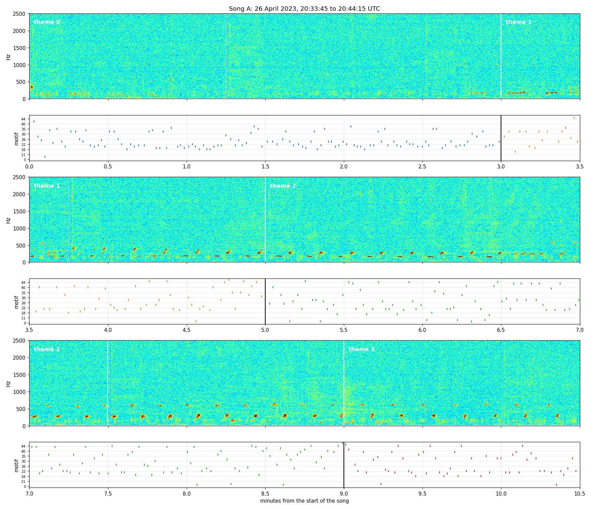
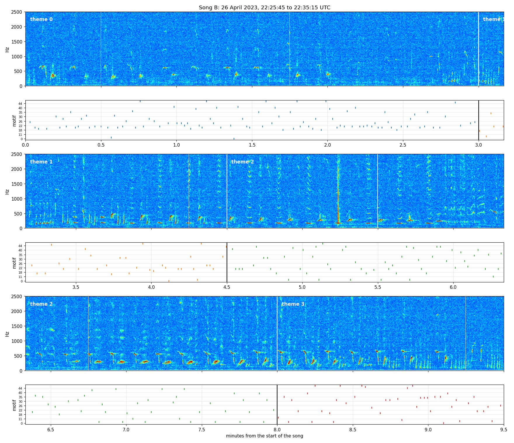
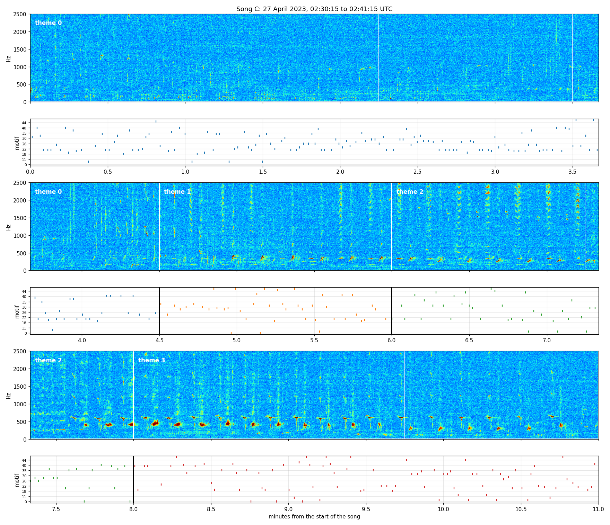
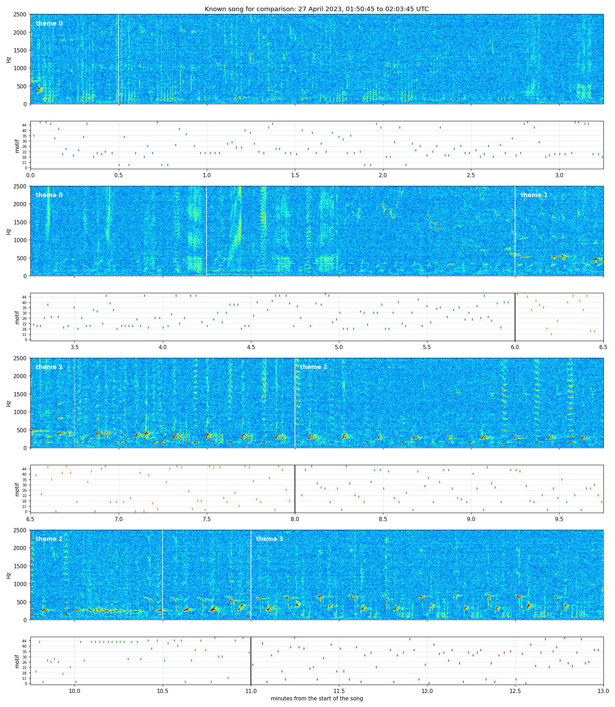

# Songs detected at Site H, 25–30 April 2023

Songs found by placing the 35-motif dictionary on the 10 kHz recordings of `SOCAL_H_76` and decoding the placements with the four-theme cyclic model. The themes are fixed at the values fitted on the known 75 minutes (27 April 2023, 01:11:15 to 02:26:15 UTC). Nothing is refitted on the new recordings.

A song is one pass through themes 0, 1, 2, 3. It is listed here when both tests hold:

- Each of its four theme visits gets a higher likelihood from its own theme than from any of the other three.
- The order matters: in 500 shuffles of the song's 30-second bins, no shuffle scores as well as the real order.

26 songs pass. 7 of them lie in the known recording, and 19 are new.

## All detected songs

Times are UTC. The recordings are in `/mnt/sda/SiteH/SOCAL_H_76/SOCAL_H_76_disk01_df20/`, each named `<file>.x.wav`. "Smallest margin" is the smallest of the four log-likelihood gaps between a visit's own theme and the best other theme. "Order score" is how many standard deviations the real order scores above the shuffled orders.

| | Start | End | File | Seconds into the file | Minutes | Minutes in themes 0 / 1 / 2 / 3 | Smallest margin | Order score | Note |
|---|---|---|---|---|---:|---|---:|---:|---|
|  | 26 Apr 10:12:15 | 26 Apr 10:21:45 | `SOCAL_H_76_230426_054845_df20` | 15810–16380 | 9.5 | 4.5 / 1 / 3 / 1 | 2.2 | 4.0 |  |
|  | 26 Apr 11:09:45 | 26 Apr 11:14:15 | `SOCAL_H_76_230426_054845_df20` | 19260–19530 | 4.5 | 1 / 1 / 1 / 1.5 | 3.5 | 2.7 |  |
|  | 26 Apr 20:08:15 | 26 Apr 20:18:45 | `SOCAL_H_76_230426_054845_df20` | 51570–52200 | 10.5 | 3 / 2.5 / 1.5 / 3.5 | 7.2 | 3.9 |  |
| A | 26 Apr 20:33:45 | 26 Apr 20:44:15 | `SOCAL_H_76_230426_054845_df20` | 53100–53730 | 10.5 | 3 / 2 / 4 / 1.5 | 5.5 | 4.9 | pictured below |
|  | 26 Apr 21:18:45 | 26 Apr 21:27:45 | `SOCAL_H_76_230426_054845_df20` | 55800–56340 | 9 | 3.5 / 1 / 2.5 / 2 | 0.1 | 3.6 |  |
|  | 26 Apr 22:05:45 | 26 Apr 22:18:45 | `SOCAL_H_76_230426_054845_df20` | 58620–59400 | 13 | 6 / 1 / 5 / 1 | 2.2 | 5.0 |  |
|  | 26 Apr 22:18:45 | 26 Apr 22:25:45 | `SOCAL_H_76_230426_054845_df20` | 59400–59820 | 7 | 1 / 1.5 / 2 / 2.5 | 11.1 | 4.5 |  |
| B | 26 Apr 22:25:45 | 26 Apr 22:35:15 | `SOCAL_H_76_230426_054845_df20` | 59820–60390 | 9.5 | 3 / 1.5 / 3.5 / 1.5 | 9.7 | 4.0 | pictured below |
|  | 26 Apr 23:56:15 | 27 Apr 00:12:45 | `SOCAL_H_76_230426_054845_df20` | 65250–66240 | 16.5 | 7 / 3 / 5 / 1.5 | 4.9 | 4.9 |  |
|  | 27 Apr 00:12:45 | 27 Apr 00:23:15 | `SOCAL_H_76_230426_054845_df20` | 66240–66870 | 10.5 | 4 / 1 / 4.5 / 1 | 0.6 | 4.0 |  |
|  | 27 Apr 01:05:15 | 27 Apr 01:19:15 | `SOCAL_H_76_230426_054845_df20` | 69390–70230 | 14 | 6.5 / 2 / 4 / 1.5 | 4.5 | 3.1 | known recording |
|  | 27 Apr 01:19:15 | 27 Apr 01:31:45 | `SOCAL_H_76_230426_054845_df20` | 70230–70980 | 12.5 | 7 / 2 / 1.5 / 2 | 9.7 | 5.6 | known recording |
|  | 27 Apr 01:31:45 | 27 Apr 01:40:15 | `SOCAL_H_76_230426_054845_df20` | 70980–71490 | 8.5 | 1.5 / 2 / 3.5 / 1.5 | 15.5 | 3.6 | known recording |
|  | 27 Apr 01:40:15 | 27 Apr 01:50:45 | `SOCAL_H_76_230426_054845_df20` | 71490–72120 | 10.5 | 4 / 1.5 / 2.5 / 2.5 | 21.5 | 4.9 | known recording |
|  | 27 Apr 01:50:45 | 27 Apr 02:03:45 | `SOCAL_H_76_230426_054845_df20` | 72120–72900 | 13 | 6 / 2 / 3 / 2 | 31.2 | 6.2 | known recording |
|  | 27 Apr 02:03:45 | 27 Apr 02:17:15 | `SOCAL_H_76_230426_054845_df20` | 72900–73710 | 13.5 | 7.5 / 1 / 3 / 2 | 7.3 | 5.5 | known recording |
|  | 27 Apr 02:17:15 | 27 Apr 02:30:15 | `SOCAL_H_76_230426_054845_df20` | 73710–74490 | 13 | 4 / 2.5 / 2.5 / 4 | 37.8 | 6.6 | known recording |
| C | 27 Apr 02:30:15 | 27 Apr 02:41:15 | `SOCAL_H_76_230426_054845_df20` | 74490–75150 | 11 | 4.5 / 1.5 / 2 / 3 | 11.9 | 5.4 | pictured below |
|  | 27 Apr 02:41:15 | 27 Apr 02:55:15 | `SOCAL_H_76_230426_054845_df20` | 75150–75990 | 14 | 6.5 / 1 / 4 / 2.5 | 2.9 | 6.1 |  |
|  | 27 Apr 02:55:15 | 27 Apr 03:06:45 | `SOCAL_H_76_230426_054845_df20` | 75990–76680 | 11.5 | 6 / 1 / 2 / 2.5 | 0.7 | 5.1 |  |
|  | 27 Apr 03:06:45 | 27 Apr 03:20:15 | `SOCAL_H_76_230426_054845_df20` | 76680–77490 | 13.5 | 6.5 / 1.5 / 1.5 / 4 | 7.1 | 5.4 |  |
|  | 27 Apr 04:14:45 | 27 Apr 04:24:45 | `SOCAL_H_76_230427_034115_df20` | 2010–2610 | 10 | 6 / 1.5 / 1.5 / 1 | 3.4 | 4.4 |  |
|  | 27 Apr 04:38:45 | 27 Apr 04:48:15 | `SOCAL_H_76_230427_034115_df20` | 3450–4020 | 9.5 | 4 / 2 / 1.5 / 2 | 3.7 | 4.7 |  |
|  | 28 Apr 12:30:45 | 28 Apr 12:49:15 | `SOCAL_H_76_230428_013345_df20` | 39420–40530 | 18.5 | 14.5 / 1 / 1.5 / 1.5 | 1.8 | 4.4 |  |
|  | 28 Apr 15:22:15 | 28 Apr 15:38:15 | `SOCAL_H_76_230428_013345_df20` | 49710–50670 | 16 | 6 / 3.5 / 4.5 / 2 | 6.1 | 4.7 |  |
|  | 28 Apr 15:38:15 | 28 Apr 15:51:45 | `SOCAL_H_76_230428_013345_df20` | 50670–51480 | 13.5 | 8 / 1.5 / 2.5 / 1.5 | 3.5 | 4.6 |  |

Two of the songs marked "known recording" cross its edges. The one that starts at 01:05:15 on 27 April begins six minutes before the known recording. The one that starts at 02:17:15 ends four minutes after it.

## Three new songs

Each picture shows the whitened spectrogram up to 2.5 kHz, the theme boundaries, and the motif placements coloured by theme.

### Song A: 26 April 2023, 20:33:45 to 20:44:15

This song is fainter than the other two.

### Song B: 26 April 2023, 22:25:45 to 22:35:15

### Song C: 27 April 2023, 02:30:15 to 02:41:15

This song starts four minutes after the known recording ends.

### A known song, for comparison: 27 April 2023, 01:50:45 to 02:03:45

## Checks and limits

- The dictionary was learned on 200 kHz audio up to 10 kHz. The disk files are 10 kHz, so only the dictionary rows below 4.5 kHz are used. On the known 75 minutes this recovers the same seven songs, with boundaries within half a minute of the published ones.
- The 22-hour recording that starts on 25 April has no song that passes. The recordings that start on 28 April at 23:26 and on 29 April also have none.
- Only the six recordings from 25 to 30 April 2023 were searched. The dictionary describes that season's song; other deployments and years were not searched.
- Three 37.5-minute blocks on the evening of 26–27 April (starting 21:26:15, 23:18:45, and 00:33:45) received almost no placements, because the pursuit's stop rule fired early. Songs in those blocks are missing from the table.

## Files

- `results/decoded_songs.csv`: every decoded cycle, including the ones that fail the tests.
- `results/placements_*.csv`: the motif placements of each recording.
- `results/theme_model.npz`: the fixed theme model, written by `fit_theme_model.py`.
- `scan.py` places the dictionary, `songs.py` decodes and tests, `figure.py` draws a song.
