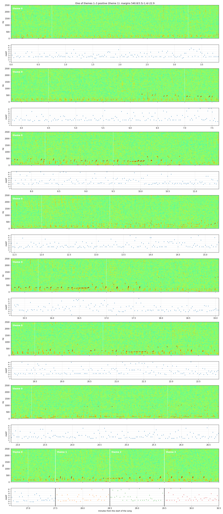
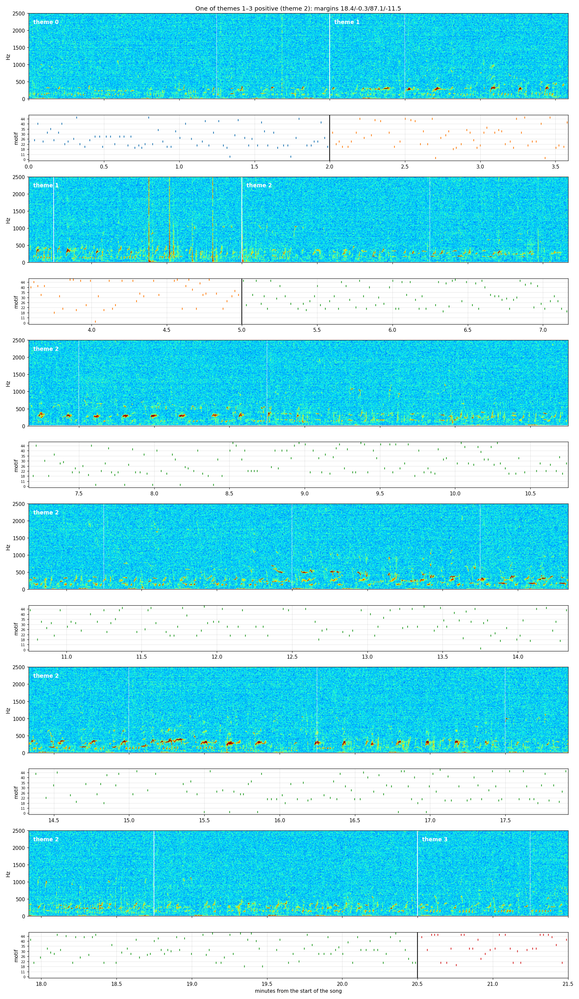
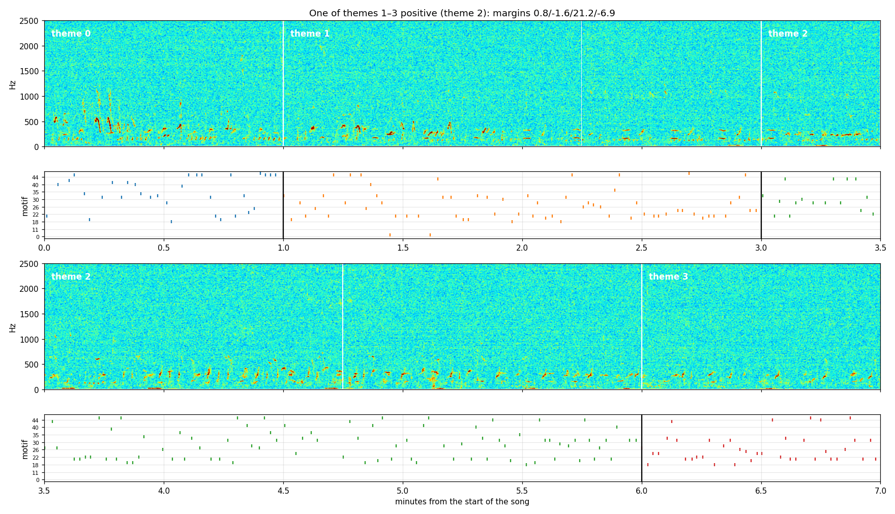
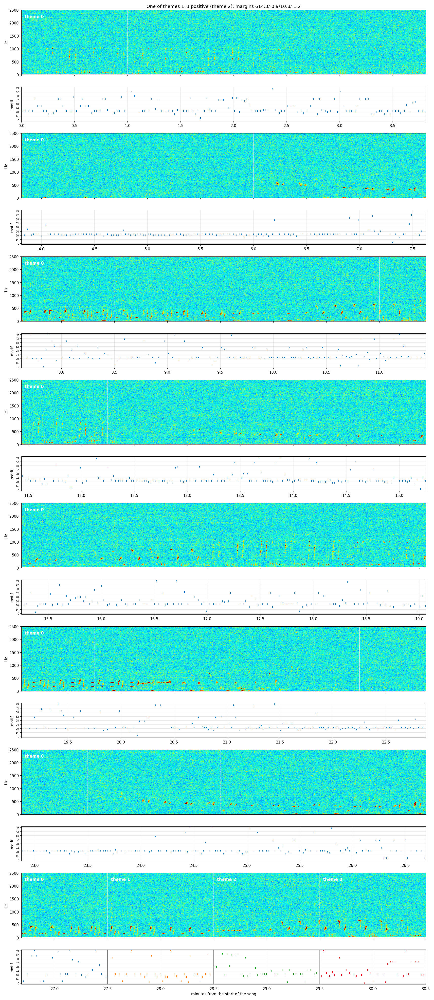
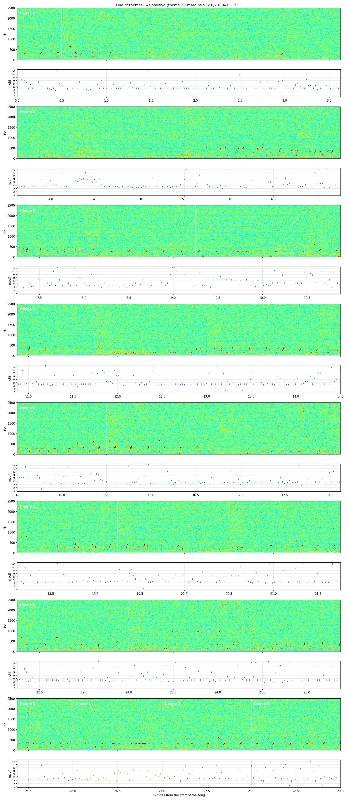

# Cycles with one of themes 1–3 positive and the other two negative

Decoded 0→1→2→3 cycles where **exactly one** of themes 1, 2, and 3 has a positive margin and the other two are negative. Theme 0 is left out of that count because its margin is almost always large and positive. These cycles fail the song test (`min_margin > 0` for all four visits).

On the six April recordings there are **84** such cycles (theme 1 alone positive: 5; theme 2: 75; theme 3: 4). Five are shown below.

## Five segments

| | Start | End | File | Minutes | Margins 0 / 1 / 2 / 3 | Positive among 1–3 | Placements |
|---|---|---|---|---:|---|---:|---:|
| 1 | 27 Apr 10:56:45 | 27 Apr 11:27:15 | `SOCAL_H_76_230427_034115_df20` | 30.5 | 540.8/3.5/-1.4/-22.9 | 1 | 1144 |
| 2 | 26 Apr 09:18:45 | 26 Apr 09:40:15 | `SOCAL_H_76_230426_054845_df20` | 21.5 | 18.4/-0.3/87.1/-11.5 | 2 | 685 |
| 3 | 26 Apr 09:40:15 | 26 Apr 09:47:15 | `SOCAL_H_76_230426_054845_df20` | 7 | 0.8/-1.6/21.2/-6.9 | 2 | 236 |
| 4 | 29 Apr 01:45:15 | 29 Apr 02:15:45 | `SOCAL_H_76_230428_232615_df20` | 30.5 | 614.3/-0.9/10.8/-1.2 | 2 | 1041 |
| 5 | 27 Apr 18:08:15 | 27 Apr 18:37:15 | `SOCAL_H_76_230427_034115_df20` | 29 | 552.6/-16.8/-11.3/1.3 | 3 | 1083 |

## Pictures

Whitened spectrogram to 2.5 kHz, theme boundaries, and motif placements coloured by theme.

### 1. Theme 1 positive among 1–3: 27 Apr 2023, 10:56:45–11:27:15

File `SOCAL_H_76_230427_034115_df20`, 30.5 minutes, margins `540.8/3.5/-1.4/-22.9`.

### 2. Theme 2 positive among 1–3: 26 Apr 2023, 09:18:45–09:40:15

File `SOCAL_H_76_230426_054845_df20`, 21.5 minutes, margins `18.4/-0.3/87.1/-11.5`.

### 3. Theme 2 positive among 1–3: 26 Apr 2023, 09:40:15–09:47:15

File `SOCAL_H_76_230426_054845_df20`, 7 minutes, margins `0.8/-1.6/21.2/-6.9`.

### 4. Theme 2 positive among 1–3: 29 Apr 2023, 01:45:15–02:15:45

File `SOCAL_H_76_230428_232615_df20`, 30.5 minutes, margins `614.3/-0.9/10.8/-1.2`.

### 5. Theme 3 positive among 1–3: 27 Apr 2023, 18:08:15–18:37:15

File `SOCAL_H_76_230427_034115_df20`, 29 minutes, margins `552.6/-16.8/-11.3/1.3`.

## Files

- `results/decoded_songs.csv`: every decoded cycle.
- `results/one_positive_two_negative_five.csv`: the five segments pictured here.
- `figure.py`: draws one cycle.
