# Energy ratio and conforming-song rate by year (2008–2026)

Each panel is one calendar year. The **left axis (blue)** is the daily mean whitened 50–500 Hz energy fraction from `energy_segments.csv` (600 s segments; dashed line at the hybrid gate **0.15**). The **right axis (red)** is the rate of conforming song detections from `conforming_songs.csv`: thin stems are songs counted that day, and the thick line is a **14-day centered mean** (songs/day). The x-axis runs January–December.

**Notes**

- Energy covers all eligible Site H 10 kHz files (hybrid pass plus backfill of the earlier song-only stems, including **2008–2012**).
- Song counts cover the full Site H 10 kHz scan (conforming songs: margin and shuffle tests).
- Totals in this report: **2,546** conforming songs; **879,704** energy segments.

## 2008

9 conforming songs; 25,008 energy segments.

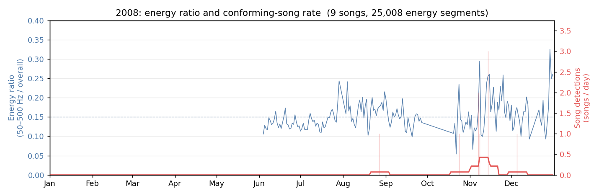

## 2009

6 conforming songs; 36,896 energy segments.

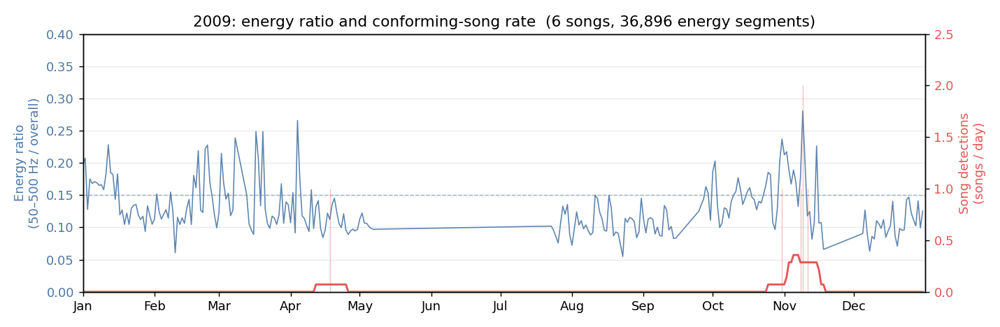

## 2010

14 conforming songs; 46,080 energy segments.

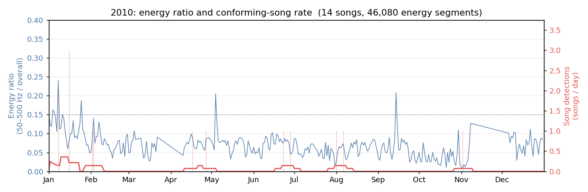

## 2011

4 conforming songs; 48,966 energy segments.

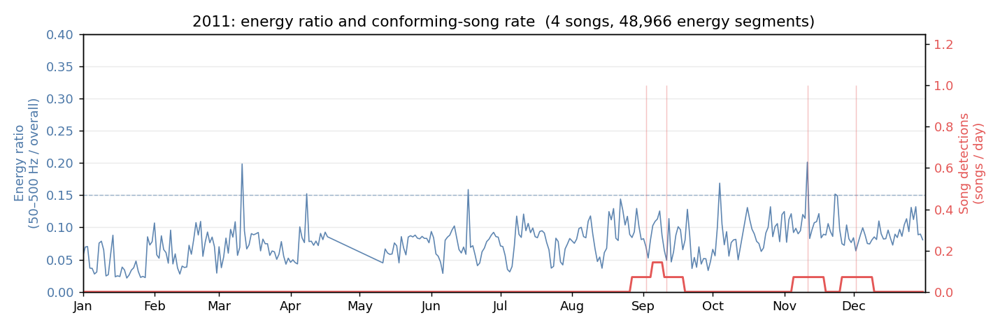

## 2012

6 conforming songs; 28,612 energy segments.

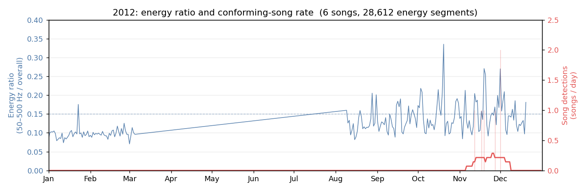

## 2013

6 conforming songs; 34,994 energy segments.

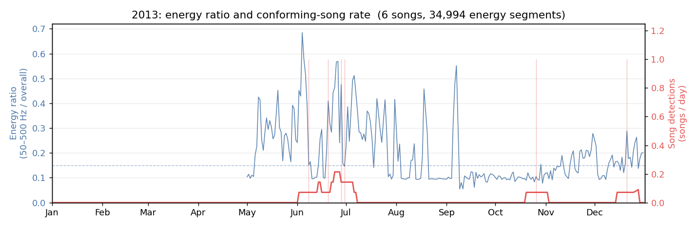

## 2014

18 conforming songs; 52,807 energy segments.

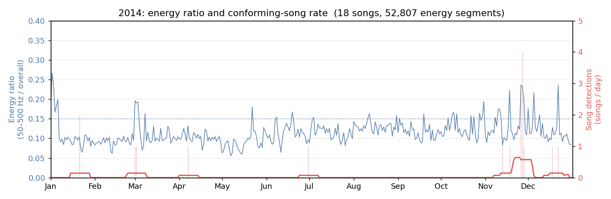

## 2015

25 conforming songs; 52,815 energy segments.

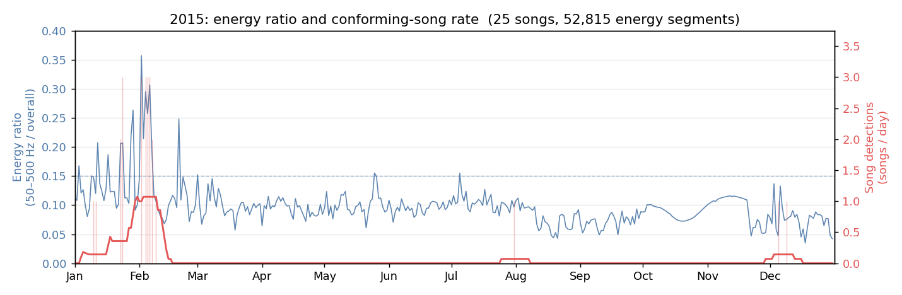

## 2016

1 conforming songs; 34,906 energy segments.

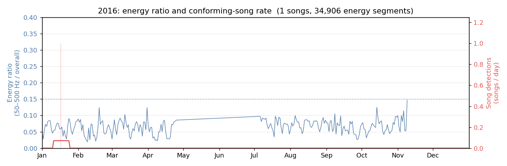

## 2017

16 conforming songs; 44,479 energy segments.

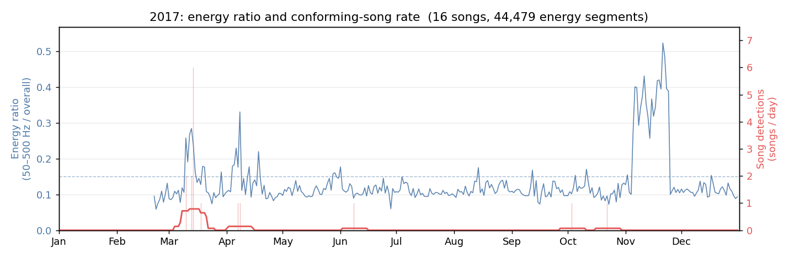

## 2018

32 conforming songs; 52,680 energy segments.

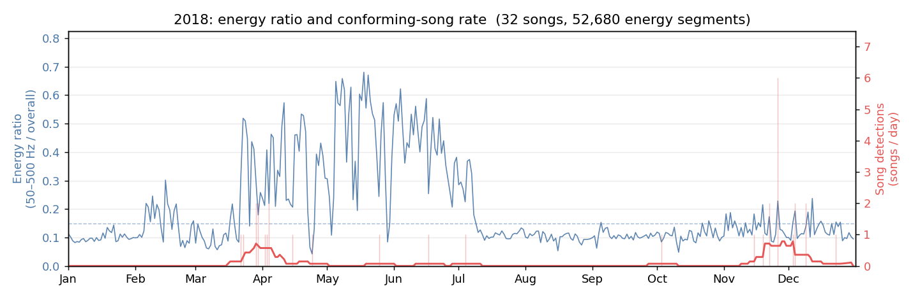

## 2019

62 conforming songs; 53,119 energy segments.

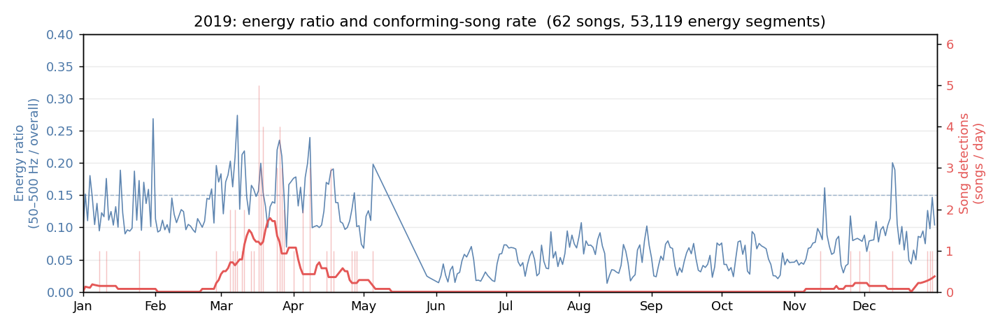

## 2020

103 conforming songs; 52,972 energy segments.

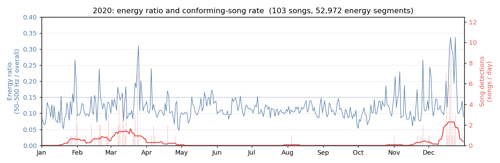

## 2021

84 conforming songs; 60,494 energy segments.

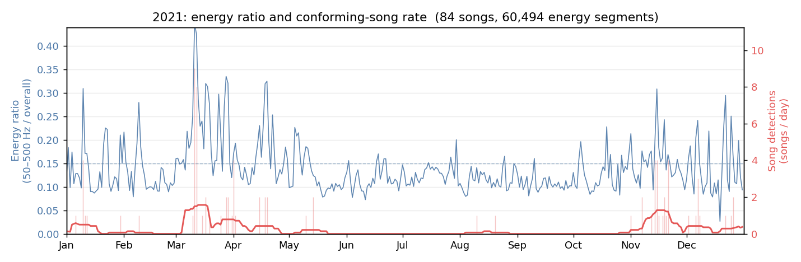

## 2022

359 conforming songs; 52,662 energy segments.

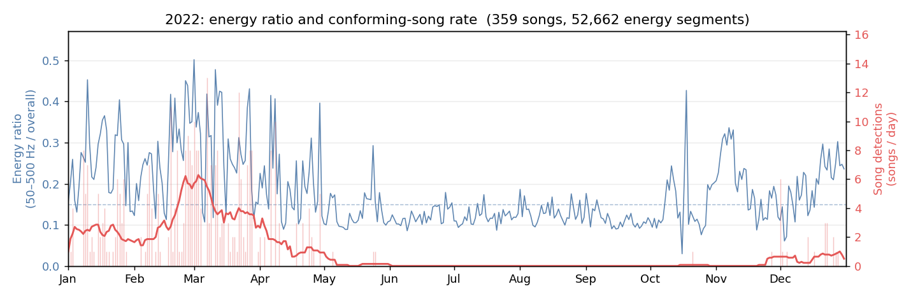

## 2023

968 conforming songs; 50,015 energy segments.

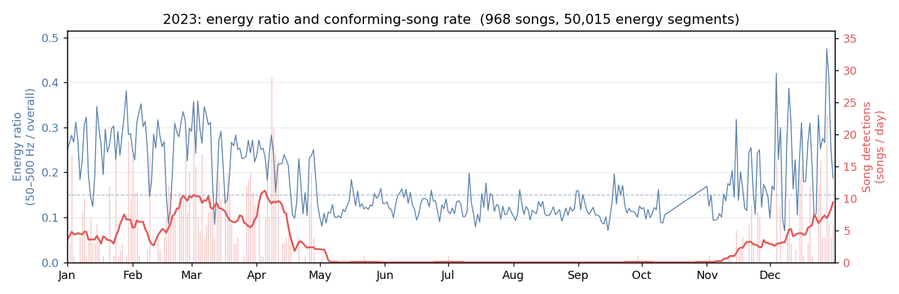

## 2024

225 conforming songs; 53,016 energy segments.

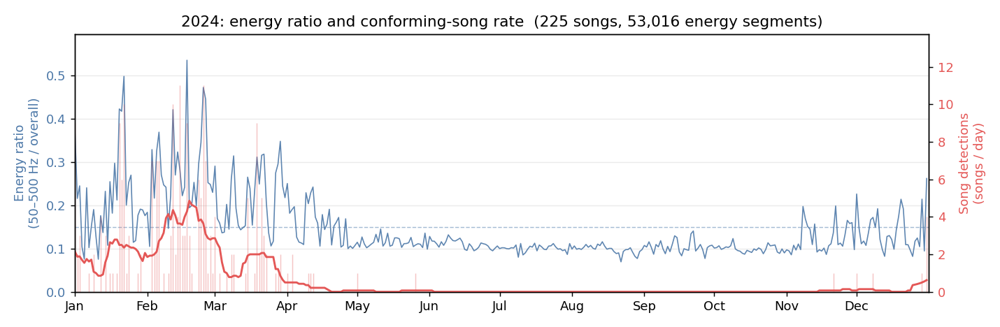

## 2025

181 conforming songs; 52,850 energy segments.

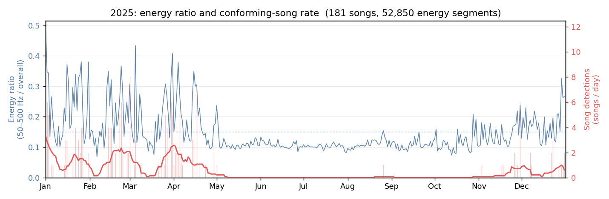

## 2026

427 conforming songs; 38,477 energy segments.

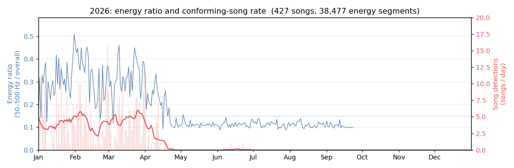

## Files

- `conforming_songs.csv`, `energy_segments.csv` — sources
- `figures/year_panels/year_YYYY.png` — panels above
