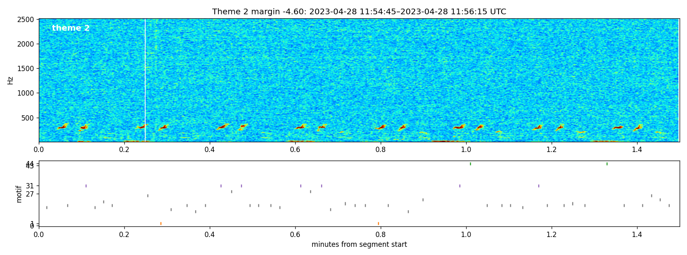
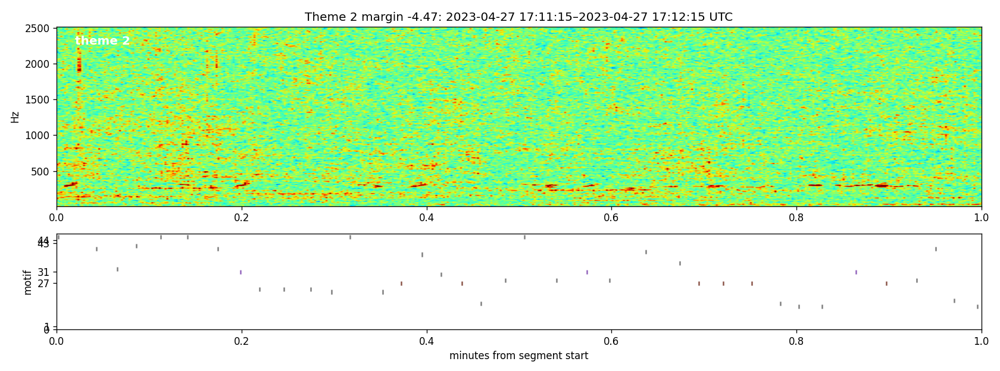
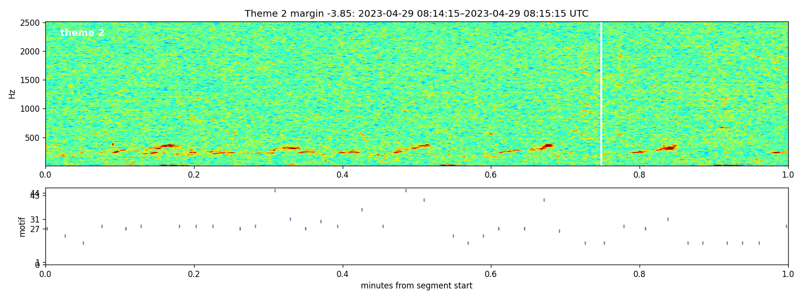
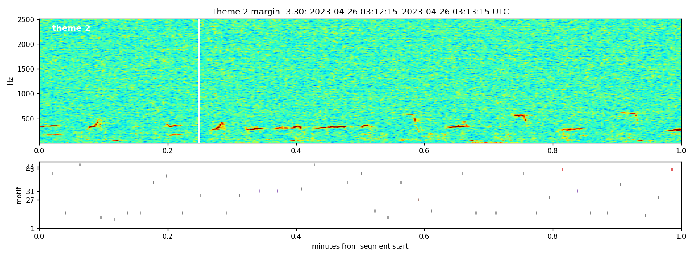
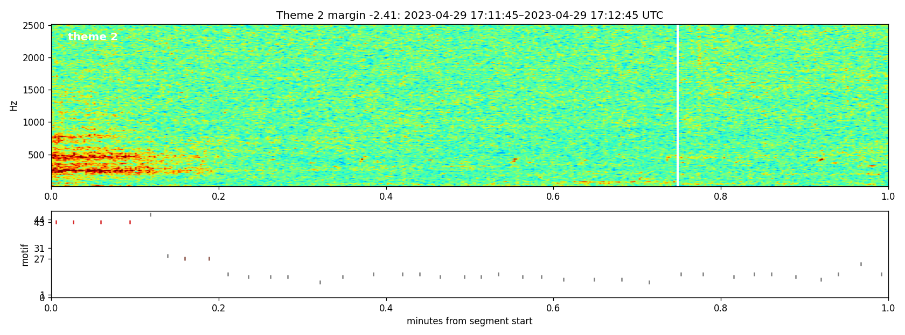
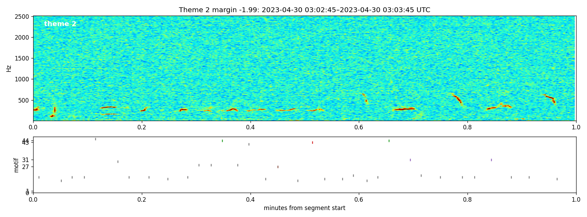
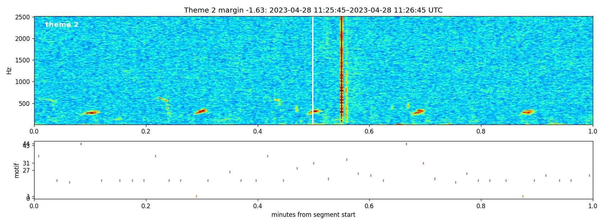
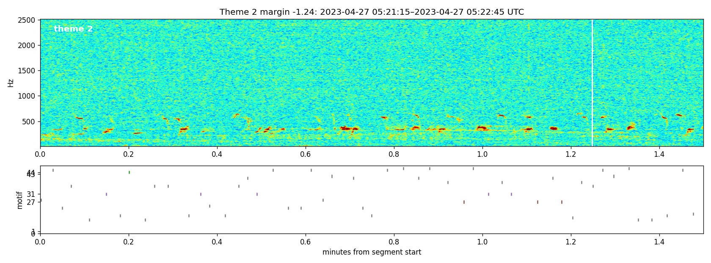
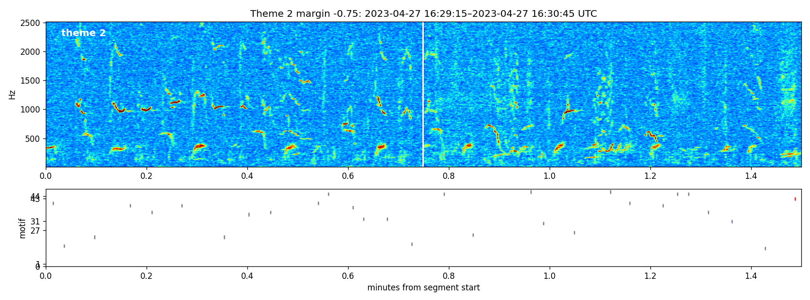
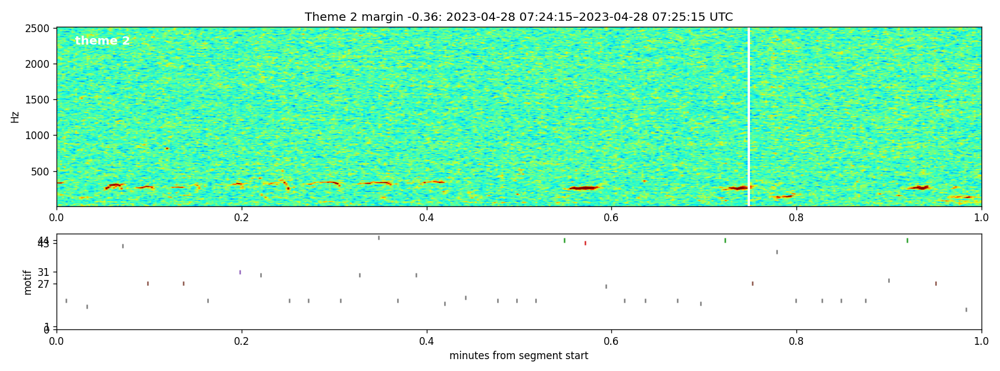

# Theme-2 visits with margin between −5 and 0

Theme-2 visits from the fixed four-theme decode with `theme2_margin` in **[−5, 0]**. Theme 2 loses to at least one other theme on these visits, but only by a small amount. The margin is the log-likelihood gap between theme 2 and the best of the other three themes on that visit's motif counts.

On the six recordings of 25–30 April 2023 there are **16** theme-2 visits in this band (**16** with at least 20 placements). The ten below are spaced across the band among those denser visits.

## Ten segments

| | Start | End | File | Seconds | Minutes | Theme-2 margin | Motifs 43 / 1 / 44 | Placements |
|---|---|---|---|---:|---:|---:|---|---:|
| 1 | 28 Apr 11:54:45 | 28 Apr 11:56:15 | `SOCAL_H_76_230428_013345_df20` | 37260–37350 | 1.5 | -4.60 | 0 / 2 / 2 | 47 |
| 2 | 27 Apr 17:11:15 | 27 Apr 17:12:15 | `SOCAL_H_76_230427_034115_df20` | 48600–48660 | 1 | -4.47 | 0 / 0 / 0 | 38 |
| 3 | 29 Apr 08:14:15 | 29 Apr 08:15:15 | `SOCAL_H_76_230428_232615_df20` | 31680–31740 | 1 | -3.85 | 0 / 0 / 0 | 38 |
| 4 | 26 Apr 03:12:15 | 26 Apr 03:13:15 | `SOCAL_H_76_230425_075615_df20` | 69360–69420 | 1 | -3.30 | 2 / 0 / 0 | 38 |
| 5 | 29 Apr 17:11:45 | 29 Apr 17:12:45 | `SOCAL_H_76_230428_232615_df20` | 63930–63990 | 1 | -2.41 | 4 / 0 / 0 | 37 |
| 6 | 30 Apr 03:02:45 | 30 Apr 03:03:45 | `SOCAL_H_76_230429_211845_df20` | 20640–20700 | 1 | -1.99 | 1 / 0 / 2 | 34 |
| 7 | 28 Apr 11:25:45 | 28 Apr 11:26:45 | `SOCAL_H_76_230428_013345_df20` | 35520–35580 | 1 | -1.63 | 0 / 2 / 2 | 39 |
| 8 | 27 Apr 05:21:15 | 27 Apr 05:22:45 | `SOCAL_H_76_230427_034115_df20` | 6000–6090 | 1.5 | -1.24 | 0 / 0 / 1 | 51 |
| 9 | 27 Apr 16:29:15 | 27 Apr 16:30:45 | `SOCAL_H_76_230427_034115_df20` | 46080–46170 | 1.5 | -0.75 | 1 / 0 / 0 | 29 |
| 10 | 28 Apr 07:24:15 | 28 Apr 07:25:15 | `SOCAL_H_76_230428_013345_df20` | 21030–21090 | 1 | -0.36 | 1 / 0 / 3 | 38 |

## Pictures

Whitened spectrogram to 2.5 kHz and motif raster. Motifs **43**, **1**, **44**, **31**, **27**, **0**, and **10** are coloured; the rest are grey.

### 1. Margin -4.60: 28 Apr 2023, 11:54:45–11:56:15

File `SOCAL_H_76_230428_013345_df20`, 1.5 minutes, motif counts 43/1/44 = 0/2/2.

### 2. Margin -4.47: 27 Apr 2023, 17:11:15–17:12:15

File `SOCAL_H_76_230427_034115_df20`, 1 minutes, motif counts 43/1/44 = 0/0/0.

### 3. Margin -3.85: 29 Apr 2023, 08:14:15–08:15:15

File `SOCAL_H_76_230428_232615_df20`, 1 minutes, motif counts 43/1/44 = 0/0/0.

### 4. Margin -3.30: 26 Apr 2023, 03:12:15–03:13:15

File `SOCAL_H_76_230425_075615_df20`, 1 minutes, motif counts 43/1/44 = 2/0/0.

### 5. Margin -2.41: 29 Apr 2023, 17:11:45–17:12:45

File `SOCAL_H_76_230428_232615_df20`, 1 minutes, motif counts 43/1/44 = 4/0/0.

### 6. Margin -1.99: 30 Apr 2023, 03:02:45–03:03:45

File `SOCAL_H_76_230429_211845_df20`, 1 minutes, motif counts 43/1/44 = 1/0/2.

### 7. Margin -1.63: 28 Apr 2023, 11:25:45–11:26:45

File `SOCAL_H_76_230428_013345_df20`, 1 minutes, motif counts 43/1/44 = 0/2/2.

### 8. Margin -1.24: 27 Apr 2023, 05:21:15–05:22:45

File `SOCAL_H_76_230427_034115_df20`, 1.5 minutes, motif counts 43/1/44 = 0/0/1.

### 9. Margin -0.75: 27 Apr 2023, 16:29:15–16:30:45

File `SOCAL_H_76_230427_034115_df20`, 1.5 minutes, motif counts 43/1/44 = 1/0/0.

### 10. Margin -0.36: 28 Apr 2023, 07:24:15–07:25:15

File `SOCAL_H_76_230428_013345_df20`, 1 minutes, motif counts 43/1/44 = 1/0/3.

## Files

- `results/theme2_all_visits.csv`: every decoded theme-2 visit (filter source).
- `results/theme2_margin_pm5_ten.csv`: the ten segments pictured here.
- `figure_theme2.py`: draws one visit.
