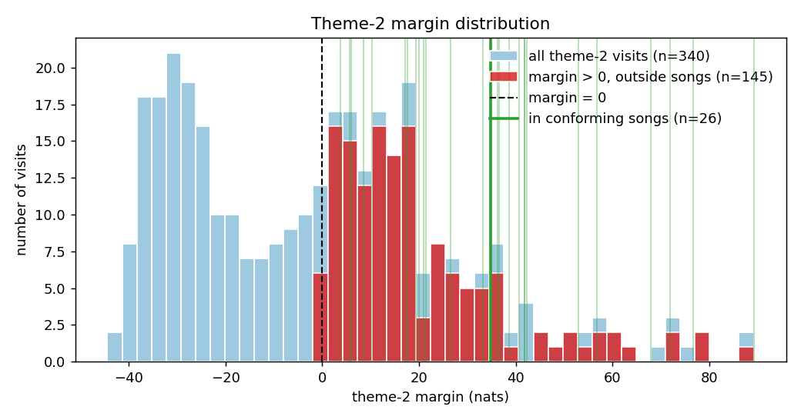
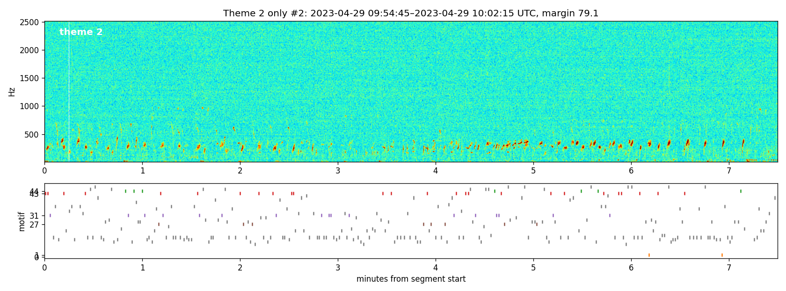
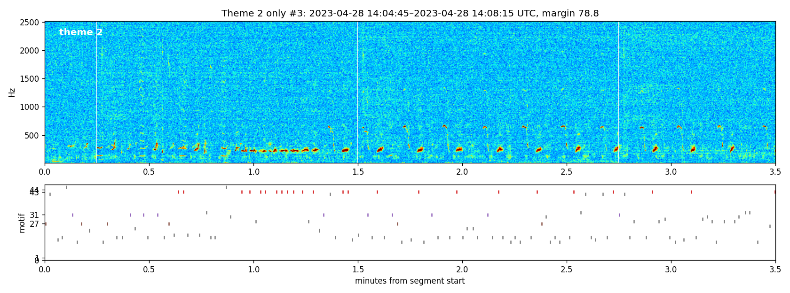
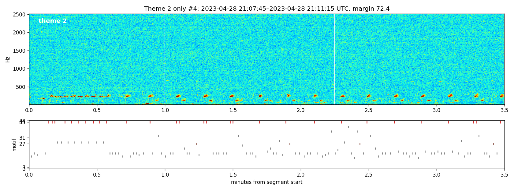
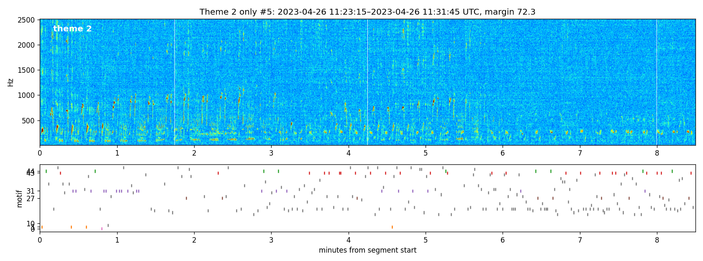
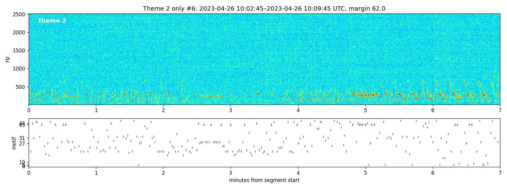
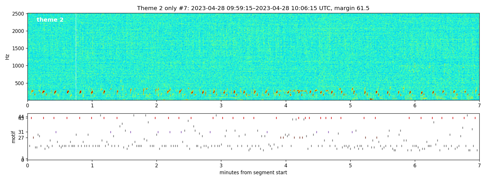
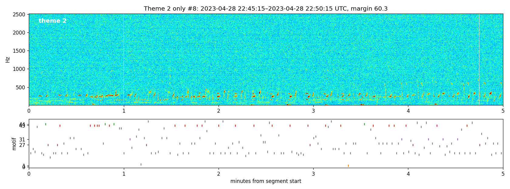
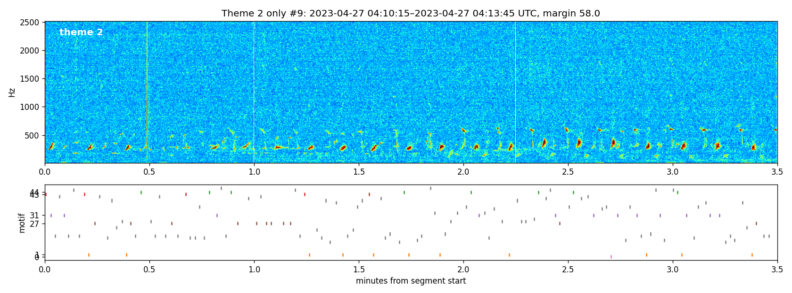
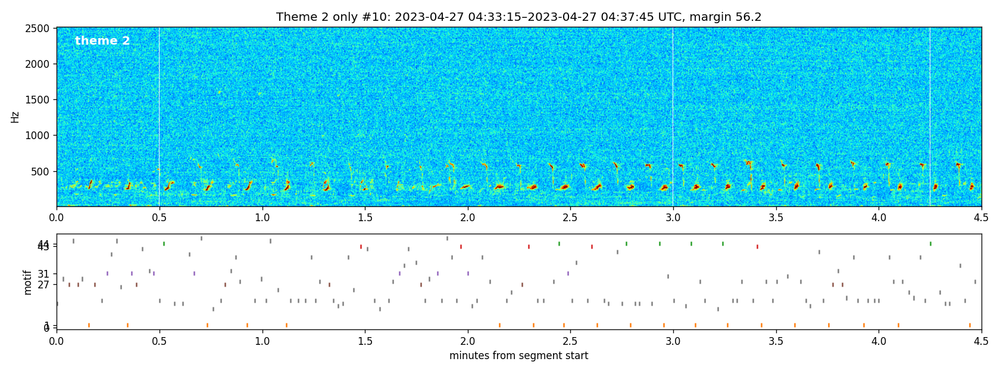

# Theme-2 segments outside detected songs

A weaker filter that uses **theme 2 alone**. Theme 2 is the most distinctive non-background theme in the song model (top motifs **43**, **1**, **44**).

## Filter

1. Decode each recording with the fixed four-theme cyclic model (same as `songs.py`).
2. Keep every visit labeled theme 2 whose motif counts score higher under theme 2 than under any of the other three (`theme2_margin > 0`).
3. Drop visits that overlap a conforming song (`min_margin > 0` and no shuffle as strong as the real order).

This ignores the margins of themes 0, 1, and 3 and skips the shuffle test. On the six recordings of 25–30 April 2023 there are **340** theme-2 visits, **171** with positive margin, and **145** of those outside conforming songs (the song detector kept **26** full songs).

## Margin distribution

`theme2_margin` is the log-likelihood gap between theme 2 and the best of the other three themes on that visit's motif counts. The histogram is every decoded theme-2 visit on the six recordings; the red overlay is the filter's candidates (positive margin and outside conforming songs). Green lines mark the theme-2 visits that sit inside the 26 conforming songs.

## Ten strongest outside songs

Ranked by `theme2_margin`. Times are UTC. Counts are placements of the leading theme-2 motifs inside the visit.

| | Start | End | File | Seconds | Minutes | Theme-2 margin | Motifs 43 / 1 / 44 | Placements |
|---|---|---|---|---:|---:|---:|---|---:|
| 1 | 26 Apr 09:23:45 | 26 Apr 09:39:15 | `SOCAL_H_76_230426_054845_df20` | 12900–13830 | 15.5 | 87.1 | 30 / 11 / 19 | 480 |
| 2 | 29 Apr 09:54:45 | 29 Apr 10:02:15 | `SOCAL_H_76_230428_232615_df20` | 37710–38160 | 7.5 | 79.1 | 26 / 2 / 7 | 261 |
| 3 | 28 Apr 14:04:45 | 28 Apr 14:08:15 | `SOCAL_H_76_230428_013345_df20` | 45060–45270 | 3.5 | 78.8 | 24 / 0 / 0 | 116 |
| 4 | 28 Apr 21:07:45 | 28 Apr 21:11:15 | `SOCAL_H_76_230428_013345_df20` | 70440–70650 | 3.5 | 72.4 | 29 / 0 / 0 | 130 |
| 5 | 26 Apr 11:23:15 | 26 Apr 11:31:45 | `SOCAL_H_76_230426_054845_df20` | 20070–20580 | 8.5 | 72.3 | 25 / 4 / 9 | 236 |
| 6 | 26 Apr 10:02:45 | 26 Apr 10:09:45 | `SOCAL_H_76_230426_054845_df20` | 15240–15660 | 7 | 62.0 | 23 / 9 / 9 | 239 |
| 7 | 28 Apr 09:59:15 | 28 Apr 10:06:15 | `SOCAL_H_76_230428_013345_df20` | 30330–30750 | 7 | 61.5 | 34 / 0 / 0 | 260 |
| 8 | 28 Apr 22:45:15 | 28 Apr 22:50:15 | `SOCAL_H_76_230428_013345_df20` | 76290–76590 | 5 | 60.3 | 24 / 1 / 4 | 168 |
| 9 | 27 Apr 04:10:15 | 27 Apr 04:13:45 | `SOCAL_H_76_230427_034115_df20` | 1740–1950 | 3.5 | 58.0 | 5 / 11 / 8 | 127 |
| 10 | 27 Apr 04:33:15 | 27 Apr 04:37:45 | `SOCAL_H_76_230427_034115_df20` | 3120–3390 | 4.5 | 56.2 | 5 / 19 / 7 | 157 |

## Pictures

Whitened spectrogram to 2.5 kHz and motif raster. Motifs **43**, **1**, **44**, **31**, **27**, **0**, and **10** are coloured; the rest are grey.

### 1. 26 Apr 2023, 09:23:45–09:39:15 (margin 87.1)

File `SOCAL_H_76_230426_054845_df20`, 15.5 minutes, motif counts 43/1/44 = 30/11/19.

### 2. 29 Apr 2023, 09:54:45–10:02:15 (margin 79.1)

File `SOCAL_H_76_230428_232615_df20`, 7.5 minutes, motif counts 43/1/44 = 26/2/7.

### 3. 28 Apr 2023, 14:04:45–14:08:15 (margin 78.8)

File `SOCAL_H_76_230428_013345_df20`, 3.5 minutes, motif counts 43/1/44 = 24/0/0.

### 4. 28 Apr 2023, 21:07:45–21:11:15 (margin 72.4)

File `SOCAL_H_76_230428_013345_df20`, 3.5 minutes, motif counts 43/1/44 = 29/0/0.

### 5. 26 Apr 2023, 11:23:15–11:31:45 (margin 72.3)

File `SOCAL_H_76_230426_054845_df20`, 8.5 minutes, motif counts 43/1/44 = 25/4/9.

### 6. 26 Apr 2023, 10:02:45–10:09:45 (margin 62.0)

File `SOCAL_H_76_230426_054845_df20`, 7 minutes, motif counts 43/1/44 = 23/9/9.

### 7. 28 Apr 2023, 09:59:15–10:06:15 (margin 61.5)

File `SOCAL_H_76_230428_013345_df20`, 7 minutes, motif counts 43/1/44 = 34/0/0.

### 8. 28 Apr 2023, 22:45:15–22:50:15 (margin 60.3)

File `SOCAL_H_76_230428_013345_df20`, 5 minutes, motif counts 43/1/44 = 24/1/4.

### 9. 27 Apr 2023, 04:10:15–04:13:45 (margin 58.0)

File `SOCAL_H_76_230427_034115_df20`, 3.5 minutes, motif counts 43/1/44 = 5/11/8.

### 10. 27 Apr 2023, 04:33:15–04:37:45 (margin 56.2)

File `SOCAL_H_76_230427_034115_df20`, 4.5 minutes, motif counts 43/1/44 = 5/19/7.

## Files

- `theme2_filter.py`: runs the filter.
- `results/theme2_outside_songs.csv`: all theme-2 visits with positive margin outside conforming songs.
- `results/theme2_all_visits.csv`: every decoded theme-2 visit.
- `results/theme2_ten.csv`: the ten segments pictured here.
- `figure_theme2.py`: draws one visit.
