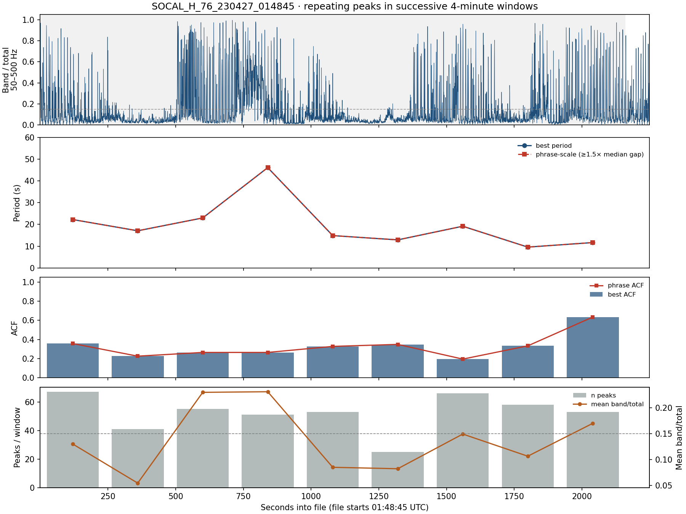

# Repeating peaks in 4-minute windows

Recording: `SOCAL_H_76_230427_014845` (0–2250 s into file).
Non-overlapping **240 s** windows: **9**.

Windows with ACF≥0.2 and ≥8 peaks: **8**.

- 0–240 s: best **22.2 s** (ACF 0.36, 67 peaks, phrase 22.2 s)
- 240–480 s: best **17.1 s** (ACF 0.23, 41 peaks, phrase 17.1 s)
- 480–720 s: best **23.0 s** (ACF 0.27, 55 peaks, phrase 23.0 s)
- 720–960 s: best **46.1 s** (ACF 0.27, 51 peaks, phrase 46.1 s)
- 960–1200 s: best **14.9 s** (ACF 0.33, 53 peaks, phrase 14.9 s)
- 1200–1440 s: best **12.9 s** (ACF 0.35, 25 peaks, phrase 12.9 s)
- 1680–1920 s: best **9.6 s** (ACF 0.33, 58 peaks, phrase 9.6 s)
- 1920–2160 s: best **11.7 s** (ACF 0.63, 53 peaks, phrase 11.7 s)

