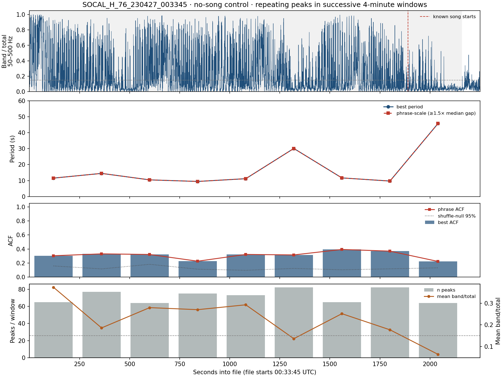

# Repeating peaks — no-song control

Recording: `SOCAL_H_76_230427_003345` (starts 00:33:45 UTC; ~0–2250 s).
Chosen because this 37.5-minute block is documented as receiving almost no motif placements
(`detected_songs.md`). A known song begins at **1890 s** (01:05:15 UTC);
windows ending before that are the clean control.

Non-overlapping **240 s** windows: **9** (7 fully pre-song).
Pre-song windows with shuffle-null max-ACF p<0.05: **7/7**.

## Pre-song windows

- 0–240 s: best **11.6 s** (ACF 0.30, null95 0.16, p=0.000, 65 peaks, mean ratio 0.373)
- 240–480 s: best **14.5 s** (ACF 0.33, null95 0.12, p=0.000, 77 peaks, mean ratio 0.186)
- 480–720 s: best **10.4 s** (ACF 0.32, null95 0.18, p=0.000, 64 peaks, mean ratio 0.280)
- 720–960 s: best **9.5 s** (ACF 0.23, null95 0.11, p=0.000, 75 peaks, mean ratio 0.270)
- 960–1200 s: best **11.2 s** (ACF 0.32, null95 0.10, p=0.000, 73 peaks, mean ratio 0.293)
- 1200–1440 s: best **30.1 s** (ACF 0.32, null95 0.12, p=0.000, 82 peaks, mean ratio 0.137)
- 1440–1680 s: best **11.7 s** (ACF 0.39, null95 0.10, p=0.000, 65 peaks, mean ratio 0.252)

