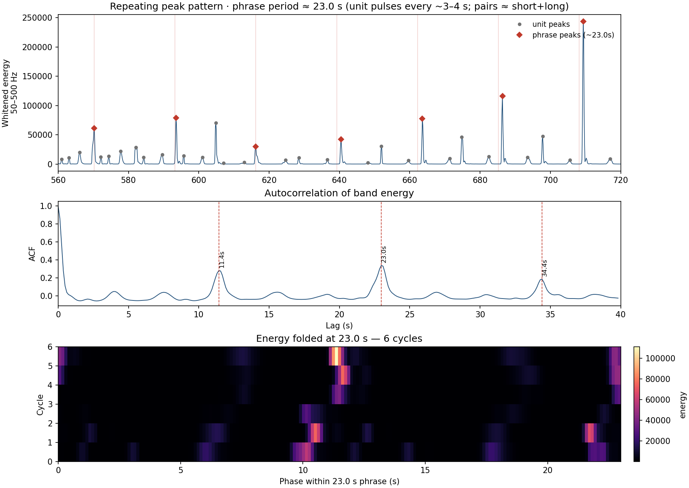

# Repeating peaks in 50–500 Hz energy

Song file `SOCAL_H_76_230427_014845`, analyzed **560–720 s** into the file (strong pulsed stretch).

## Pattern

Two nested timescales:

1. **Unit pulses** — peaks every **~2–4 s** (median gap **3.93 s**, n=34).
2. **Phrase period ≈ 23.0 s** — strongest autocorrelation lag (also ≈2×11.4≈23 s, ≈3×≈34 s).

In the later part of this stretch, gaps often alternate **short (~3.8 s) + long (~7.6 s)**, which sum to the **~23.0 s** phrase.

Phrase-spaced peaks (min separation 0.7×P): median gap **23.04 s**.

Alternating short+long pairs found: **9**, mean pair period **11.56 ± 0.31 s**.

