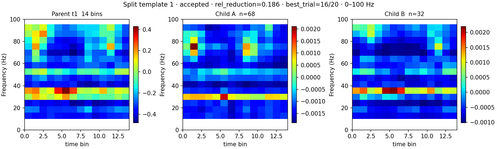

# Split experiment rerun (PCA components 2–5)

## Setup

| | |
|---|---|
| Dictionary | `analysis/dict_learning/reports/randomized_m10_r3_nmin5_eps001` |
| GPL | `/Users/yoavfreund/projects/whale_processing/LeiData/GPL_Python_outputs` |
| Parent atom | template **1** (14 time bins, 100 catalog patches, 100 extractable matchings) |
| Source segment | `spwhiten_SOCAL_H_76_230427_003345.x_w000009_s120000001_e135000000::det871::548` |
| Perturbation | ±ε with ‖ε‖ = 0.1 × ‖base‖, direction uniform on PCA components **2–5** (4 usable) |
| Trials / refine | K=20, S=3, min_size=2, min_relative_reduction=0.1, seed=0 |

Windows touched (9):

- `spwhiten_SOCAL_H_76_230427_003345.x_w000001_s000000001_e015000000`: 2 placements
- `spwhiten_SOCAL_H_76_230427_003345.x_w000002_s015000001_e030000000`: 5 placements
- `spwhiten_SOCAL_H_76_230427_003345.x_w000003_s030000001_e045000000`: 2 placements
- `spwhiten_SOCAL_H_76_230427_003345.x_w000005_s060000001_e075000000`: 12 placements
- `spwhiten_SOCAL_H_76_230427_003345.x_w000006_s075000001_e090000000`: 36 placements
- `spwhiten_SOCAL_H_76_230427_003345.x_w000007_s090000001_e105000000`: 20 placements
- `spwhiten_SOCAL_H_76_230427_003345.x_w000008_s105000001_e120000000`: 16 placements
- `spwhiten_SOCAL_H_76_230427_003345.x_w000009_s120000001_e135000000`: 4 placements
- `spwhiten_SOCAL_H_76_230427_003345.x_w000010_s135000001_e150000000`: 3 placements

Amplitude range: -0.438 … 4.02 (median 0.28)

## Result

| | |
|---|---|
| Accepted | **True** |
| Best trial | 16 / 20 |
| Split sizes | A=68, B=32 |
| Relative reduction | **0.1857** = (sse_one − sse_two) / sse_one |
| SSE one / two | 2.435e+07 / 1.983e+07 |
| RMS one / two | 3.259 / 2.941 |

Parent and children at **0–100 Hz**, `cmap=jet`, each panel scaled to its own min–max:

Artifacts: `details.json`, `template_parent.npy`, `template_a.npy`, `template_b.npy`, `labels.npy`.
