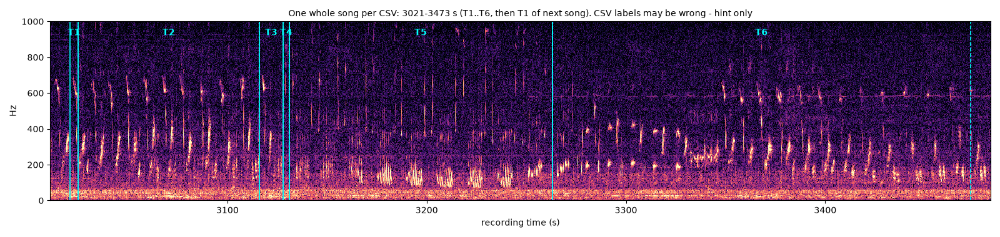
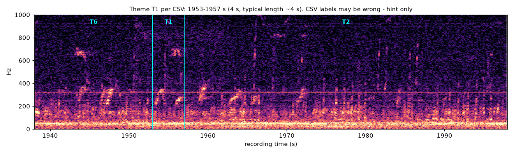
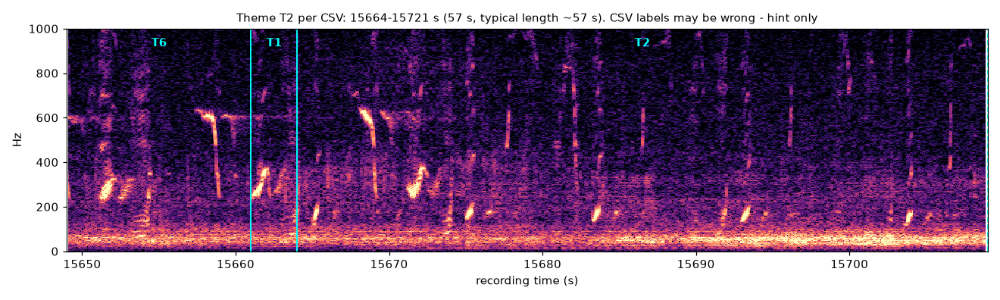
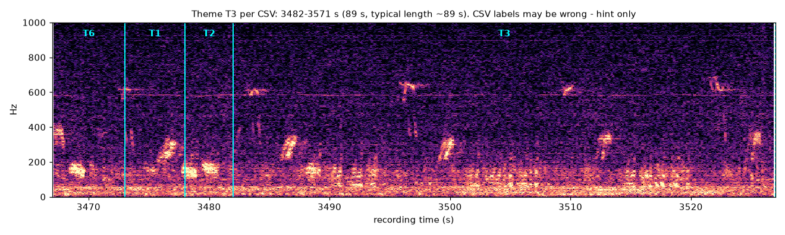
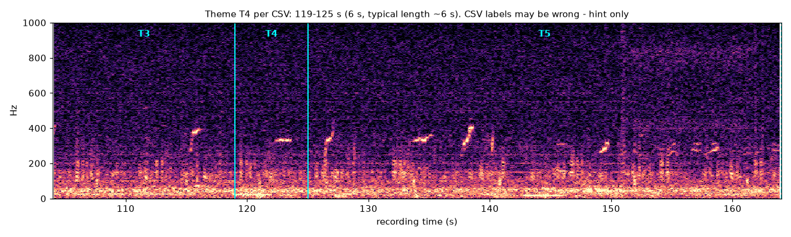
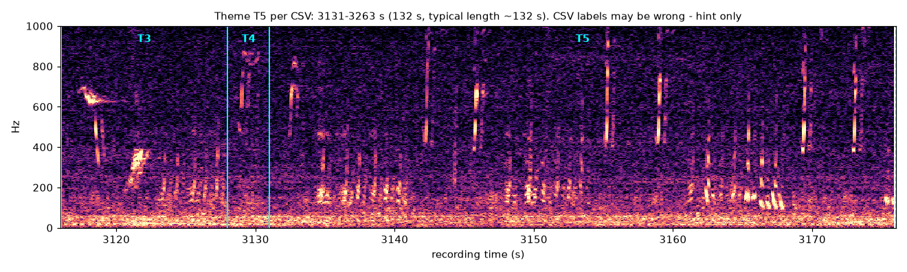
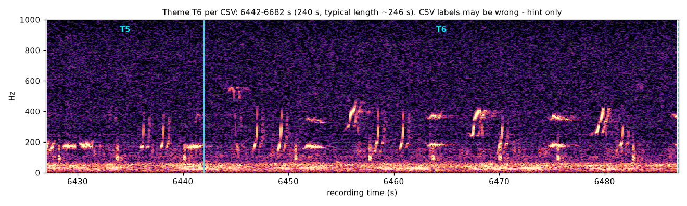

# Hand-labelling the Experiment 3 reference clips

The theme/song CSV that Experiments 1 and 2 were scored against looks machine-made
and may be wrong. Experiment 3 is scored against **your** labels instead: two
30-minute clips from the test half of `SOCAL_H_76_230426_193500` (2 kHz).

| clip | file | recording time |
|------|------|----------------|
| clip1 | `clip1.wav` | 25,200 – 27,000 s |
| clip2 | `clip2.wav` | 30,600 – 32,400 s |

Label times are in seconds **from the start of the clip** (that is what Audacity
shows); the parser adds the clip offset from `clips.json`.

## 0. Get the clips

If you have the repository and the 10 h recording:

```bash
python -m analysis.song_exp3.reference.export_clips
```

This writes `clip1.wav`, `clip2.wav` and `clips.json` into
`analysis/song_exp3/work/reference/` (not in git). Otherwise ask for the two wav files.

## 1. Install Audacity and open a clip

1. Install Audacity (free, <https://www.audacityteam.org/download/>), version 3.x.
2. File > Open > `clip1.wav`.

## 2. Spectrogram view

1. Click the track name drop-down (the arrow by `clip1` at the top-left of the track) > **Spectrogram**.
2. Same menu > **Spectrogram Settings…**:
   - Scale: Linear, **Min frequency 0 Hz, Max frequency 1000 Hz**
   - Algorithm: Frequencies, **Window size 512**, Window type Hann
   - Colours: raise *Gain* / lower *Range* if the calls look faint
3. Make the track tall (drag its bottom edge) and zoom to roughly 30–60 s per screen
   (Ctrl+1 / Ctrl+3, or View > Zoom). Playing at 1–2x speed helps; the calls are audible.

## 3. Label track

Tracks > Add New > **Label Track**. Then:

- **Theme span**: drag-select the stretch in the audio track, press **Ctrl+B**, type the label, Enter.
- **Point label**: click once at the time (no selection), Ctrl+B, type, Enter.
- Drag a label's edges to adjust it; click its text to rename it.

Labels to use (exactly these, upper case):

| label | type | meaning |
|-------|------|---------|
| `T1` … `T6` | span | one theme, from its first unit to its last unit |
| `S` | point | a song start (the first unit of a T1 that follows a T6, or the first T1 after a long break) |
| `BG` | span | any non-song gap longer than 10 s (silence, ship noise, other calls) |

Put one span per theme occurrence; neighbouring themes should touch or nearly touch.
Short pauses inside a theme (between phrases) stay inside that theme's span. Leave
stretches you cannot decide on unlabelled – they are scored as "unlabelled", not as
mistakes. Overlapping spans: the later one wins, so please avoid them.

## 4. Export

File > Export > **Export Labels…**, save as

- `clip1_labels.txt` for clip1, `clip2_labels.txt` for clip2

into `analysis/song_exp3/reference/labels/` (or send them back). Also File > Save
Project if you want to resume later. The export is plain text,
`start<TAB>end<TAB>label`, which `analysis/song_exp3/reference/labels.py` reads:

```bash
python -c "from analysis.song_exp3.reference.labels import load_all; print(load_all())"
```

## How humpback song is structured (Payne & McVay 1971)

- A **unit** is a single sound (~0.5–3 s). A **phrase** is a short fixed pattern of
  units (~5–15 s). A **theme** is a run of repeats of the same phrase. A **song** is the
  sequence of themes; a **session** is songs sung back to back.
- In this recording the themes come in a **fixed order T1 → T2 → T3 → T4 → T5 → T6**,
  then the next song starts again at T1. So the **song boundary is the T6 → T1
  transition**: put an `S` at the first unit of each T1.
- A theme may be skipped in some songs, but the order does not change.
- A theme can be **a single short phrase**: per the CSV, T1 and T4 here are usually
  only ~4–6 s, while T2/T3 run ~1–3 min and T5/T6 ~2–7 min.
- The singer keeps going across short pauses: a pause **≤ 60 s** is still the same
  session (label it `BG` only if it is > 10 s); after a longer pause the next T1 gets an `S`.

## Example spectrograms (hints only)

These show where the **CSV** puts each theme in the *train* half (0–18,000 s), with
the same settings as above (window 512, 0–1000 Hz). Solid cyan line = CSV start,
dashed = CSV end. **The CSV may be wrong** – that is why we need your labels – so
use these only to get your eye in, not as the truth. Trust what you see and hear.

Whole song (CSV 3,021–3,473 s):



| theme | image |
|-------|-------|
| T1 (~4 s) |  |
| T2 |  |
| T3 |  |
| T4 (~6 s) |  |
| T5 |  |
| T6 |  |

Each image is 60 s: 15 s before the CSV theme start to 45 s after it. Regenerate with
`python -m analysis.song_exp3.reference.make_examples`.
