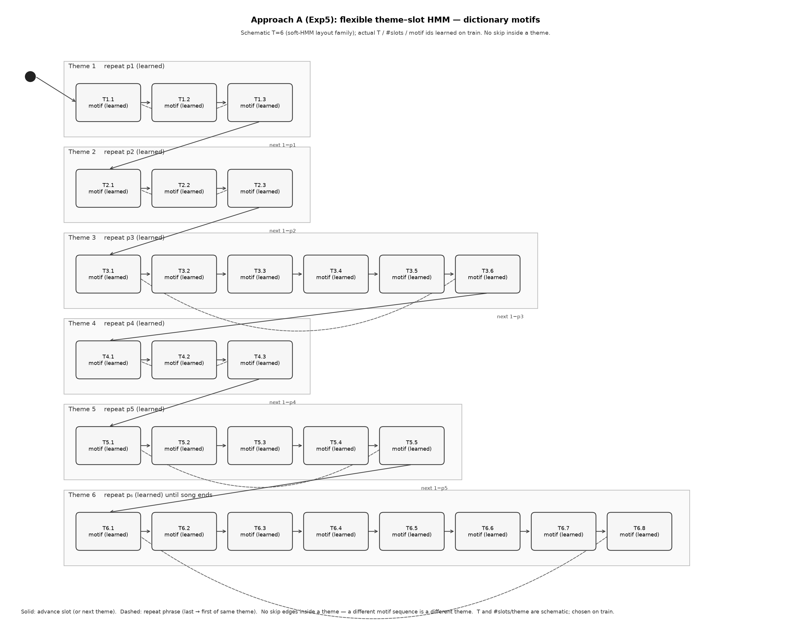

# Exp5: inputs, model, parameters, expected results

Companion to [plan.md](plan.md), [pipeline.md](pipeline.md), [metrics.md](metrics.md).  
Architecture figures: [figures/architecture/](figures/architecture/).

This document answers: **what goes into the model**, **what each input means and how we get it**, **what the model is and which parameters it has**, and **what we expect out**.

---

## 1. What we are trying to recover

Humpback song is organised as **themes**: each theme is a phrase (ordered sequence of motifs / sound units) that is **repeated** many times, then the song moves to the **next** theme.

Exp5 does **not** assume a known catalog of themes. It learns a **theme–slot HMM** on train (hours 0–7 of `193500`) and predicts, on test (hours 7–10):

1. a **theme path** over time,
2. **theme boundaries** (times where the path leaves one theme for the next),
3. for each boundary, the **theme before** and the **theme after**.

Two approaches share the same topology and differ only in the **observation** fed to each slot.

| | Approach A | Approach B |
|---|---|---|
| Observation | Motif-id (+ gap) tokens | Continuous STFT / spectrogram features |
| Emission | Categorical (discrete) | Diagonal Gaussian |
| Topology | Theme–slot, repeat / next | Same |

---

## 2. Shared raw inputs

These are the files on disk before either approach.

### 2.1 Wav

| Field | Value |
|---|---|
| Path | `/home/yfreund/whale_processing/LeiData/SOCAL_H_76_230426_193500_df100.x.x.wav` |
| Sample rate | 2 kHz |
| Duration | 10.0 h (36 000 s) |
| Meaning | Downsampled pressure time series for this deployment segment |
| How obtained | Existing LeiData product (not rebuilt in Exp5) |

**Train / test split (by time):**

| Split | Hours | Absolute time | GPL window indices |
|---|---|---|---|
| Train | 0–7 | 0–25 200 s | `[0, 336)` |
| Test | 7–10 | 25 200–36 000 s | `[336, 480)` |

`WINDOWS_PER_HOUR = 48` (75 s per window). Absolute time for window `i` ≈ `i × 75` s.

**Rule:** nothing from test is used to fit dictionary atoms, PCA, standardisation, or HMM parameters.

### 2.2 GPL spectrograms

| Field | Value |
|---|---|
| Path | `/home/yfreund/whale_processing/result/LeiData/SOCAL_H_76_230426_193500_df100.x.x.gpl/output/` |
| Contents | `spectrogram_npy/` + `CSV_*.csv` (window sidecars) |
| Shape | **127 × 779** per 75 s window (FFT 256 / overlap 192 on 2 kHz) |
| Meaning | Whitened time–frequency tiles used for dictionary learning / MP and as an optional feature source for B |
| How obtained | Existing GPL run on ensemble; Exp5 only reads it |

### 2.3 Optional hand marks (evaluation only)

| Field | Meaning |
|---|---|
| Marks | Times on the test spectrogram where a human hears a theme change |
| How obtained | Manual annotation (preferred for final F1); until then scores vs novelty peaks are **provisional** |

---

## 3. Approach A inputs (motif sequence)

Pipeline: GPL → dictionary (train) → matching pursuit → events → token sequence → HMM.

### 3.1 Dictionary atoms

| | |
|---|---|
| **What** | A set of small spectrogram patches (atoms) that recur as call fragments |
| **Meaning** | Discrete “alphabet” of sound pieces; later each placement is a **motif id** |
| **How obtained** | `randomized-build` on **train windows only** (`--window-offset 0 --n-windows 336`) |
| **Stored** | `exp5/work/dict/` |

### 3.2 Matching-pursuit placements

| | |
|---|---|
| **What** | For each GPL window: which atoms fire, where (time/freq), and strength |
| **Meaning** | Instantiations of dictionary motifs on the recording |
| **How obtained** | Matching pursuit with the **train** dictionary on train **and** test windows |
| **Stored** | `exp5/work/mp/` (`matchings.json` slices) |

### 3.3 Motif / gap token sequence

| | |
|---|---|
| **What** | Ordered list of tokens with absolute times: motif ids + `GAP_S` / `GAP_L` / `BREAK` |
| **Meaning** | Discrete song sequence the categorical HMM sees. Motifs = sound units; gaps = silence / spacing; `BREAK` ends a session |
| **How obtained** | From placements: absolute `t0`/`t1` via window sidecar + column index; drop weak/overlaps; sort; insert gaps as in Exp4 rules; split sessions at `BREAK` |
| **Stored** | `exp5/work/sequences/` |

**HMM observation (A):** at each step, one discrete token (motif id or gap type) from the **train vocabulary**. Test tokens outside that vocab are mapped (e.g. to an `UNK` / ignored) — document the rule when implemented.

### 3.4 Motif-sequence gate (before trusting the HMM)

On **train**, check that phrases actually repeat (median edit distance `d1`, coverage, by-eye ticks). If the gate fails, fix dictionary / MP / cleanup — not the HMM. See [metrics.md](metrics.md) §1.

---

## 4. Approach B inputs (continuous features)

Pipeline: wav STFT and/or GPL spectrogram → per-frame features → (optional PCA) → HMM.

### 4.1 Spectrogram / STFT

| | |
|---|---|
| **What** | Time–frequency representation of the wav |
| **STFT** | Short-Time Fourier Transform: window the waveform, FFT each window, stack over time → spectrogram |
| **How obtained** | Either stitch GPL whitened windows, **or** STFT on the 2 kHz wav (document FFT size, hop, band e.g. 10–1000 Hz) |

### 4.2 Feature vectors `x_t`

| | |
|---|---|
| **What** | One real vector per time frame / short hop (e.g. 0.5–2 s) |
| **Typical contents** | Log energy in frequency bands; spectral centroid / bandwidth; optional Δ features; optional PCA scores on stacked patches |
| **Meaning** | Continuous summary of “what the sound looks like” at time `t`, without forcing a discrete motif alphabet |
| **How obtained** | Fit mean/std (and PCA if used) on **train only**; freeze and apply to test |
| **Stored** | `exp5/work/features/` |

**HMM observation (B):** sequence `x_1, x_2, …` of feature vectors.

---

## 5. The model (shared topology)

### 5.1 Idea

Same visual family as the fixed soft-HMM (`song_soft_hmm_t6`), but **flexible**:



- A **theme** is a left-to-right chain of **slots** (phrase positions).
- Inside a theme: only advance `slot j → j+1` (**no skip**). A different motif order or length is a **different theme**.
- At the **last** slot of a theme: either **repeat** (back to first slot of the same theme) or **next** (first slot of the following theme).
- Last theme may stay in repeat until the song ends (or optionally cycle — document choice at train time).

Fixed soft-HMM reference (known units / durations / fitted probs — **not** Exp5):  
[figures/architecture/song_soft_hmm_t6_reference.png](figures/architecture/song_soft_hmm_t6_reference.png)

### 5.2 Hidden state

Each hidden state is a **(theme, slot)** pair, e.g. `T3.2` = theme 3, slot 2.

| Transition | Allowed? | Meaning |
|---|---|---|
| `T.k.j → T.k.(j+1)` | Yes | Advance one position in the phrase |
| Last slot → first slot of same theme | Yes (**repeat**) | Phrase repeats |
| Last slot → first slot of next theme | Yes (**next**) | Theme boundary |
| Skip `j → j+2` inside a theme | **No** | Would imply a different theme |
| Arbitrary jump between themes | **No** | Themes are ordered in the Exp5 schematic (as in soft-HMM); only last→next |

### 5.3 Emissions

| Approach | Emission at slot `s` |
|---|---|
| **A** | Categorical: `P(token = v \| s)` over vocabulary `v` |
| **B** | Diagonal Gaussian: `x ∼ N(μ_s, Σ_s)` |

Optional duration: soft-HMM used chained duration states per slot; Exp5 may start with one state per slot and revisit duration if needed — record the choice in `work/models/`.

### 5.4 Decoding and boundaries

1. Fit parameters on **train** observations (Baum–Welch / EM, or constrained MLE with topology mask).
2. On **test**, run **Viterbi** → most likely slot path.
3. Map slot path → **theme path** (theme id of each slot).
4. A **boundary** is a time where the path takes a **next** edge (theme id changes).

---

## 6. Parameters

### 6.1 Structural hyperparameters (chosen on train, not fixed a priori)

| Symbol | Meaning | How chosen |
|---|---|---|
| `T` | Number of themes | Grid / search on train (e.g. BIC or held-out likelihood); soft-HMM used 6 as a reference shape only |
| `L_k` | Number of slots in theme `k` | Same search; unequal lengths allowed |
| Vocabulary size (A) | Motif (+ gap) alphabet | Fixed by train dictionary + gap rules |
| Feature dim `d` (B) | Length of `x_t` | Set by band count / PCA dim on a train slice, then frozen |

### 6.2 Learned parameters (fit on train)

| Parameter | Approach | Meaning |
|---|---|---|
| Advance probs along slots | A, B | Usually near 1 (deterministic advance when slot ends); may absorb duration |
| `p_k` = P(repeat \| last slot of theme `k`) | A, B | How often theme `k` repeats its phrase |
| `1 − p_k` = P(next \| last slot) | A, B | Probability of leaving theme `k` for theme `k+1` |
| Emission probs `P(v \| slot)` | A | Which motifs (and gaps) each slot prefers |
| Means `μ_slot`, variances `Σ_slot` | B | Typical feature vector for each slot |
| Start distribution | A, B | Usually mass on Theme 1, slot 1 |

### 6.3 Front-end parameters (not HMM, but affect inputs)

| Approach | Examples |
|---|---|
| A | Dictionary size / build seed; MP threshold; overlap cleanup; gap length cutoffs for `GAP_S` / `GAP_L` / `BREAK` |
| B | STFT FFT / hop; frequency band edges; hop for `x_t`; PCA dimension; train mean/std |

All front-end fits use **train only**.

### 6.4 Evaluation parameters

| Parameter | Default / note |
|---|---|
| JS half-window `W` | ≈ 60 s |
| Boundary match tolerances | ±5 / ±10 / ±30 s vs hand marks |
| Main F1 | @ 10 s when marks exist |

---

## 7. Expected results from the model

### 7.1 Primary outputs (both approaches)

Written under `exp5/work/results/{A,B}/` and shown in notebooks:

| Output | Meaning |
|---|---|
| Theme path | For each time (token or frame): decoded `theme_id` (and slot id) |
| Theme segments | Contiguous runs: `(theme_id, t0, t1)` |
| Boundaries | List of times `t` where theme changes via **next** |
| Per-boundary pair | At each `t`: theme before `[t_prev, t)` and theme after `[t, t_next)` |

### 7.2 What “good” looks like

| Check | Expectation |
|---|---|
| Phrase repeat | Inside a theme, the same slot sequence (motifs in A / similar features in B) recurs many times before **next** |
| Boundaries | Align with audible / marked theme changes; JS(left, right) higher at predicted boundaries than at random times |
| Notebooks | Every boundary listed; **both** adjacent themes drawn on the spectrogram |
| Scores (when marks exist) | Report recall / precision / F1 @ 10 s and false alarms / h on the **test 3 h** |

### 7.3 Metrics (summary)

Full definitions in [metrics.md](metrics.md).

1. **JS at predicted boundaries** vs random times (and vs JS-novelty baseline).
2. **F1 / recall / precision** vs hand marks (when available).
3. Approach A only: **motif-sequence gate** on train before trusting HMM results.

### 7.4 What we do *not* expect

- Theme ids that match a fixed catalog name (`Theme 3` in soft-HMM CSV ≠ Exp5’s learned theme 3).
- Skip edges inside a theme.
- Perfect boundaries without a repeating front end (if Approach A’s motif gate fails, boundary quality will be poor).

---

## 8. Side-by-side: soft-HMM reference vs Exp5

| | Fixed soft-HMM (reference) | Exp5 theme–slot HMM |
|---|---|---|
| Themes / slots | Known (e.g. 6 themes, fixed lengths) | Unknown a priori; chosen on train |
| Slot labels | Known units `U*` + durations | Learned emissions (motif ids or `N(μ,Σ)`) |
| `repeat` / `next` | Fitted but structure fixed | Learned; structure size also free |
| Skip inside theme | No | No (same rule) |
| Role in Exp5 | Shape reference only | Actual model family for A and B |

---

## 9. Where things live

```
exp5/
  plan.md              # goals, stages
  pipeline.md          # how to run stages
  metrics.md           # scores
  model_inputs.md      # this file
  figures/architecture/
  work/                # git-ignored outputs
    dict/ mp/ sequences/ features/
    models/A/ models/B/
    results/A/ results/B/
```
