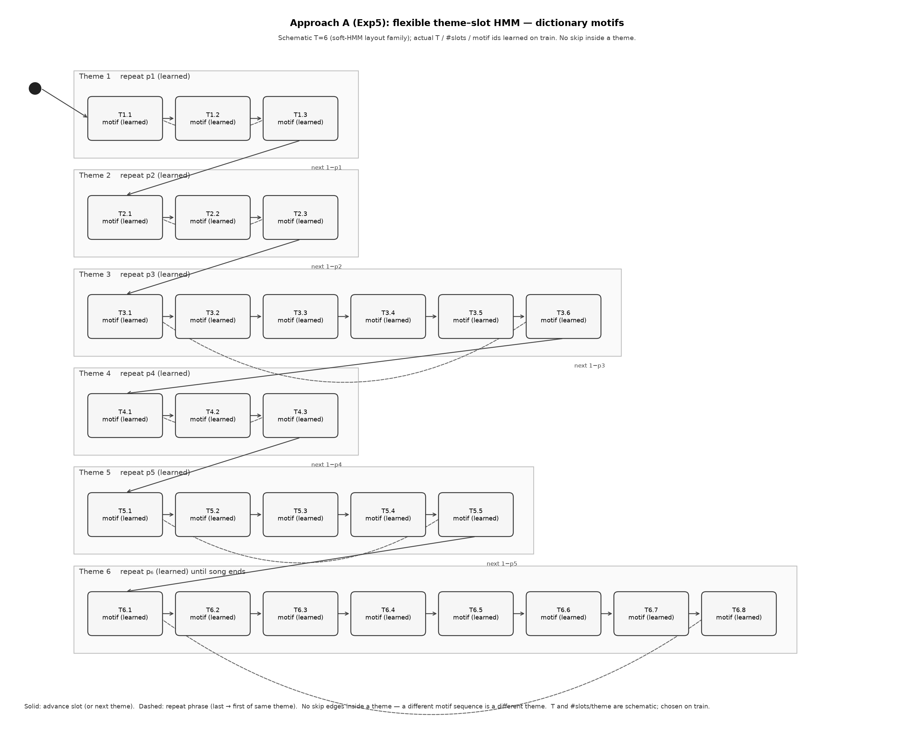
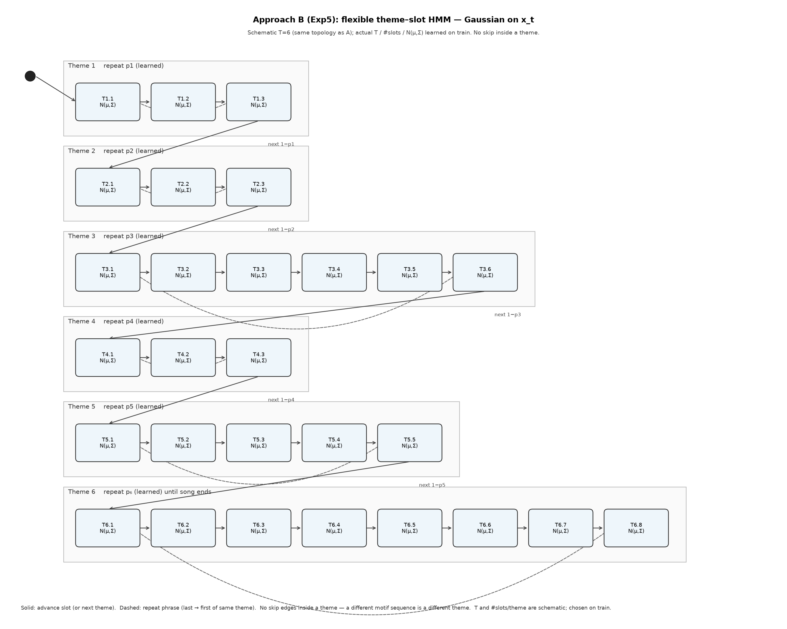

# Experiment 5: theme boundaries — two flexible approaches

Companion documents in this folder:
- [model_inputs.md](model_inputs.md) — inputs, parameters, model explanation, expected results
- [pipeline.md](pipeline.md)
- [metrics.md](metrics.md)
- [figures/architecture/](figures/architecture/) — HMM architecture (`.dot` + `.png`)

**This is a new experiment.** Exp4 (`014845`, fixed topologies) stays unchanged under `../exp4/`.

## 1. Context

Experiments 1–3 mixed “what the sounds are” and “how they are ordered” in one HMM on hand-made spectrogram features. Exp4 tried motifs first, then HMMs with **assumed** topologies (A→B pair, fixed theme cycle) on a short file; those models failed mainly because the motif alphabet did not repeat cleanly and the architectures were too rigid.

**Experiment 5 assumptions:**
- We do **not** know phrase structure, theme count `T`, or slots-per-theme a priori (unlike the fixed soft-HMM on 193500).
- No CSV reference. Evaluation is theme **boundaries** (and the two themes on either side), not fixed theme names from a catalog.
- Topology family is **theme–slot with repeat / next** (same visual family as soft-HMM), but `T`, slot lengths, emissions, and branch probs are **learned on train**.
- **No skip edges inside a theme.** Slot order is strict (`j → j+1`). A different motif sequence / length is a **different theme**, not a skip.

## 2. Goal

On **`SOCAL_H_76_230426_193500`**, detect theme boundaries on held-out audio and show, for each boundary, **both themes** (the segment before and the segment after).

Compare two approaches that share the same split, metrics, and notebook contract:

| | **Approach A: dictionary motifs** | **Approach B: raw signal / Fourier** |
|---|---|---|
| Input | Motif-id (+ gap) token sequence | Continuous spectrogram / STFT features |
| Front end | GPL → dictionary (train) → matching pursuit → sequence | STFT or GPL spectrogram → frame/window features (train stats frozen) |
| Model | **Theme–slot** categorical HMM (motif emissions); T & slot lengths on train | **Theme–slot** Gaussian HMM (feature emissions); same topology |
| Boundary | Leaving a theme for the next (Viterbi) | Same |

## 3. Data

| Item | Value |
|---|---|
| Wav | `/home/yfreund/whale_processing/LeiData/SOCAL_H_76_230426_193500_df100.x.x.wav` |
| Rate / length | 2 kHz, 10.0 h |
| GPL (existing) | `/home/yfreund/whale_processing/result/LeiData/SOCAL_H_76_230426_193500_df100.x.x.gpl/output` — 480 windows × 75 s |
| **Train** | Hours 0–7 → 0–25,200 s (windows 0–335) |
| **Test** | Hours 7–10 → 25,200–36,000 s (windows 336–479) |

014845 is **out of scope** for Exp5.

Results live under `exp5/work/` (git-ignored).

## 4. Reference

- Prefer **hand marks** on the test spectrogram: each mark is a time where one theme ends and the next starts.
- Until hand marks exist, quantitative scores vs automatic novelty peaks are **provisional** and must be labelled as such in reports/notebooks.

## 5. Approach A — dictionary motif sequence

See [pipeline.md](pipeline.md) §A.

1. Use existing GPL windows (2 kHz, 127×779 on ensemble).
2. `randomized-build` on **train windows only**.
3. `matching-pursuit` on train + test windows with that dictionary.
4. Placements → events → gap tokens (`GAP_S` / `GAP_L` / `BREAK`) → sessions.
5. **Gate:** motif/phrase repeat checks on train ([metrics.md](metrics.md) §1). If phrases do not repeat, fix the front end before trusting the HMM.
6. Train a **theme–slot categorical HMM** on train sessions: each theme is a left-to-right chain of motif slots (no skips); from the last slot, **repeat** (back to first slot of the same theme) or **next** (first slot of the following theme). Choose `T` and per-theme slot counts on train (BIC / held-out).
7. Decode test with Viterbi → theme path + boundaries.

**Fixed soft-HMM vs Exp5:** the six-theme soft-HMM graph (known `U*` / durations / fitted `repeat`/`next`) is a **reference shape only** — see [`figures/architecture/song_soft_hmm_t6_reference.dot`](figures/architecture/song_soft_hmm_t6_reference.dot). Exp5 keeps that topology family but leaves `T`, slot counts, and motif emissions free to be selected/learned on train.

**Architecture diagram** (schematic flexible Exp5 model):

Source: [`figures/architecture/approachA_theme_slot_hmm.dot`](figures/architecture/approachA_theme_slot_hmm.dot)

## 6. Approach B — raw signal / Fourier features

See [pipeline.md](pipeline.md) §B.

1. Build a feature time series from the wav STFT and/or GPL whitened spectrogram (log bands, short-window summaries, optional PCA on patches).
2. Fit normalisation / PCA on **train only**; freeze for test.
3. Train a **theme–slot Gaussian HMM** with the **same topology as A** (repeat / next); each slot emits a diagonal Gaussian on the feature vector. Choose T and slot counts on train as in A.
4. Decode test → theme path + boundaries.

**Flexibility:** same hierarchical topology as A; emissions are continuous features, not motif ids. Slot counts / T learned on train.

**Architecture diagram:**

Source: [`figures/architecture/approachB_theme_slot_hmm.dot`](figures/architecture/approachB_theme_slot_hmm.dot)

## 7. Evaluation

Full detail in [metrics.md](metrics.md).

1. **Jensen–Shannon boundary quality:** for each predicted boundary `t`, JS between left and right windows `[t−W,t)` vs `[t,t+W)` (W ≈ 60 s) — motif histograms (A) or feature histograms (B). Compare to JS at random times.
2. **Boundary scores vs marks** (when available): hit rate / precision / F1 at ±5 / ±10 / ±30 s; false alarms per hour.
3. **Baselines:** JS novelty peak-picking alone (no HMM); optional spectrogram self-similarity novelty.

## 8. Notebooks (required)

| Notebook | Shows |
|---|---|
| [`notebooks/approachA_motifs.ipynb`](notebooks/approachA_motifs.ipynb) | Approach A on test |
| [`notebooks/approachB_signal.ipynb`](notebooks/approachB_signal.ipynb) | Approach B on test |

**Contract for each notebook:**
1. Print **every** detected theme boundary (time in s / min / hour).
2. For each boundary, show **both themes**: the segment before and the segment after (`theme_id`, `t0`, `t1`).
3. Overlay on the spectrogram: coloured spans for both themes + a clear boundary line.
4. Summary table of all themes and all boundaries; scores / JS summary.

## 9. Stages

| Stage | Work | Check |
|---|---|---|
| 0 | Confirm 193500 wav + GPL; define 7 h / 3 h window indices | Shapes match; split documented |
| 1A | Dictionary on train; MP on all windows; motif sequences | Gate metrics on train |
| 1B | Feature matrix for train/test | Train-only stats frozen |
| 2 | Theme–slot HMMs for A and B; choose `T` + slot counts on train | Models under `work/models/` |
| 3 | Decode test; JS + boundary scores; baselines | `work/results/` |
| 4 | Notebooks A and B executed with spectrograms | Both themes visible per boundary |
| 5 | Report `../reports/exp5_theme_boundaries.md` | Good / bad / where |

## 10. Deliverables

- `analysis/song_hmm/exp5/plan.md`, `pipeline.md`, `metrics.md`
- Code and notebooks under `exp5/`
- `exp5/work/` outputs (ignored by git via `analysis/song_hmm/**/work/`)
- Report: `analysis/song_hmm/reports/exp5_theme_boundaries.md`

## 11. Open questions

1. Hand-mark the test 3 h (or a dense subset) for final scores.
2. Exact feature recipe for Approach B (band count, window length, PCA dim) — set on a train slice, then freeze.
3. Whether Approach A should also report a phrase-distance (option-2-style) sticky model as a secondary variant after the motif gate passes.
