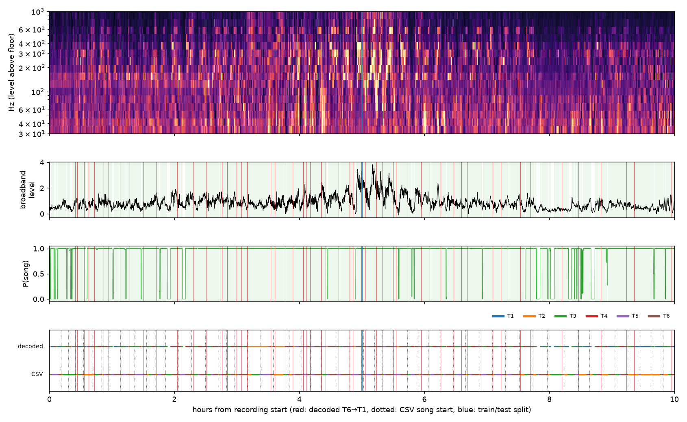
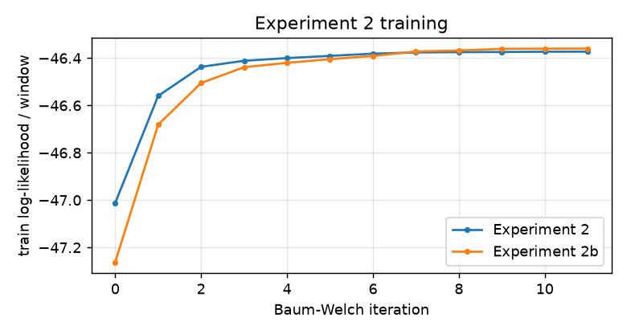
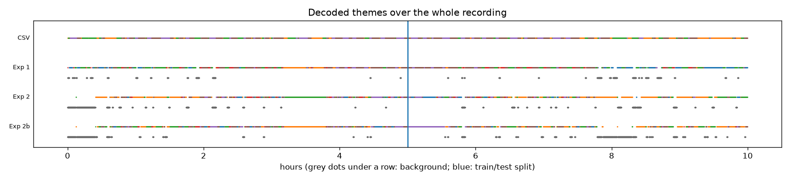
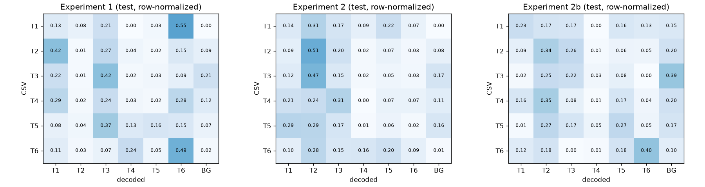
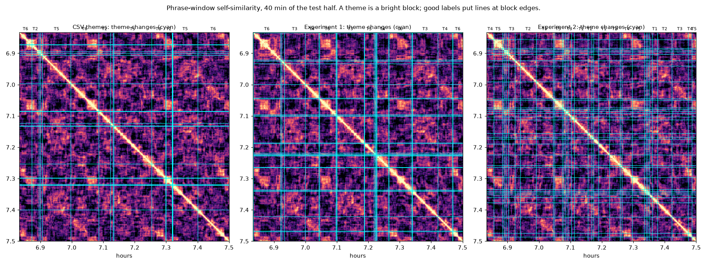
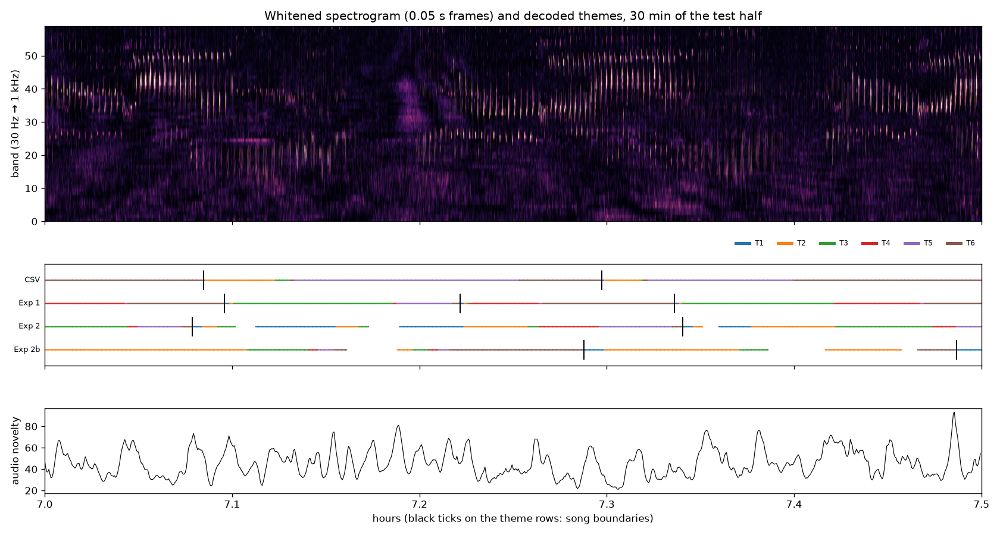
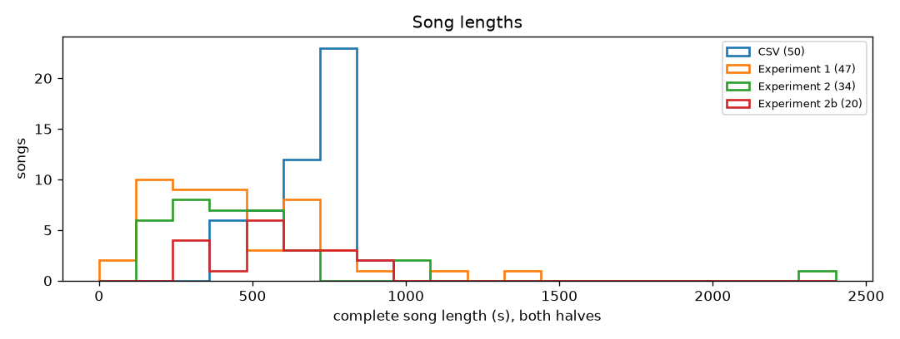

# Song-session HMM: Experiment 2 report (with Experiment 1 reviewed and compared)

Branch `dat-hmm`. Plan: [plan.md](../exp2_phrase_hmm/plan.md). Exact processing: [pipeline.md](../exp2_phrase_hmm/pipeline.md). Metric definitions: [metrics.md](../exp2_phrase_hmm/metrics.md). Numbers: `work/report.json`. Everything below is regenerated by `python -m analysis.song_hmm.exp2_phrase_hmm.report`.

## Summary

Headline numbers on the **test half** (last 5 h, never used for fitting). Higher is better for every row except song-length CV. Group B scores agreement with the CSV, which is a reference, not ground truth; group C scores the labels against the audio itself, and the CSV gets a row there too.

| metric (test half) | CSV | Experiment 1 | Experiment 2 | Experiment 2b |
|---|---|---|---|---|
| B theme balanced accuracy (chance 0.167) | – | 0.208 | 0.156 | 0.244 |
| B Cohen's κ vs CSV | – | 0.145 | 0.041 | 0.171 |
| B song-boundary F1 ±30 s | – | 0.16 | 0.18 | 0.15 |
| C theme coherence | 0.089 | 0.104 | 0.104 | 0.200 |
| C theme identity across songs | 0.120 | 0.137 | 0.109 | 0.144 |
| C theme changes on an audio change point (precision) | 0.36 | 0.38 | 0.53 | 0.50 |
| sessions / fraction of time in session | 1 / 1.000 | 21 / 0.921 | 18 / 0.910 | 28 / 0.807 |
| D synthetic theme accuracy | – | 1.000 | 0.995 | – |

In short:
- The phrase-window input makes decoded theme changes land on audible change points more often: 0.53 (Exp 2) and 0.50 (Exp 2b) against 0.38 (Exp 1) and 0.36 (CSV).
- Seeded from the CSV (2b), it gives the most acoustically uniform themes (coherence 0.200 vs 0.104) and the best agreement with the CSV (balanced accuracy 0.244 vs 0.208; κ 0.171 vs 0.145). The gain is real but small.
- Seeded from the audio alone (Exp 2), the six k-means clusters do not follow a clean 1→6 cycle (only 0.33 of cluster changes lie on the best cycle; random would be about 0.20), and its themes do not match the CSV (balanced accuracy 0.156, near chance).
- The CSV's own themes are the **least** acoustically coherent segmentation of all (0.089), which adds to the evidence that the CSV does not describe this audio well.
- Session detection did not improve. On the test half Experiment 1 finds 21 sessions (0.921 of the time in song), Experiment 2 18 (0.910) and Experiment 2b 28 (0.807). In the phrase models the background state also absorbs quiet stretches of song.
- Both models recover a synthetic recording almost perfectly, so the model structure is not the bottleneck; the mapping from sound to theme is.

## Data and split

- Recording `SOCAL_H_76_230426_193500_df100.x.x.wav`: 2 kHz, mono, 16-bit, 10 h (36,000 s), starting 2023-04-26 19:35:00 UTC.
- **Train** = 0–18,000 s, **test** = 18,000–36,000 s. Every statistic, PCA basis, seed and Baum–Welch fit uses train only.
- Reference: `backend/data/song_structure/SOCAL_H_76_230426_193500_df100.x.x.motif_segments.csv` (53 songs, 30,923 units). It covers every second, all units are whole seconds, and 8 songs skip themes (which Payne & McVay say never happens), so it looks generated. It is used as a reference and a seed, never as truth.

## Experiment 1 (previous): per-second slot HMM

Code and its own report: [`analysis/song_hmm/exp1_slot_hmm/`](../exp1_slot_hmm/README.md), [its report](exp1_slot_hmm.md).

### Input

One 18-number vector per second (details in [pipeline.md](../exp2_phrase_hmm/pipeline.md#experiment-1-input)): 16 log-spaced band levels (30–1000 Hz) above a 10-minute 10th-percentile noise floor, averaged over the second's ten 0.1 s frames; the broadband level above its floor; and the within-second spread of the broadband level. z-scored with train statistics. It says *how loud each pitch region is during this second*, but not how pitch moves, nor anything about the phrase around the second.

### Model

176 states, one step per second: 28 phrase slots from the six-theme drawing × 5 duration states (1–5 s); a breath state per theme (shares the background Gaussian); and a 30-state background chain (background lasts ≥ 30 s). Themes run 1→…→6→1 with no skips; only a theme's last slot branches (repeat / next / breath / end); T6 → T1 is the song boundary; background may enter any theme. One diagonal Gaussian per slot. Fixed priors: P(end) = 1e-3 per phrase end, background mean 1 h. Seeded from the CSV slot labels, trained with log-domain Baum–Welch on the train half (30 iterations).

Changes made while building it: a minimum background length (without it, 1 s background gaps were used to jump between themes against the cycle), fixed session priors (learned, they collapsed into gap fillers because nothing is labeled non-song), and log-domain forward–backward (a scaled pass underflowed).

### Results (same metrics as Experiment 2)

| log-likelihood / s | train | test |
|---|---|---|
| Experiment 1 | -19.024 | -19.381 |
| one Gaussian (same 18-D input) | -25.541 | -26.202 |
| 2-state HMM (same input) | -21.640 | -20.806 |

| Experiment 1 | train | test |
|---|---|---|
| theme accuracy | 0.332 | 0.269 |
| theme balanced accuracy | 0.285 | 0.208 |
| Cohen's κ | 0.183 | 0.145 |
| song-boundary F1 ±15 s | 0.10 | 0.08 |
| song-boundary F1 ±30 s | 0.23 | 0.16 |
| song-boundary F1 ±60 s | 0.33 | 0.39 |
| songs / complete songs | 50 / 29 | 47 / 18 |
| sessions | 17 | 21 |
| fraction of seconds in a session | 0.944 | 0.921 |
| theme coherence (within − adjacent) | 0.114 | 0.104 |
|   within-theme similarity | 0.175 | 0.188 |
|   adjacent-theme similarity | 0.062 | 0.084 |
| theme identity across songs | 0.084 | 0.137 |
| theme changes on a novelty peak (precision ±10 s) | 0.40 | 0.38 |
| novelty peaks hit by a theme change (recall ±10 s) | 0.21 | 0.15 |
| theme changes | 209 | 157 |
| longest run of one theme (min) | 20.6 | 16.7 |
| complete songs: median length (s) | 320 | 440 |
| complete songs: length CV | 0.67 | 0.45 |

Synthetic recovery (sampled from the fitted model, refit, decoded): theme accuracy 1.000, slot accuracy 0.983, song-boundary F1 ±5 s 1.00.



### Why it fell short

The model can do the job when its assumptions hold (synthetic recovery is near perfect), and it does find sessions and a T6 → T1 cycle with plausible song lengths. But its themes agree with the CSV only a little above chance (balanced accuracy and κ in the table above), mostly because of its input. A classifier trained directly on the CSV labels (`diagnostics/exp1_feature_checks.py`, train on the first 5 h, score the last 5 h) shows how little per-second spectra carry:

```
theme classification on the test half: accuracy / balanced accuracy (chance balanced 0.17)
  16 bands, 1 s mean (Experiment 1)     1 s: 0.27/0.21  10 s: 0.26/0.20  30 s: 0.37/0.29
  48 bands, 1 s mean + std              1 s: 0.23/0.20  10 s: 0.28/0.20  30 s: 0.35/0.30
  16 bands x 10 frames (contour)        1 s: 0.27/0.22  10 s: 0.31/0.22  30 s: 0.38/0.29
unit-name classification per second, labels shifted by lag (balanced accuracy; chance 0.125)
  lag -20 s: 0.162
  lag -10 s: 0.169
  lag  -5 s: 0.174
  lag  -2 s: 0.181
  lag  -1 s: 0.179
  lag  +0 s: 0.197
  lag  +1 s: 0.186
  lag  +2 s: 0.166
  lag  +5 s: 0.182
  lag +10 s: 0.178
  lag +20 s: 0.151
```

- Units are hardly recognisable from a 1 s spectrum (balanced accuracy ≈ 0.2 with 8 classes, chance 0.125). The best lag is 0 s, so the CSV is not simply shifted in time.
- Themes are hardly recognisable even from 30 s of averaged spectra. Themes share units (U7, U8 and U9 occur in most of them), so a theme is defined by its **phrase** — the order and shape of its units — not by its average spectrum.

## Experiment 2 (current): phrase-window theme HMM

### Why

Payne & McVay define a theme as *an unbroken sequence of similar phrases*, each theme with its own phrase type. So the input should describe a **phrase**, and it should keep what makes phrases differ: the pitch contour of each unit and the rhythm of the phrase. A 40-minute test showed that windows of 12 s cut from a 0.05 s spectrogram make themes appear as bright blocks in a self-similarity matrix, recurring one song (≈ 13 min) later.

### Input (full detail in [pipeline.md](../exp2_phrase_hmm/pipeline.md))

| step | what it produces | shape |
|---|---|---|
| I-0 read wav | pressure samples | 72,000,000 at 2 kHz |
| I-1 band spectrogram | ln power in 64 log bands, 30–1000 Hz (≈ 1 semitone each; empty ones dropped), 0.05 s frames | 720,000 × 59 |
| I-2 noise whitening | minus a rolling 5-min per-band median, clipped at 0: energy above the noise | same |
| I-3 phrase windows | 12 s of I-2 every 2 s, inside one half | 8,995 train, 8,995 test |
| I-4 descriptor | per band: level, variability, flux, up-sweep, down-sweep | 295 per window |
| I-5 standardize | z-score with train statistics | same |
| I-6 PCA → model input | top 20 components (train fit), 0.64 of the variance | 8,995 × 20 |

What the first three components weigh most (sign is arbitrary):

- **PC1** (12.8% of variance): flux 300-316 Hz; variability 440-464 Hz; variability 316-334 Hz; variability 416-440 Hz. Weight by statistic: variability 34%, level 30%, flux 29%, upsweep 4%, downsweep 3%.
- **PC2** (8.1% of variance): variability 80-85 Hz; variability 85-90 Hz; variability 90-95 Hz; variability 76-80 Hz. Weight by statistic: variability 33%, level 30%, flux 29%, downsweep 4%, upsweep 4%.
- **PC3** (5.4% of variance): variability 173-183 Hz; flux 173-183 Hz; flux 164-173 Hz; level 173-183 Hz. Weight by statistic: level 28%, flux 26%, variability 26%, upsweep 11%, downsweep 9%.

### Model

81 states, one step per 2 s window: each theme is a chain of 10 states (≥ 20 s, a few phrases) ending in a dwell state that loops while the phrase repeats; one breath state per theme; a 15-state background chain (≥ 30 s). From a dwell state: stay / next theme / breath / end session; T6 → T1 is the song boundary; background may enter any theme; no skips, no going back. One diagonal 20-D Gaussian per theme; breaths share the background Gaussian. Fixed priors: P(end) = 1e-4 per step, background mean 1 h.

### Initialization

- **Experiment 2 (audio seed).** Background = quietest 10% of train windows; k-means (k = 6) on the rest; majority-smoothed over 20 s; the best cyclic order of the six clusters is [0, 5, 1, 2, 4, 3], but only 0.33 of cluster changes follow it. Which cluster is Theme 1 was set by the CSV (agreement per rotation: 0.225, 0.180, 0.187, 0.172, 0.142, 0.095; chosen 0). This is the only use of the CSV in this run.
- **Experiment 2b (CSV seed, ablation).** Theme Gaussians from the CSV theme at each train window centre; everything else identical.

### Training

| log-likelihood / window | train | test | iterations |
|---|---|---|---|
| Experiment 2 | -46.399 | -47.373 | 11 |
| Experiment 2b | -46.386 | -47.448 | 11 |
| one Gaussian (same 20-D input) | -48.497 | -49.112 | – |
| 2-state HMM (same input) | -47.389 | -47.767 | – |



Learned end-of-theme behaviour (per 2 s step, from the dwell state) and session entry:

| run | theme | stay | mean dwell | next | breath | breath: stay | resume | next |
|---|---|---|---|---|---|---|---|---|
| Experiment 2 | T1 | 0.968 | 63 s | 0.032 | 0.000 | 0.000 | 1.000 | 0.000 |
| Experiment 2 | T2 | 0.971 | 68 s | 0.017 | 0.012 | 0.962 | 0.030 | 0.007 |
| Experiment 2 | T3 | 0.979 | 93 s | 0.016 | 0.005 | 0.911 | 0.074 | 0.014 |
| Experiment 2 | T4 | 0.971 | 70 s | 0.027 | 0.001 | 0.960 | 0.000 | 0.040 |
| Experiment 2 | T5 | 0.972 | 71 s | 0.028 | 0.000 | 0.522 | 0.478 | 0.000 |
| Experiment 2 | T6 | 0.951 | 41 s | 0.049 | 0.000 | 0.000 | 0.010 | 0.990 |
| Experiment 2b | T1 | 0.981 | 104 s | 0.019 | 0.000 | 0.629 | 0.004 | 0.367 |
| Experiment 2b | T2 | 0.978 | 91 s | 0.016 | 0.006 | 0.939 | 0.041 | 0.020 |
| Experiment 2b | T3 | 0.960 | 50 s | 0.021 | 0.019 | 0.966 | 0.014 | 0.020 |
| Experiment 2b | T4 | 0.939 | 33 s | 0.055 | 0.006 | 0.983 | 0.000 | 0.017 |
| Experiment 2b | T5 | 0.963 | 54 s | 0.032 | 0.005 | 0.979 | 0.021 | 0.000 |
| Experiment 2b | T6 | 0.980 | 99 s | 0.018 | 0.003 | 0.918 | 0.054 | 0.029 |

### Results

**Experiment 2**

| Experiment 2 | train | test |
|---|---|---|
| theme accuracy | 0.153 | 0.204 |
| theme balanced accuracy | 0.140 | 0.156 |
| Cohen's κ | 0.017 | 0.041 |
| song-boundary F1 ±15 s | 0.11 | 0.13 |
| song-boundary F1 ±30 s | 0.22 | 0.18 |
| song-boundary F1 ±60 s | 0.25 | 0.36 |
| songs / complete songs | 45 / 19 | 38 / 15 |
| sessions | 17 | 18 |
| fraction of seconds in a session | 0.857 | 0.910 |
| theme coherence (within − adjacent) | 0.043 | 0.104 |
|   within-theme similarity | 0.125 | 0.189 |
|   adjacent-theme similarity | 0.082 | 0.085 |
| theme identity across songs | 0.129 | 0.109 |
| theme changes on a novelty peak (precision ±10 s) | 0.56 | 0.53 |
| novelty peaks hit by a theme change (recall ±10 s) | 0.20 | 0.18 |
| theme changes | 147 | 135 |
| longest run of one theme (min) | 36.3 | 19.0 |
| complete songs: median length (s) | 372 | 498 |
| complete songs: length CV | 0.95 | 0.46 |

**Experiment 2b**

| Experiment 2b | train | test |
|---|---|---|
| theme accuracy | 0.337 | 0.320 |
| theme balanced accuracy | 0.342 | 0.244 |
| Cohen's κ | 0.213 | 0.171 |
| song-boundary F1 ±15 s | 0.08 | 0.15 |
| song-boundary F1 ±30 s | 0.12 | 0.15 |
| song-boundary F1 ±60 s | 0.29 | 0.35 |
| songs / complete songs | 35 / 14 | 43 / 6 |
| sessions | 14 | 28 |
| fraction of seconds in a session | 0.878 | 0.807 |
| theme coherence (within − adjacent) | 0.053 | 0.200 |
|   within-theme similarity | 0.124 | 0.273 |
|   adjacent-theme similarity | 0.071 | 0.073 |
| theme identity across songs | 0.187 | 0.144 |
| theme changes on a novelty peak (precision ±10 s) | 0.64 | 0.50 |
| novelty peaks hit by a theme change (recall ±10 s) | 0.21 | 0.10 |
| theme changes | 135 | 80 |
| longest run of one theme (min) | 37.1 | 32.7 |
| complete songs: median length (s) | 540 | 626 |
| complete songs: length CV | 0.80 | 0.14 |

Synthetic recovery for Experiment 2 (8,995 steps sampled from the fitted model, 19 song boundaries, refit, decoded): theme accuracy 0.995, song vs background 1.000, song-boundary F1 ±10 s 1.00, session-edge F1 ±10 s 1.00.



## Comparing Experiment 1 and Experiment 2

### What changed

|  | Experiment 1 | Experiment 2 / 2b |
|---|---|---|
| time step | 1 s | 2 s (12 s window) |
| spectrogram | 0.1 s frames, 16 bands | 0.05 s frames, 59 bands (≈ semitone) |
| noise floor | 10-min 10th percentile | 5-min median, clipped at 0 |
| what one observation describes | average pitch profile + loudness of one second | one phrase: profile, on/off pattern, flux, up/down sweeps |
| observation size | 18 | 20 (PCA of 295) |
| states | 176 (28 slots × 5 durations + breaths + background) | 81 (6 theme chains + breaths + background) |
| minimum theme length | none (a phrase can be 3 s) | 20 s |
| seed | CSV slot labels | k-means (2) / CSV themes (2b) |

Log-likelihoods are **not** comparable across experiments (different inputs); within each experiment both models beat their baselines on the test half (Exp 1 -19.381 vs 2-state -20.806 per second; Exp 2 -47.373 vs 2-state -47.767 per window).

### Side by side, test half

| metric | Experiment 1 | Experiment 2 | Experiment 2b |
|---|---|---|---|
| theme accuracy | 0.269 | 0.204 | 0.320 |
| theme balanced accuracy | 0.208 | 0.156 | 0.244 |
| Cohen's κ | 0.145 | 0.041 | 0.171 |
| song-boundary F1 ±15 s | 0.08 | 0.13 | 0.15 |
| song-boundary F1 ±30 s | 0.16 | 0.18 | 0.15 |
| song-boundary F1 ±60 s | 0.39 | 0.36 | 0.35 |
| songs / complete songs | 47 / 18 | 38 / 15 | 43 / 6 |
| sessions | 21 | 18 | 28 |
| fraction of seconds in a session | 0.921 | 0.910 | 0.807 |

| label-free metric | CSV | Experiment 1 | Experiment 2 | Experiment 2b |
|---|---|---|---|---|
| theme coherence (within − adjacent) | 0.089 | 0.104 | 0.104 | 0.200 |
|   within-theme similarity | 0.162 | 0.188 | 0.189 | 0.273 |
|   adjacent-theme similarity | 0.074 | 0.084 | 0.085 | 0.073 |
| theme identity across songs | 0.120 | 0.137 | 0.109 | 0.144 |
| theme changes on a novelty peak (precision ±10 s) | 0.36 | 0.38 | 0.53 | 0.50 |
| novelty peaks hit by a theme change (recall ±10 s) | 0.13 | 0.15 | 0.18 | 0.10 |
| theme changes | 143 | 157 | 135 | 80 |
| longest run of one theme (min) | 12.7 | 16.7 | 19.0 | 32.7 |
| complete songs: median length (s) | 736 | 440 | 498 | 626 |
| complete songs: length CV | 0.15 | 0.45 | 0.46 | 0.14 |

### Side by side, train half

| metric | Experiment 1 | Experiment 2 | Experiment 2b |
|---|---|---|---|
| theme accuracy | 0.332 | 0.153 | 0.337 |
| theme balanced accuracy | 0.285 | 0.140 | 0.342 |
| Cohen's κ | 0.183 | 0.017 | 0.213 |
| song-boundary F1 ±15 s | 0.10 | 0.11 | 0.08 |
| song-boundary F1 ±30 s | 0.23 | 0.22 | 0.12 |
| song-boundary F1 ±60 s | 0.33 | 0.25 | 0.29 |
| songs / complete songs | 50 / 29 | 45 / 19 | 35 / 14 |
| sessions | 17 | 17 | 14 |
| fraction of seconds in a session | 0.944 | 0.857 | 0.878 |

| label-free metric | CSV | Experiment 1 | Experiment 2 | Experiment 2b |
|---|---|---|---|---|
| theme coherence (within − adjacent) | 0.090 | 0.114 | 0.043 | 0.053 |
|   within-theme similarity | 0.154 | 0.175 | 0.125 | 0.124 |
|   adjacent-theme similarity | 0.063 | 0.062 | 0.082 | 0.071 |
| theme identity across songs | 0.069 | 0.084 | 0.129 | 0.187 |
| theme changes on a novelty peak (precision ±10 s) | 0.32 | 0.40 | 0.56 | 0.64 |
| novelty peaks hit by a theme change (recall ±10 s) | 0.12 | 0.21 | 0.20 | 0.21 |
| theme changes | 155 | 209 | 147 | 135 |
| longest run of one theme (min) | 10.0 | 20.6 | 36.3 | 37.1 |
| complete songs: median length (s) | 654 | 320 | 372 | 540 |
| complete songs: length CV | 0.23 | 0.67 | 0.95 | 0.80 |

Per-theme recall against the CSV (test):

| run | T1 | T2 | T3 | T4 | T5 | T6 |
|---|---|---|---|---|---|---|
| Experiment 1 | 0.13 | 0.01 | 0.42 | 0.03 | 0.16 | 0.49 |
| Experiment 2 | 0.14 | 0.51 | 0.15 | 0.00 | 0.06 | 0.09 |
| Experiment 2b | 0.23 | 0.34 | 0.22 | 0.01 | 0.27 | 0.40 |



The same 40 minutes of the test half under each labelling. The background image is the audio's own phrase-level self-similarity; cyan lines are where each labelling changes theme:



The same stretch as a spectrogram, with every labelling's themes and song boundaries:





### What improved, what did not, and why

1. **Theme changes now follow the sound.** The share of decoded theme changes that sit on an audio change point is 0.53 / 0.50 for Exp 2 / 2b, higher than Exp 1 (0.38). A 12 s window sees whole phrases, so a change of phrase type shows up as a change of input; a 1 s average does not.
2. **With a good seed, themes are more uniform and more like the CSV.** Exp 2b's theme coherence is 0.200 vs 0.104 for Exp 1, and its balanced accuracy against the CSV is 0.244 vs 0.208 (κ 0.171 vs 0.145). T4 is still almost never found (0.01 recall); it is the rarest CSV theme.
3. **Without the CSV, the six themes are not found.** k-means on phrase windows does not split the audio along the 1→6 cycle (cycle share 0.33), so Exp 2 starts from clusters that are not themes and Baum–Welch keeps them (balanced accuracy 0.156). Its coherence (0.104) only matches Exp 1. Clusters probably follow loudness and noise as much as phrase type (PC1 is mostly level/variability/flux at 300–460 Hz).
4. **Sessions did not improve.** Exp 1 splits the test half into 21 sessions (0.921 of the time in song); Exp 2 / 2b into 18 / 28 (0.910 / 0.807). The single background Gaussian on phrase descriptors also fits quiet phrases and noise bursts, so the phrase models leave the session for 30 s or more in the middle of clear song (see the gaps in the timeline). Exp 2b does this most.
5. **Song boundaries are still weak against the CSV.** Song-boundary F1 at ±30 s is 0.16 / 0.18 / 0.15 (Exp 1 / 2 / 2b), and complete songs are rarer in Exp 2b because a session break inside a song makes both halves partial.
6. **The CSV is the weakest labelling of the audio.** Its theme coherence (0.089) and its change-point precision (0.36) are the lowest of the four, while its songs are by far the most regular (length CV 0.15). Very regular songs whose theme edges do not match audible changes are what a generated file would look like. Agreement with the CSV therefore cannot be the main yardstick.
7. **The phrase models stay in one theme too long.** On the train half the longest single-theme run is 36 min (Exp 2) and 37 min (Exp 2b), against 21 min for Exp 1 and 10 min in the CSV. The leading components are mostly level, variability and flux (80%–94% of the weight of PC1–PC3), which all scale with loudness, so a theme's Gaussian can follow a loud or quiet period rather than a phrase type. The same models also call the start of the recording background (grey in the full timeline).
8. **Model capacity is not the problem.** Both models recover their own synthetic data almost perfectly; what limits them is how well the input separates themes.

## Limitations and next steps

- **A trustworthy reference.** Hand-mark 30–60 minutes (theme per phrase run and song starts) from the spectrogram. Every CSV-based number above is limited by the CSV.
- **Background model.** Give background two or more Gaussians (quiet, noise burst) and a session-level prior that keeps sessions together across short quiet phrases; check gaps against the spectrogram.
- **Phrase types before themes.** Cluster into more phrase types than themes (e.g. 12–20), then let each theme emit a mixture of phrase types, or learn the mapping from the cycle order. Six raw clusters are too coarse to be themes.
- **Use the audio's structure directly.** The self-similarity matrix shows block edges and the song-to-song repeat; segmenting on novelty first and labelling segments with the HMM second may beat per-window emissions.
- **Loudness-independent phrase descriptors.** Normalize each window's level (e.g. divide by its own total energy) so that the shape statistics, not the loudness, drive the leading components; this targets the long single-theme runs.
- **Overlapping windows.** Consecutive windows share 10 s of audio but are treated as independent; this overstates the evidence per step. A larger step or a correction would make dwell probabilities easier to read.
