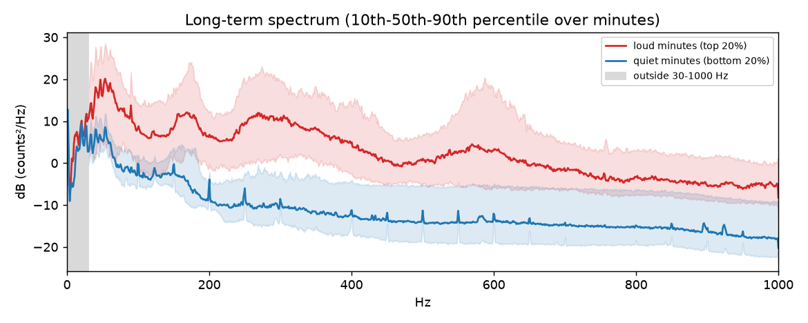
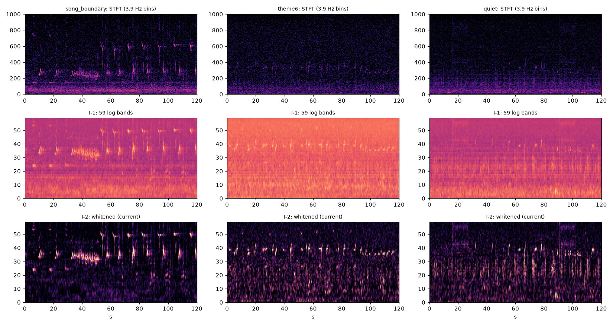
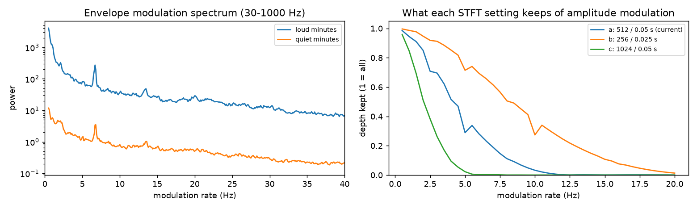
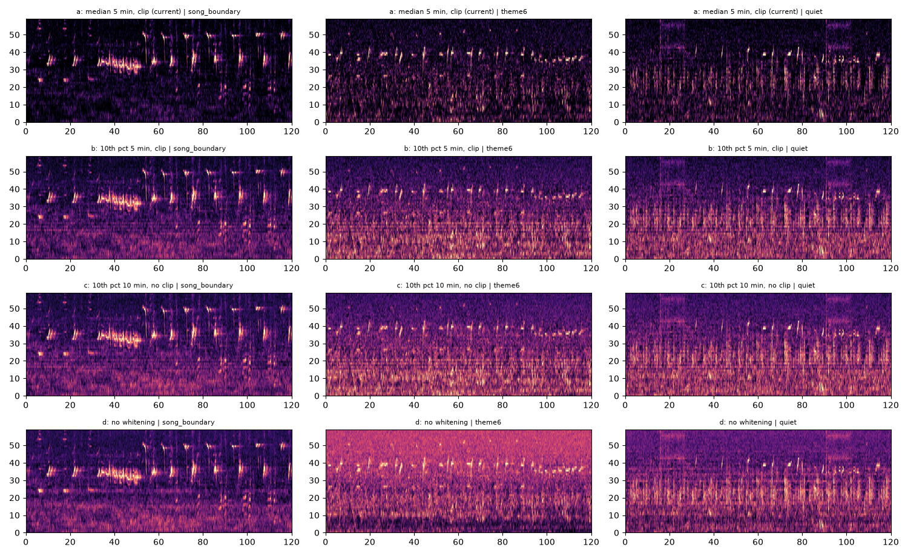

# Pipeline check: does wav → matrix keep the information in the recording?

Checks the Experiment 2 input pipeline (`analysis/song_hmm/exp2_phrase_hmm/features.py`; stages I-0 … I-6 in [../pipeline.md](../exp2_phrase_hmm/pipeline.md)). Plan: [plan.md](../exp2_phrase_hmm/pipeline_check/plan.md). Code: `check.py` (it calls the real functions in `features.py`). Numbers: `work/results.json`. Listening clips (Griffin–Lim rebuilds, 8 kHz wav): `work/audio/` (not committed; regenerate with `python -m analysis.song_hmm.exp2_phrase_hmm.pipeline_check.check`).

**How to read the song-repeat test (used in E, F and G).** A song repeats every ≈ 13 min. For 500 loud test-half windows, the nearest neighbour (among windows ≥ 5 min away) is found under a representation; a *hit* is a neighbour one or two song periods away (13 ± 2 or 26 ± 2 min). Random choice hits 0.051 of the time. A representation that keeps 'which phrase is this' scores higher; the number in brackets is the gain over chance.

## Summary

|  | check | result | verdict |
|---|---|---|---|
| A | Header, size, sample count | fmt + `harp` (88 B metadata) + data; 72,000,000 samples = 36,000 s at 2000 Hz | ✅ pass |
| A | Clipping, drop-outs | clipped 0.000%; constant runs ≥ 0.1 s: 0 | ✅ pass |
| A | DC offset | constant 631 counts (AC RMS ≈ 53); raises any band by ≤ 0.01 dB | ℹ️ note (harmless; subtract it anyway) |
| A | Time origin | CSV first unit at 0.0 s from the file-name start | ✅ pass |
| B | Song energy outside 30–1000 Hz | 1.4% of the song's excess energy is below 30 Hz | ✅ pass |
| B | Source limit | nothing above 1 kHz exists (`df100`, 2 kHz); no roll-off ≥ 10 dB before 1 kHz | ℹ️ note |
| C | STFT framing invertible | inverse-STFT SNR 315 dB | ✅ pass |
| C | Chunked = one-pass | max difference 1.9e-06 | ✅ pass |
| C | Time stamps | tone burst in frame 204 (expected 204); frames are labelled by their start, 0.128 s before their centre | ✅ pass |
| C | Band pooling | every bin 30–1000 Hz in exactly one of 59 bands; power identity error 1e-15 | ✅ pass |
| D | Fast amplitude modulation (pulses) | current setting keeps 52% of the song's envelope modulation (5 Hz depth 0.29, 10 Hz 0.03); 256-sample FFT keeps 63% | ⚠️ loses information |
| D | Short units | 53% of sound runs (≥ 13 dB above floor) are shorter than the 0.256 s window | ⚠️ loses information |
| E | Median noise floor | half of all cells clipped to 0 even in loud minutes (51% kept); 19% of loud-minute power removed | ⚠️ loses information |
| F | Window summary (295 numbers) | song-repeat hit rate 0.160 (×3.1) vs raw patch 0.212 (×4.1) | ⚠️ loses information |
| F | PCA to 20 | 64% of variance; 80% needs 37, 90% needs 62; hit rate 0.148 (×2.9) | ⚠️ loses information |
| F | 12 s window vs phrase length | median phrase period 11.4 s; 35% of windows have a period ≥ 12 s | ℹ️ note |
| G | Best combined setting | 6 short FFT + no whitening, 20 s: PCA-20 hit 0.252 (×4.9) vs current 0.148 (×2.9) | ℹ️ note |

**Bottom line.** The pipeline is *implemented* correctly: the file is read completely and exactly, the STFT framing is invertible, chunking changes nothing, time stamps are right and band pooling keeps all the power. What it *keeps* is the problem: three design choices throw away information the song carries — the 0.256 s window blurs pulses and short units, the median noise floor deletes about half of every band (including quiet song), and the 295-number window summary followed by PCA-20 keeps noticeably less 'which phrase is this' than the spectrogram itself. Recommendations are at the end.

## The source limit

The file is a ×100 decimation (`df100`) to 2 kHz, so anything the whale sang above 1 kHz is gone before this pipeline starts. Within 0–1 kHz, the loud (singing) minutes are 12–18 dB above the quiet ones across 30–1000 Hz:

| band | loud − quiet (dB) |
|---|---|
| 0-30 Hz | 1.8 |
| 30-100 Hz | 11.9 |
| 100-300 Hz | 14.9 |
| 300-600 Hz | 17.8 |
| 600-1000 Hz | 13.0 |

Below 30 Hz the difference is small: 1.4% of the song's extra energy lies there, so the 30 Hz lower edge loses almost nothing. Quiet minutes have 30% of their energy below 30 Hz (sea and flow noise), loud minutes 3%. The quiet spectrum also shows narrow lines at multiples of 50 Hz (100, 150, 200, 250 Hz, …): instrument tones, which a noise floor removes.

## I-0 Reading the wav (check A)

RIFF chunks: `fmt` 16 B at 12, `harp` 88 B at 36, `data` 144,000,000 B at 132. File size 144,000,140 B = 12 + chunk headers + chunks, so the data chunk is complete. The `WavFileWarning: Chunk (non-data) not understood` comes from the `harp` chunk (HARP recorder metadata), which scipy skips; it does not affect the samples.

- 72,000,000 int16 samples at 2000 Hz = 36,000 s. No clipped samples, no constant runs (drop-outs) ≥ 0.1 s.
- DC offset: every 10-minute mean is between 630.8 and 631.0 counts, larger than the signal itself (AC RMS ≈ 53). With a Hann window it leaks at most 0.01 dB into any band ≥ 30 Hz, so the features are unaffected; subtracting the mean is still free and removes the question.
- The CSV's first unit starts at 0 s from the time in the file name (2023-04-26 19:35:00 UTC), so labels and audio share one clock.

## I-1 STFT and band pooling (check C)

- **Framing.** The complex STFT with these settings (Hann, 512, hop 100) inverts back to the waveform at 315 dB SNR (machine precision): nothing is lost before the magnitude is taken.
- **Chunking.** Computing in chunks vs in one pass differs by 1.9e-06 (float32 rounding).
- **Time stamps.** A 0.1 s tone burst lands in frame 204, the frame whose centre is nearest (expected 204). The pipeline assigns frame n to time 0.05·n (its start); its centre is 0.128 s later. This is a constant shift, small next to 2 s windows, but Experiment 3 should use centres.
- **Pooling.** Every FFT bin from 30 to 1000 Hz belongs to exactly one band and summed band power equals summed bin power (relative error 1e-15). Of 64 log bands, 5 below about 60 Hz contain no FFT bin (bins are 3.9 Hz apart) and are dropped without losing power: their bins belong to neighbouring bands.
- **What pooling loses.** Above ~150 Hz one band holds several bins (≈ 14 at 1 kHz), so pitch detail finer than a semitone is averaged away. Whale units are judged by contour, not by exact pitch, so this is a reasonable loss.

The same three example stretches through the first stages (song boundary, inside theme 6, quietest start of the recording):

## I-1 Time and frequency resolution vs the song (check D)

**What the song contains.** Envelope modulation spectrum (30–1000 Hz) of the raw audio, share of modulation energy above a rate:

| above | loud minutes | quiet minutes |
|---|---|---|
| 2 Hz | 49% | 83% |
| 5 Hz | 37% | 70% |
| 10 Hz | 28% | 58% |
| 20 Hz | 20% | 45% |

Noise has a flat envelope spectrum, so quiet minutes are high everywhere; what matters is that loud minutes still have a third of their modulation above 5 Hz: pulse trains and rapid unit sequences (Payne & McVay's subunits) are real in this recording.

**What each STFT setting keeps** (depth of a 100 % amplitude-modulated 400 Hz tone that survives in the band series; 1 = all):

| setting | frequency step | depth at 5 Hz | depth at 10 Hz | song modulation kept | up-sweep sharpness |
|---|---|---|---|---|---|
| a: 512 / 0.05 s (current) | 3.9 Hz | 0.29 | 0.03 | 52% | 0.25 |
| b: 256 / 0.025 s | 7.8 Hz | 0.71 | 0.27 | 63% | 0.40 |
| c: 1024 / 0.05 s | 2.0 Hz | 0.02 | 0.00 | 40% | 0.17 |

'Song modulation kept' weights the depth curve by the loud-minute modulation spectrum. 'Up-sweep sharpness' is the share of a 0.5 s, 200→800 Hz chirp's energy in its strongest band per frame (higher = a cleaner contour).

The current 0.256 s window keeps only 0.03 of a 10 Hz pulse train and 0.29 at 5 Hz. Halving the window (256 samples, hop 0.025 s) keeps 0.27 and 0.71, and draws fast sweeps more sharply (0.40 vs 0.25). The price is a 7.8 Hz frequency step, which merges the lowest bands (50 non-empty bands instead of 59, all below ~120 Hz). A longer window is worse on every count.

**Units and sweeps in the whitened spectrogram** (loud minutes; a frame is 'on' when its strongest band is above the threshold):

| 'on' threshold | frames on | runs: 25th / 50th / 75th pct (s) | runs shorter than the window | steps where the ridge moves ≥ 1 band |
|---|---|---|---|---|
| 1.0 (4 dB) | 99% | 0.35 / 1.50 / 5.60 | 22% | 26% |
| 2.0 (9 dB) | 74% | 0.10 / 0.15 / 0.50 | 65% | 23% |
| 3.0 (13 dB) | 48% | 0.10 / 0.25 / 0.90 | 53% | 22% |

At a low threshold almost every frame is 'on' (the median floor leaves half of every band above it), so runs merge into long stretches; at 9–13 dB, runs break into fragments, many shorter than the 0.256 s window. These runs are therefore only a rough guide to unit length (a unit with internal pulses splits into several runs), but they agree with the modulation test: much of the song changes faster than the window. The ridge moves by a whole band (≈ 1 semitone per 0.05 s ≈ 19 semitones/s) in about a quarter of steps: the up/down-sweep statistics see fast sweeps, but slower glides only appear as a change of level between bands.

## I-2 Noise whitening (check E)

| variant | cells above floor (loud / quiet) | loud power removed | loud vs quiet separation (d′) | song-repeat hit, 295 | song-repeat hit, PCA-20 |
|---|---|---|---|---|---|
| a: median 5 min, clip (current) | 51% / 50% | 19% | 1.60 | 0.160 (×3.1) | 0.148 (×2.9) |
| b: 10th pct 5 min, clip | 90% / 90% | 5% | 1.70 | 0.186 (×3.6) | 0.164 (×3.2) |
| c: 10th pct 10 min, no clip | 89% / 90% | 0 (no clip) | 1.47 | 0.180 (×3.5) | 0.150 (×2.9) |
| d: no whitening | 74% / 18% | 0 (no clip) | 2.55 | 0.228 (×4.4) | 0.202 (×3.9) |

- **The median floor (current) sits on the song.** The whale sings most of the time, so in the bands it uses, the 5-minute median *is* song. Subtracting it and clipping at 0 sets half of every band to zero in loud and quiet minutes alike (51% vs 50% kept) and removes 19% of loud-minute power, including the quieter units. It also equalises loud and quiet periods, which is why sessions and background were hard to tell apart in Experiment 2.
- **A 10th-percentile floor** keeps most cells (90%), removes 5% of loud power, and does better on the song-repeat test.
- **No whitening** (one fixed offset per band) separates loud from quiet best (d′ 2.55) and scores best on the song-repeat test, but slow noise stays in: the theme-6 example below shows a broadband haze that whitening removes, and the 50 Hz-multiple instrument lines stay in quiet periods.

Listening clips for each example stretch are in `work/audio/`: `0_original`, `1_stft_magnitude` (Griffin–Lim from the full STFT magnitude), `2_59_bands` (from the band powers, spread flat inside each band), `3_whitened` (from the whitened band powers). Phase is estimated, so they sound rough; the point is what survives each step.

## I-3 to I-6 Phrase windows, statistics, PCA (check F)

**How much 'which phrase is this' survives each compression** (same 500 queries):

| representation | size per window | song-repeat hit (×chance) | 10-NN overlap with the patch |
|---|---|---|---|
| whitened patch, best of ±3 s shifts | 240 × 59 (time-averaged to 30 × 59) | 0.212 (×4.1) | – |
| 295 descriptors | 295 | 0.160 (×3.1) | 26% |
| PCA-40 | 40 | 0.154 (×3.0) | 24% |
| PCA-20 (model input) | 20 | 0.148 (×2.9) | 21% |
| level-normalised descriptors | 295 | 0.166 (×3.2) | – |

- The 295 summary statistics keep about 75% of the patch's song-repeat hit rate; PCA-20 keeps 70%. PCA-20 explains 64% of the descriptor variance; 80% needs 37 components, 90% needs 62.
- Summary statistics are order-free: they keep which pitches, how choppy and which way units sweep, but not the *order* of units within the phrase, which is what defines a phrase.
- Dividing each window by its own level did not help, so loudness in the statistics is not what limits them.

**Window length.** Dominant repeat period inside a 30 s stretch (phrase period): 10th pct 1.9 s, 25th pct 10.0 s, 50th pct 11.4 s, 75th pct 13.9 s, 90th pct 18.2 s. 35% of windows have a period of 12 s or more, so a 12 s window often holds less than one full phrase. Song-repeat hits by window length:

| window | 295 descriptors | PCA-20 |
|---|---|---|
| 8 s | 0.158 (×3.1) | 0.158 (×3.1) |
| 12 s | 0.160 (×3.1) | 0.148 (×2.9) |
| 20 s | 0.162 (×3.1) | 0.162 (×3.1) |

Window length between 8 and 20 s matters little for this test.

## Combined settings (check G)

The changes above interact, so they were also tried together (same 500 queries; every row recomputes the spectrogram, floor, windows, statistics and PCA from the wav):

| setting | bands | 295-type descriptors | PCA-20 | PCA-40 |
|---|---|---|---|---|
| 1 current: 512/0.05 s, median floor, 12 s | 59 | 0.160 (×3.1) | 0.148 (×2.9) | 0.154 (×3.0) |
| 2 short FFT: 256/0.025 s, median floor, 12 s | 50 | 0.164 (×3.2) | 0.152 (×3.0) | 0.148 (×2.9) |
| 3 no whitening: 512/0.05 s, 12 s | 59 | 0.228 (×4.4) | 0.202 (×3.9) | 0.212 (×4.1) |
| 4 10th-pct floor: 512/0.05 s, 12 s | 59 | 0.186 (×3.6) | 0.164 (×3.2) | 0.180 (×3.5) |
| 5 short FFT + no whitening, 12 s | 50 | 0.240 (×4.7) | 0.232 (×4.5) | 0.220 (×4.3) |
| 6 short FFT + no whitening, 20 s | 50 | 0.230 (×4.5) | 0.252 (×4.9) | 0.264 (×5.1) |
| 7 short FFT + 10th-pct floor, 20 s | 50 | 0.158 (×3.1) | 0.152 (×3.0) | 0.170 (×3.3) |

Best PCA-20 setting: **6 short FFT + no whitening, 20 s** (0.252 (×4.9) vs current 0.148 (×2.9)). For reference, the raw patch reaches 0.212 (×4.1) with the current spectrogram.

## Recommendations for Experiment 3

Keep:
- Reading, framing, chunking, band pooling and the 30–1000 Hz range: correct and essentially lossless for this 2 kHz file.

Change:
1. **Subtract the DC offset** when reading (harmless today, but free).
2. **Label frames by their centre** (+0.128 s), so window times match the audio exactly.
3. **Drop the median noise floor (largest single gain).** With everything else unchanged, the song-repeat hit rate goes from 0.148 to 0.202 without whitening (0.164 with a 10th-percentile floor). The median deletes half of every band, including song, and hides the loud/quiet difference that session detection needs. Slow noise (passing ships, instrument lines) then has to be handled separately, e.g. as its own feature or by a background model that expects it.
4. **Shorter FFT: 256 samples, hop 0.025 s, together with 3.** On its own it barely helps (0.152), because the median floor erases what it adds; without the floor it reaches 0.232 and, with 20 s windows, **0.252** — the best setting tried, 1.7× the current one and above the raw patch under the current floor (0.212). It keeps 63% of the song's fast modulation instead of 52% and draws sweeps more sharply; the price is fewer bands below ~120 Hz.
5. **Keep more of the phrase than 295 order-free statistics and 20 PCs.** The raw patch with a small time shift carries the most 'which phrase is this'. For Experiment 3 this suggests comparing phrases directly (patch similarity / alignment between songs), and, if a compact vector is still needed, keeping more components (PCA-40 or more) or adding order-aware features.
6. **Use 20 s windows.** With the current spectrogram, 8–20 s makes little difference, but with the short FFT and no floor 20 s is best; phrase periods are 10–14 s for half of the windows, so 20 s nearly always holds a full phrase.

None of this changes Experiment 2's features or results; when Experiment 3 is planned, the chosen settings go into an 'Experiment 3 input' section of `../pipeline.md`.
