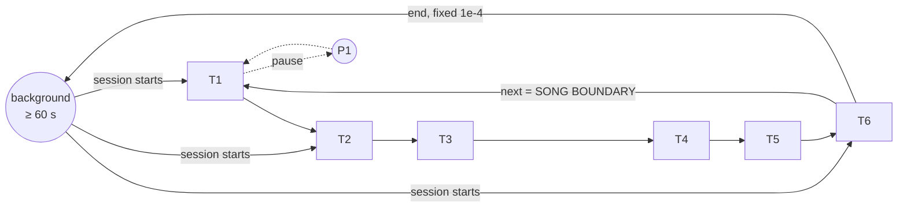

# Best combination: `S2_N1_X2_20s` + M1 theme HMM

This page describes the best setup from Experiment 3: how it turns the wav into model input, how the model works, and how well it does. All numbers are for the **test half** (the last 5 h of the recording, never used for fitting) unless the text says otherwise.

| Where to find it | |
|---|---|
| Full Experiment 3 report | [exp3_inputs_and_models.md](exp3_inputs_and_models.md) |
| Processing and input details | [pipeline.md](../analysis/song_exp3/pipeline.md) |
| Metric definitions | [metrics.md](../analysis/song_exp3/metrics.md) |
| Code | `inputs/spectrogram.py`, `inputs/window_features.py`, `models/m1_theme.py`, `models/graph.py` |
| Numbers | `work/eval.json`, `work/models/results.json`, `work/inputs/screen.json` |

**Caveat on the reference.** Every accuracy below is agreement with the CSV. The CSV looks generated, and its song starts drift a median of 110 s from the audio's own song-to-song alignment. The hand labels and the pair judgements will give the real accuracy, and they are still pending.

---

## 1. What the combination is

### From the wav to the model input

| Step | Setting | What it does |
|---|---|---|
| Read | 2 kHz wav, DC offset (+631 counts) removed | The raw signal. Nothing above 1 kHz exists in this file |
| **S2** spectrogram | 256-sample Hann window (0.128 s), hop 0.025 s (40 frames per second), 50 log bands of about one semitone each, 30–1000 Hz, ln power | A sound picture with twice the time detail of Experiment 2's, so pulses and fast sweeps stay sharp |
| **N1** noise floor | Each band minus its rolling 5-minute median, clipped at 0 | Removes steady noise such as ship hum and instrument tones. It also removes quiet song (see §4) |
| Window | 20 s, one every 2 s (8,991 windows per half) | Long enough to hold a whole phrase, even T6's ~11 s phrase |
| **X2** 2D-Fourier patch | Each window is averaged to 0.1 s columns (200 × 50). Take the magnitude of its 2D Fourier transform; keep time rhythms from 0 to 3 Hz and pitch patterns −15…+15; apply log; add the mean level of each band. That gives 1,941 numbers | Describes the phrase's **rhythm and the shape of its units** (rising or falling, repeating every X seconds), and the result doesn't change if the phrase starts earlier or later inside the window |
| Standardise + PCA | z-score, then the top 40 principal components, both fitted on the train half | 40 numbers per 2 s step: the matrix the model sees |

### The model (M1)

- **States:**
  - one state per theme, self-looping while the theme lasts; a theme can be a single 2 s window, so single-phrase themes like T1 and T4 fit;
  - one pause state per theme, which shares background's sound model;
  - a 30-step background chain, so a session only ends after at least 60 s of background.
- **Transitions:** from each theme the model can stay, move to the next theme, pause, or end the session. T6 → T1 marks a song boundary. Themes can't be skipped and the order never goes backward.
- **Sound model:** a 2-component Gaussian mixture per theme, and one for background, on the 40 numbers.
- **Training:**
  - seeded from the CSV theme at each train window, with background taken from the quietest 10% of windows;
  - then 27 rounds of Baum–Welch on the train half;
  - the end-of-session probability (1e-4 per step) and background's mean length (1 h) are fixed, because nothing is labelled non-song.

---

## 2. How good the input is

On the song-repeat test (500 loud test windows; a hit is when the closest window at least 5 min away is one or two songs later):

| Input | Hit rate | × chance |
|---|---|---|
| **This combination (X2, S2, N1, 20 s)** | **0.304** | **5.9×** |
| Experiment 2's input (X1, S1, N1, 12 s) | 0.148 | 2.9× |
| Raw spectrogram window, best setting | 0.242 | 4.7× |
| Chance | 0.051 | 1× |

The closest match carries the same CSV theme 60% of the time; for a random window that would be 28%.

---

## 3. What it does well

| Strength | Evidence (test half) |
|---|---|
| **Best agreement with the CSV of any model so far** | Balanced accuracy 0.313 (Exp 2b 0.244, chance 0.167); κ 0.233 (Exp 2b 0.171); plain accuracy 0.389 against 0.326 for always answering the most common theme |
| **Sessions follow the rule** | 2 sessions and 1 background stretch (172 s); 0 session breaks at pauses ≤ 60 s (Exp 2b: 28 sessions, 14 such breaks); 99% of the time in song |
| **The same label means the same sound from song to song** | Theme identity across songs 0.217: the best of every model, and higher than the CSV's own 0.120. When M1 says "T3" in song n and in song n+1, those stretches sound alike |
| **Its themes are acoustically uniform** | Theme coherence 0.134; the CSV scores 0.089 |
| **It recognises T3 very well** | T3 recall 0.82 |
| **Every complete song contains all six themes in order** | 32 of 33 complete songs |
| **Inference is sound** | On data sampled from the fitted model: theme accuracy 0.999, and 31 of 31 song boundaries found |

---

## 4. What it does not do well

| Weakness | Evidence | Why |
|---|---|---|
| **Songs are too short** | Median complete song 6.3 min; only 13 of 33 complete songs fall in Payne & McVay's 7–30 min (CSV median 12.3 min). Lengths run from 2.2 to 36 min | The model has no idea how long a song lasts. It races through T4, T5 and T6: their median time per decoded song is 2 s, 2 s and 10 s, against the CSV's 6 s, 146 s and 246 s. Each pass makes a "complete" song, so a real song can be split into two short ones |
| **T3 absorbs T2 and T5** | It decodes 8,639 s as T3 where the CSV has 2,944 s. Of CSV-T5 seconds, 55% are decoded as T3; of CSV-T2 seconds, 63% | In this input space, the T2, T3 and T5 phrases look alike, and the one-Gaussian-pair-per-theme sound model can't separate them |
| **Short themes are poorly found** | T1 recall 0.09; T4 recall 0.11 | They last a few seconds per song. A 20 s window that overlaps a 4 s theme is mostly the neighbouring theme |
| **T5 and T6 are under-found** | Recall 0.11 (T5), 0.47 (T6); decoded 828 s of T5 against 4,052 in the CSV, and 3,355 s of T6 against 5,860 | This follows from the two problems above: T5 is taken by T3, and T6 is rushed through |
| **Song boundaries are rough** | The decoded boundary nearest each CSV song start is a median 74 s away; F1 0.13 / 0.23 / 0.30 at ±15 / 30 / 60 s | Partly the model (songs too short means extra boundaries: 35 decoded against 25 CSV), and partly the CSV (its own starts drift ~110 s) |
| **Theme changes don't land on audio change points** | Change-point precision 0.28 (Exp 2: 0.53) | 20 s windows every 2 s smear each change over ~20 s, so the model switches somewhere inside that span |
| **Train and test disagree** | Balanced accuracy is 0.385 on train and 0.313 on test; T2 recall falls from 0.61 to 0.28, while T3 rises from 0.37 to 0.82 | Either the song changes over the night (humpback songs do evolve), or the recording conditions differ between the halves. A 5 h train half may not cover both |
| **The input keeps little of its variance** | 40 components keep 27% of the 1,941 numbers' variance | PCA keeps the strongest directions, which may not be the ones that separate T2, T3 and T5 |
| **The background gap is unverified** | One 172 s background stretch at 7.42 h; faint song is visible there in the spectrogram | This is either real (the whale stopped or moved away) or the background model catching quiet song. The hand labels will tell |

---

## 5. What would improve it

1. **Give it a song length.** Use M2's song cycle (median 12.8 min, every song in range) as fixed song limits, and let M1 place the six themes inside each song. This targets the short songs, the rushed T4–T6 and the extra boundaries.
2. **Separate T2, T3 and T5.** Give each theme more mixture components, or a small phrase model (as M4 does) on X2 windows. Alternatively, keep PCA directions chosen to separate themes (for example LDA on the train CSV themes) instead of the largest-variance ones.
3. **Find short themes.** Use shorter or adaptive windows around theme changes, or let M2's phase alignment place T1 and T4 between their neighbours.
4. **Check against the human reference.** The hand labels and pair judgements decide whether the weaknesses above are real, or partly the CSV's fault.
