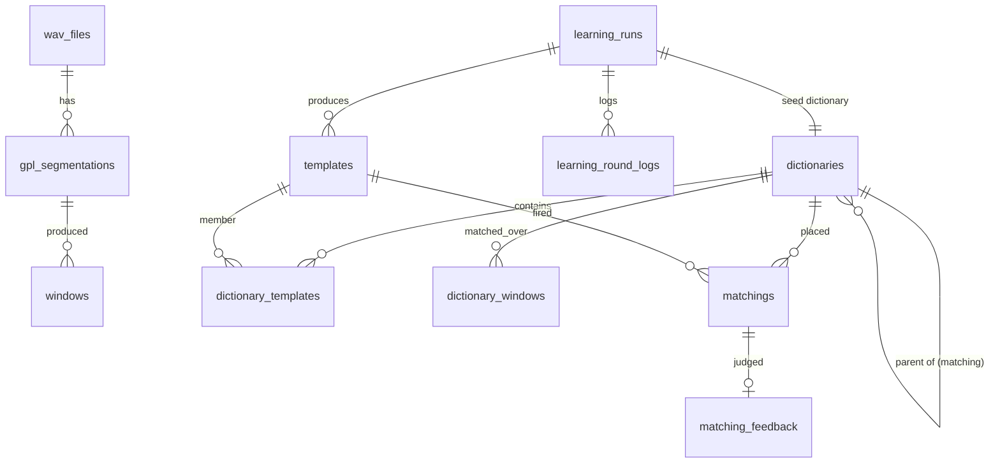

# `database/`: SQLite catalog

Keeps track of the dictionaries and runs we make and the song-structure CSVs we
have, so the web viewer can list, name, sort and overlay them. Large arrays stay
on disk; the catalog stores metadata and absolute paths.

Adapted from `gplrev3-webserver/database/` (same table names and lineage
rules), with a fresh schema for this repo: only the randomized build and
matching pursuit write to it, and CSVs are a new kind of entry. It uses its own
DB file; it never touches gplrev3's catalog.

## What it stores

| Table | One row per |
|---|---|
| `wav_files` | WAV under a library root |
| `gpl_segmentations` | GPL output folder (`spectrogram_npy/`, `CSV_*.csv`, `panel.bin`) |
| `windows` | Whitened window, with its sample span, STFT hop and wall-clock times |
| `learning_runs` | `randomized-build` output folder |
| `learning_round_logs` | Outer pass of a build (`outer_logs.jsonl`) |
| `tool_runs` | Registered folder: tool (`randomized_build` / `matching_pursuit`), input and output dictionary |
| `templates` | Atom (`atoms/template_NNN.npy`); `template_pk` is its global id |
| `dictionaries` | List of atoms: `seed` (a build) or `matching` (MP with a parent's atoms); `refinement` and `edit` reserved |
| `dictionary_templates` | Atom in a dictionary (position, user label) |
| `dictionary_windows` | Window a dictionary's MP ran over |
| `matchings` | MP placement: atom, window, `t_start`, amplitude, and `start_sec` / `end_sec` from the WAV start |
| `matching_feedback` | Good/bad verdict on a placement (API only) |
| `annotation_csvs` | Song-structure CSV (`*.motif_segments.csv`), linked to a WAV by stem |

DDL: [`schema.sql`](schema.sql).



**Linking to a WAV.** A dictionary carries `wav_stem`, parsed from its window
ids (`spwhiten_<stem>_w000001_…`), and a `segmentation_id` once its GPL folder
is indexed. A CSV carries the stem of its file name. The picker matches either
by stem, so neither needs the WAV to be indexed first.

**Placement times.** `start_sec = (window start sample − 1) / sample_freq +
t_start × hop / sample_freq`, and `end_sec` adds the atom width. They are
computed when the folder is registered, from the window sidecars. If the GPL
folder is gone they stay NULL and the placement has no lane box.

**Re-registering** the same folder updates its rows in place: ids and user
labels are kept, atoms are upserted by `template_id`, placements and outer logs
are replaced.

## Writing to it

```bash
# While running: --catalog on either dict_learning command
python -m analysis.dict_learning randomized-build --gpl-dir GPL_OUT --out runs/build_a --catalog catalog.sqlite
python -m analysis.dict_learning matching-pursuit --gpl-dir GPL_OUT --dictionary runs/build_a \
    --out runs/build_a_mp --catalog catalog.sqlite

# Afterwards: register folders and CSVs by path
python -m database register --db catalog.sqlite runs/build_a runs/build_a_mp \
    backend/data/song_structure/X.motif_segments.csv [--label NAME]

# Or scan roots
python -m database index --db catalog.sqlite \
    --wav-root /data/recordings --runs-root runs --csv-root backend/data/song_structure
```

- A matching-pursuit folder registers its dictionary folder first when that is
  not in the catalog yet.
- `index` takes WAVs from `--wav-root` and their GPL caches from
  `<root>/<GPL_RESULT_DIRNAME>/<rel>.gpl/output` (as
  `backend/app/services/gpl_cache.py` writes them), run folders from any
  `summary.json` under `--runs-root`, and `*.motif_segments.csv` under
  `--csv-root`. It drops CSV rows whose file is gone. Without flags it uses
  `WAV_LIBRARY_ROOTS`, `CATALOG_RUNS_ROOTS` and `CATALOG_CSV_ROOTS`.
- Exit codes: 0 done; 1 something was skipped or rejected (reason on stderr); 2
  bad arguments. With `--catalog`, a folder that cannot be registered makes the
  dict_learning command exit 2 after writing its output.

## Reading it

```python
from contextlib import closing
from database import catalog

with closing(catalog.connect("catalog.sqlite", read_only=True)) as conn:
    found = catalog.list_analyses_for_stem(conn, "SOCAL_H_76_230426_193500_df100.x.x")
    found["dictionaries"], found["csvs"]
    catalog.list_matchings(conn, dictionary_id, feedback="unlabeled")
    catalog.get_dictionary_lineage(conn, dictionary_id)   # root seed … this dictionary
```

`read_only=True` is safe while another process writes. `sqlite3`'s `with conn:`
only commits; wrap connections in `closing(...)` to close them.

## HTTP API

Mounted by the backend at `/api/catalog`
([`backend/app/routes/catalog.py`](../backend/app/routes/catalog.py)). Reads
open the file read-only.

| Method + path | Returns |
|---|---|
| `GET /api/library/analyses?fileId=` | The picker's list for one library WAV: dictionaries and CSVs |
| `GET /wavs`, `GET /wavs/{wav_id}/segmentations` | Indexed WAVs and their GPL folders |
| `GET /runs`, `/runs/{id}/templates`, `/runs/{id}/rounds` | Builds, their atoms, their outer passes |
| `GET /runs/{id}/templates/{template_id}[?include=data]` | One atom; `include=data` downloads the `.npy` |
| `GET /dictionaries`, `/dictionaries/{id}` | Dictionaries with atom, window and placement counts |
| `PATCH /dictionaries/{id}` `{label}` | Rename (empty → unnamed) |
| `GET /dictionaries/{id}/templates`, `/windows`, `/lineage` | Members, matched windows, ancestry |
| `PATCH /dictionaries/{id}/templates/{template_id}` `{label}` | Rename an atom within a dictionary |
| `GET /dictionaries/{id}/matchings?template_pk=&window_id=&feedback=` | Placements (filter by `good` / `bad` / `unlabeled`) |
| `GET /dictionaries/{id}/placements` | Placements in seconds, for the viewer's atom lane |
| `GET /matchings/{id}`; `PUT` / `DELETE /matchings/{id}/feedback` | One placement; set or clear its verdict |
| `GET /tool-runs[?learning_run_id=]`, `/tool-runs/{id}` | Registered folders |
| `GET /csvs`, `/csvs/{id}`; `PATCH /csvs/{id}` `{label}` | Song-structure CSVs; rename |
| `POST /reindex` | Run `index` over the configured roots |

`GET /api/jobs/{job_id}/song-structure?csvId=` loads a catalog CSV for the
viewer; without `csvId` it falls back to
`backend/data/song_structure/<stem>.motif_segments.csv`.

Config (`backend/app/config.py`, `backend/env.example`): `CATALOG_DB` (default
`backend/data/catalog.sqlite`, git-ignored), `CATALOG_RUNS_ROOTS`,
`CATALOG_CSV_ROOTS` (default `backend/data/song_structure`).

## Not carried over from gplrev3

Migrations of old gplrev3 catalog files and `migrate_flat_dict_dirs.py`; the
`persist_*` helpers of the removed tools (average, build from detections,
remove, merge); `action_history`; template parent lineage; pruning unmatched
templates; `POST /dictionaries` (create from a run).

## Tests

`analysis/test/unit/database/` and `analysis/test/integration/test_catalog_{cli,api}.py`;
see [`analysis/test/README.md`](../analysis/test/README.md).
