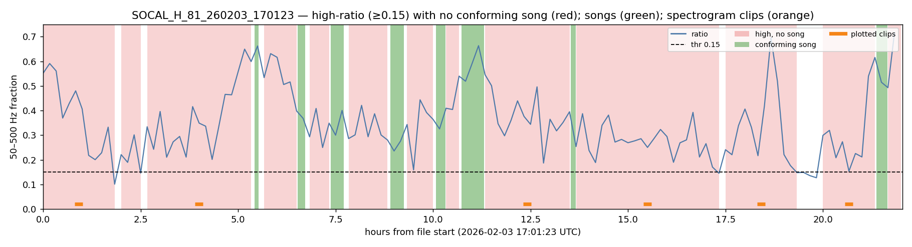
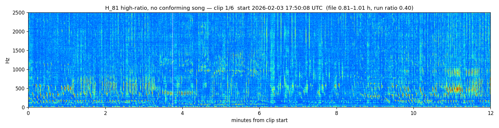
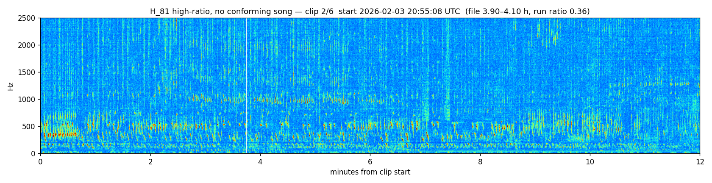
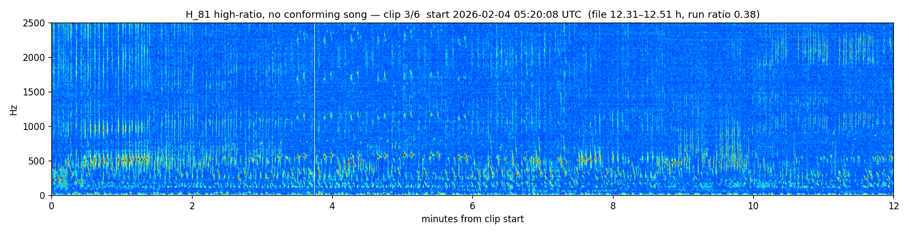
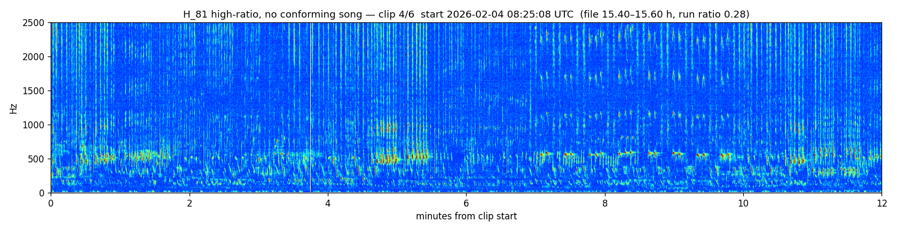
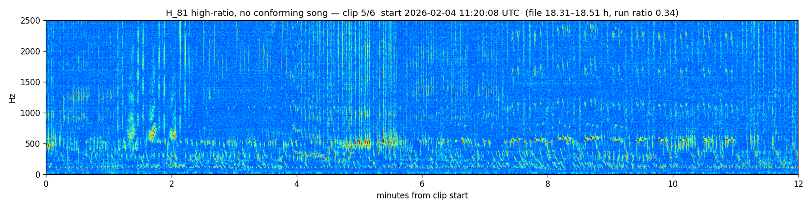
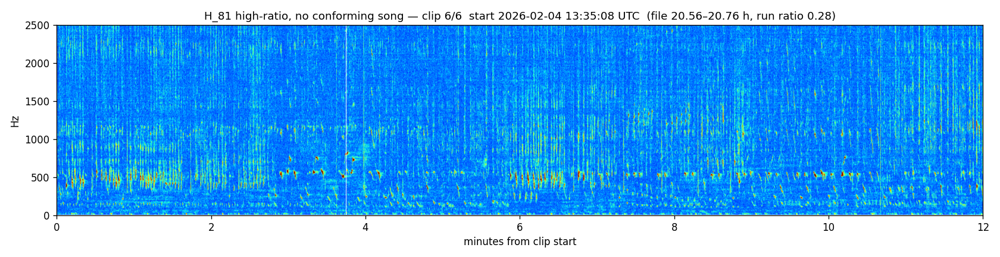

# High band-energy ratio without conforming songs on winter `SOCAL_H_81`

**Question.** Do high 50–500 Hz energy fractions during the winter sample overlap with whale songs?

**Short answer.** Sometimes, but usually not. On the winter sample, every conforming song sits in high-ratio audio, yet most high-ratio stretches have no conforming song.

## Setup

- **Energy:** GPL whitened 50–500 Hz fraction in 600 s segments (`pre_processing/results/segments_winter.csv`), threshold **0.15** (same operating point as `hypothesis_energy_songs.md`).
- **Songs:** conforming cycles from `analysis/dict_HMM/find_songs/c/build/winter/` (`min_margin > 0` and `shuffles_at_or_above == 0`).
- **Winter sample:** 12 files (seed 0). All **9** conforming songs are on one file: `SOCAL_H_81_260203_170123_df20` (3–4 Feb 2026), which also has the highest winter ratios (median **0.33**).

## Winter overlap (all 12 files)

| | Count |
|---|---:|
| 600 s segments with ratio ≥ 0.15 | 273 |
| Of those, overlapping a conforming song | **19 (7%)** |
| Conforming songs that sit in a high-ratio segment | **9 / 9** |

Mean ratio in song-overlapping winter segments: **0.44** vs **0.12** elsewhere. Other winter files with elevated ratios (`H_73_HE`, `H_70`, `H_63`, …) have many high-ratio hours and **zero** conforming songs—the same precision problem as the April hypothesis test.

## Focus: `SOCAL_H_81_260203_170123_df20`

File start **2026-02-03 17:01:23 UTC**. Of 132 segments, **125** have ratio ≥ 0.15; **19** of those overlap a conforming song; **106** do not.

### Conforming songs on this file

| Start UTC | End UTC | File sec | Minutes | min_margin | order_z |
|---|---|---:|---:|---:|---:|
| 2026-02-03 22:26:23 | 2026-02-03 22:32:53 | 19500–19890 | 6.5 | 1.15 | 2.65 |
| 2026-02-03 23:32:53 | 2026-02-03 23:44:23 | 23490–24180 | 11.5 | 2.48 | 3.29 |
| 2026-02-04 00:23:53 | 2026-02-04 00:43:53 | 26550–27750 | 20.0 | 1.68 | 3.80 |
| 2026-02-04 01:55:23 | 2026-02-04 02:16:23 | 32040–33300 | 21.0 | 0.24 | 3.38 |
| 2026-02-04 03:05:53 | 2026-02-04 03:20:23 | 36270–37140 | 14.5 | 11.27 | 3.79 |
| 2026-02-04 03:44:53 | 2026-02-04 04:00:53 | 38610–39570 | 16.0 | 4.92 | 3.52 |
| 2026-02-04 04:00:53 | 2026-02-04 04:19:53 | 39570–40710 | 19.0 | 1.20 | 3.51 |
| 2026-02-04 06:33:23 | 2026-02-04 06:40:53 | 48720–49170 | 7.5 | 1.83 | 2.74 |
| 2026-02-04 14:23:53 | 2026-02-04 14:40:23 | 76950–77940 | 16.5 | 0.32 | 3.60 |

### High-ratio runs with no conforming song

Thirteen contiguous runs (ratio ≥ 0.15, no overlap with the songs above), ~17.7 hours total:

| Run (file sec) | Hours | Mean ratio |
|---:|---:|---:|
| 0–6600 | 1.83 | 0.397 |
| 7200–9000 | 0.50 | 0.238 |
| 9600–19200 | 2.67 | 0.359 |
| 20400–23400 | 0.83 | 0.561 |
| 24600–26400 | 0.50 | 0.318 |
| 28200–31800 | 1.00 | 0.332 |
| 33600–36000 | 0.67 | 0.335 |
| 37200–38400 | 0.33 | 0.407 |
| 40800–48600 | 2.17 | 0.379 |
| 49200–62400 | 3.67 | 0.278 |
| 63000–69600 | 1.83 | 0.344 |
| 72000–76800 | 1.33 | 0.279 |
| 78000–79200 | 0.33 | 0.604 |

## Overview

Blue = 600 s ratio; dashed = threshold 0.15; red = high-ratio with no conforming song; green = conforming song; orange = 12-minute spectrogram clips below.

## Spectrograms of high-ratio, no-song clips

Whitened spectrogram to 2.5 kHz (same pipeline as `find_songs/spectro.py`). Each clip is **12 minutes** from the middle of one of the longer no-song high-ratio runs.

### 1. 2026-02-03 17:50:08 UTC (file 0.81–1.01 h, run ratio 0.40)

Dense energy in ~200–600 Hz and broadband vertical streaks; no clear multi-theme song.

### 2. 2026-02-03 20:55:08 UTC (file 3.90–4.10 h, run ratio 0.36)

Same low band active; scattered short tonal units, not a conforming 0→1→2→3 cycle.

### 3. 2026-02-04 05:20:08 UTC (file 12.31–12.51 h, run ratio 0.38)

Persistent ~500 Hz pulses amid clutter.

### 4. 2026-02-04 08:25:08 UTC (file 15.40–15.60 h, run ratio 0.28)

Low-band dashes plus dense impulsive noise.

### 5. 2026-02-04 11:20:08 UTC (file 18.31–18.51 h, run ratio 0.34)

Rhythmic ~500 Hz calls in the second half; still not a conforming song.

### 6. 2026-02-04 13:35:08 UTC (file 20.56–20.76 h, run ratio 0.28)

More low-band activity before the last conforming song on the file.

## Verdict

- On winter `H_81`, high whitened 50–500 Hz fraction is **necessary for the detected songs but not sufficient**: every conforming song is high-ratio, while ~18 hours of high-ratio audio on this file alone has none.
- The no-song high-ratio clips are **not empty**: they show pulsed / isolated calls and broadband impulses in the song band, without the structured theme cycle the HMM accepts.
- Same practical reading as the April hypothesis note: use the energy ratio as a **pre-filter**, then rely on the dictionary/HMM (or review) to confirm songs.

## Files

- `results/h81_high_nosong/overview_ratio.png` — ratio timeline with songs and clips marked
- `results/h81_high_nosong/spec_clip01_2925s.png` … `spec_clip06_74025s.png` — whitened spectrograms
- `results/h81_high_nosong/clips.csv` — clip times and parent runs
- `results/h81_high_nosong/nosong_high_runs.csv` — all high-ratio no-song runs on this file
- `results/segments_winter.csv` — winter 600 s ratios
- `analysis/dict_HMM/find_songs/c/build/winter/decoded_songs.csv` — winter song detector output
