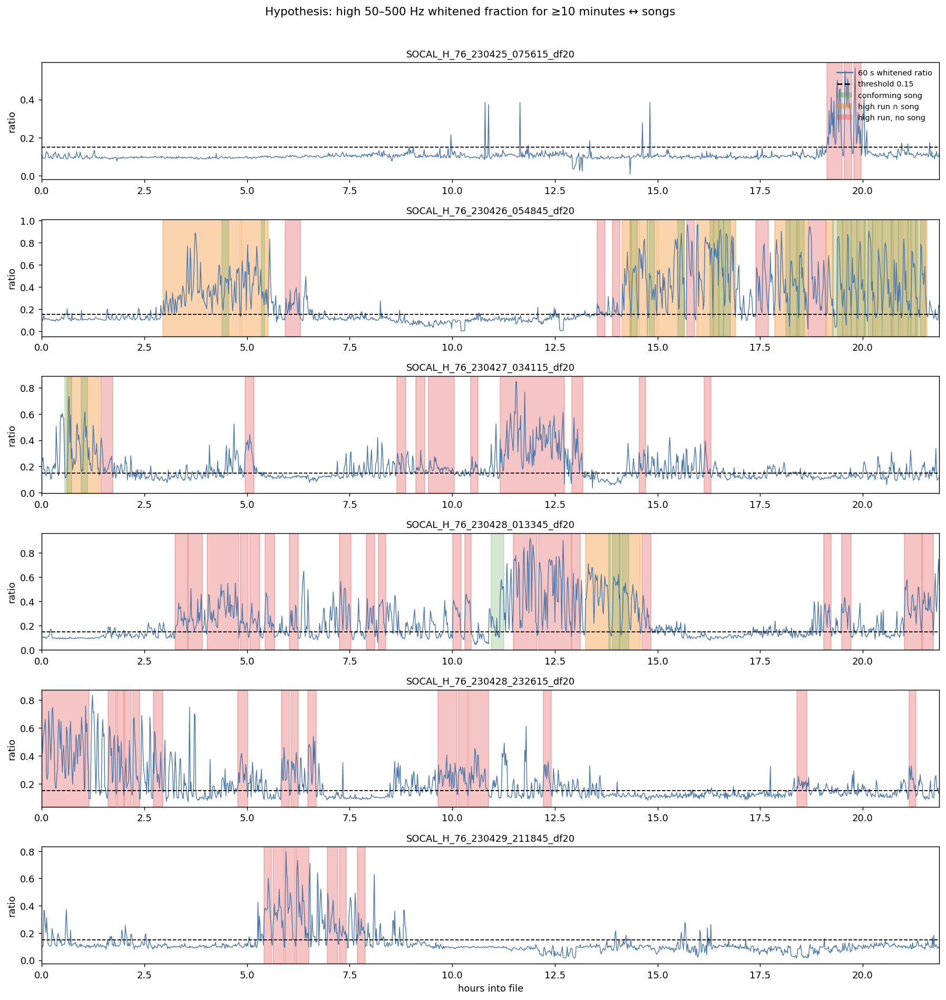

# Hypothesis: high band-energy fraction for ≥10 minutes implies whale songs

**Claim.** There are whale songs when the 50–500 Hz energy fraction (GPL whitened spectrogram) is large for a sustained period of at least 10 minutes.

## Setup

- **Energy:** whitened 50–500 Hz fraction in 60-second bins (`energy_filter --segment-sec 60`), same definition as `Initial_plan.md`.
- **Recordings:** the six `SOCAL_H_76` files of 25–30 April 2023 that `find_songs` scanned (~131 hours).
- **Labels:** the 26 conforming songs from `analysis/dict_HMM/find_songs` (exact 0→1→2→3 cycles that pass both margin and shuffle tests). Songs appear in three of the six files.
- **Detector under test:** a *high run* is a stretch of at least **10 consecutive** 60-second bins with `ratio ≥ threshold`. That is “large for ≥10 minutes.”

## Does the energy differ during songs?

| | Mean ratio | Number of 60 s bins |
|---|---:|---:|
| Overlapping a conforming song | **0.414** | 310 |
| Not overlapping a song | **0.177** | 7568 |

Songs sit in clearly higher-ratio audio, so the signal is informative. The question is whether a sustained high-ratio rule recovers songs without too many false alarms.

## Threshold trade-off

| Threshold | High runs | Song recall | Precision of runs |
|---:|---:|---:|---:|
| 0.10 | 113 | 100% (26/26) | 10% |
| 0.12 | 113 | 100% | 17% |
| **0.15** | **88** | **96% (25/26)** | **30%** |
| 0.20 | 58 | 85% (22/26) | 36% |
| 0.25 | 39 | 62% | 38% |
| 0.30 | 23 | 35% | 26% |

At threshold **0.15** (about the 60th percentile of these files’ ratios): almost every conforming song overlaps a high run, but about **70% of high runs have no conforming song**. Raising the threshold improves precision only modestly and loses songs quickly.

The single miss at 0.15 is the 18.5-minute song on 28 April starting 12:30:45 UTC (`min_margin` 1.8)—its overlapping bins stay mostly below 0.15.

## Figure

Green = conforming song; orange = high run that overlaps a song; red = high run with no conforming song; dashed line = threshold 0.15.

## Verdict

- **Supported as a coarse filter:** sustained high whitened 50–500 Hz fraction is strongly associated with song times (mean ratio ~2.3× higher in songs; recall can exceed 95% at a modest threshold).
- **Not sufficient as a song detector:** most ≥10-minute high-ratio stretches are *not* conforming songs (precision ~30% at the high-recall operating point). High band fraction marks “whale-like / low-frequency busy” periods that include songs and other content.

A practical use is a **pre-filter** before the dictionary/HMM song detector: keep stretches with ratio ≥ 0.15 for ≥10 minutes (here ~29 hours out of 131), accepting that many will still need the theme model (or human review) to confirm a song.

## Files

- `results/segments_h76_60s.csv` — 60 s ratios on the six April files
- `results/hypothesis_energy_song_thresholds.csv` — threshold sweep
- `results/hypothesis_runs_thr0.15.csv` — high runs at threshold 0.15
- `results/hypothesis_energy_songs.png` — figure above
